# 🚆 Análisis de Series de Tiempo de la Demanda de Transporte Público en el AMBA (SUBE)

[](https://www.python.org/downloads/)
[](LICENSE)
[](https://www.statsmodels.org/)
[](https://facebook.github.io/prophet/)
[](https://datos.transporte.gob.ar/)

> **Estado (2-nov-2026, rama `trabajo/herramientas-materia`).** Las hipótesis y veredictos de la versión inicial se reemplazaron por dos preguntas de trabajo (P-1 y P-2). Las métricas de la versión inicial tenían fuga de información y se rehicieron con una evaluación con origen móvil. Qué cambió y por qué: [`docs/registro_de_cambios.md`](docs/registro_de_cambios.md). Lectura de cada resultado, con sus límites: [`docs/interpretacion_resultados.md`](docs/interpretacion_resultados.md). El notebook se reescribió con el mismo enfoque.

Este repositorio contiene el análisis de la **demanda de transporte público del Área Metropolitana de Buenos Aires (AMBA)** con datos del **Sistema Único de Boleto Electrónico (SUBE)**, 2020–2026, para la materia Series Temporales de la Maestría en Ciencia de Datos.

---

## 📌 Tabla de Contenidos

- [Motivación](#-motivación)
- [Preguntas y respuestas](#-preguntas-y-respuestas)
- [Qué cambiamos y por qué](#-qué-cambiamos-y-por-qué)
- [Estructura del Repositorio](#-estructura-del-repositorio)
- [Dataset y Fuente de Datos](#-dataset-y-fuente-de-datos)
- [Metodología](#-metodología)
- [Resultados y Visualizaciones](#-resultados-y-visualizaciones)
- [Guía de Reproducibilidad](#-guía-de-reproducibilidad)
- [Referencias Bibliográficas](#-referencias-bibliográficas)
- [Licencia](#-licencia)

---

## 🧭 Motivación

El AMBA es uno de los sistemas de transporte público más grandes de América Latina: millones de viajes diarios en colectivo, tren y subte, todos con la misma tarjeta SUBE. Entre 2020 y 2026 la demanda pasó por una pandemia, un cambio fuerte en los hábitos de trabajo, una secuencia de saltos tarifarios y, en el medio, paros, elecciones y feriados que alteran un día cualquiera.

Dos preguntas prácticas ordenan el trabajo:

- **Entender:** cuando algo cambia (el precio, el calendario, un paro), ¿cuánto se mueve la demanda y podemos atribuir ese movimiento a la causa, o solo lo observamos al mismo tiempo? (P-1)
- **Anticipar:** para planificar el servicio, ¿qué método de pronóstico funciona mejor con la demanda diaria y por qué? (P-2)

Son preguntas distintas y piden herramientas distintas: atribuir una causa exige aislar el efecto de todo lo demás (un contrafactual), mientras que pronosticar exige un modelo que acierte, aunque no explique. El trabajo trata las dos por separado.

---

## 🎯 Preguntas y respuestas

### P-1. ¿Cómo se comportó la demanda alrededor de los hitos, y por qué?

Hitos estudiados: pandemia (descriptivo), saltos tarifarios, feriados, paros y elecciones.

**Terminología.** *Salto tarifario*: aumento de la tarifa mínima de al menos 10% en un solo cambio (29 en 2022–2026); un cambio menor es un *ajuste* (en general, mensuales de ~5%). *Salto tarifario grande*: la tarifa se duplica o más; son tres, todos en 2024 (colectivo nacional +251% y tren +169% el 6-feb; subte +359% el 17-may). *Elasticidad precio*: variación porcentual de la demanda dividida por la variación porcentual de la tarifa; −0,2 significa que un aumento de 10% se asocia con una caída de 2%. La literatura internacional reporta valores de corto plazo del orden de −0,3 a −0,4 (Balcombe et al., 2004).

| Pregunta | Resultado | Confianza | Por qué esa confianza |
|---|---|---|---|
| ¿Reacciona la demanda al precio? | **Subte:** sí, elasticidad de −0,22 a −0,26 con tarifa real (deflactada por IPC) y de −0,15 a −0,25 al controlar por salario real (RIPTE); Granger lo respalda (p de Holm 0,019). **Colectivo nacional y tren:** no se distinguen de cero, con o sin control salarial. **Colectivo provincial:** −0,27, pero desaparece al controlar por salario real. | Subte: media. Colectivo y tren: baja | Subte: dos métodos independientes coinciden y el test predictivo lo respalda, pero son pocos saltos y no es un experimento. Colectivo y tren: pocos saltos que además se mueven juntos en el tiempo, así que el precio no se puede separar de otros cambios. |
| ¿Cuánto cayó con los saltos tarifarios grandes? | Colectivo nacional ene–feb 2024: −13% (estudio de eventos) contra −3% sin significancia (control sintético). Subte may-2024 (tarifa ×4): −19%. Tren: inconsistente. | Baja a media | Los dos métodos discrepan para el colectivo y el control sintético tiene donantes sin verificar. El subte tiene un solo evento grande limpio. |
| ¿Hay sustitución entre modos? | No se observa, ni ante saltos tarifarios ni ante paros: cuando para el colectivo el subte no sube (1,00 a 1,01 de un día normal) y el tren cae (0,66 a 0,79). | Media | Los coeficientes cruzados no se pueden separar por colinealidad entre tarifas. En los paros hay solo tres casos de cada tipo y no se controla clima ni aviso previo. |
| ¿Las líneas de subte de mayor ingreso reaccionan menos? | Sin respaldo. | Baja | Solo 6 líneas: la prueba no tiene poder para detectar un efecto. Es un resultado nulo, no una refutación. |
| ¿Cómo se comporta la demanda en feriados, paros, elecciones y pandemia? | Feriados laborables: ~0,3 de un día normal. Paro del propio modo: 0,0 a 0,2 (el cociente depende de quién paró: colectivo, tren, tren y subte o general). Elecciones con gratuidad: ~0; sin gratuidad (2025): 0,6 a 1,0. Pandemia: mínimo de 2% a 12% del verano de 2020; a fines de 2021, 97% (colectivo), 75% (tren) y 65% (subte). | Alta | Muchos eventos, efectos mucho mayores que el ruido normal (banda de días ordinarios) y resultados consistentes entre modos y años. |

**Sobre la causalidad.** En la materia se distinguen dos ideas: Granger (si el pasado del precio mejora la predicción de la demanda, lo que no demuestra una causa) y el efecto de una intervención contra un contrafactual estimado con series de control. Acá se usan las dos: el estudio de eventos con el año anterior como control, el control sintético con ciudades del interior (que absorben los shocks nacionales comunes) y, como robustez, el salario real (RIPTE) como covariable, más Granger como evidencia predictiva. Ningún diseño es un experimento: todos dependen de supuestos (controles comparables, sin otros eventos simultáneos propios del AMBA), y por eso las confianzas de la tabla son medias o bajas. Los hitos de calendario son los efectos más claros.

### P-2. ¿Qué métodos pronostican mejor la demanda diaria, y por qué?

Evaluación con **origen móvil**: 42 cortes (el primero el 30-jun-2023, uno cada 28 días), cada uno con 28 días de prueba que no se solapan (1.161 días sin paros ni elecciones). Los modelos solo usan el pasado y el calendario. Diferencias contrastadas con Diebold-Mariano.

| Modelo (total AMBA, 28 días) | MAE (millones) | MAPE | MASE |
| :--- | :---: | :---: | :---: |
| 🥇 **Gradient Boosting recursivo** | **0,187** | **7,4%** | **0,57** |
| 🥈 Prophet | 0,254 | 11,9% | 0,77 |
| 🥉 SARIMAX (2,0,1)x(0,1,1,7) | 0,270 | 11,8% | 0,82 |
| Naive 364 días | 0,395 | 17,4% | 1,20 |
| Naive 7 días | 0,472 | 19,5% | 1,43 |

MASE menor a 1 significa mejor que repetir la última semana. Lo que se encontró:

- **Por qué gana el Gradient Boosting:** los feriados explican el grueso de la diferencia con los Naive; la estacionalidad anual y el patrón semanal multiplicativo importan; y los rezagos aportan además del calendario.
- **No hay un método único:** en colectivo gana el Gradient Boosting, pero en tren y subte empata con el SARIMAX. Un **híbrido por tipo de día** (modelo aditivo en días hábiles, Gradient Boosting en el resto, con la regla elegida solo con cortes anteriores) mejora a ambos en tren (MASE 0,62 a 0,54) y subte (0,71 a 0,61), pero no en total ni colectivo. Es un hallazgo a confirmar en otro período.
- **Robusto** al tratamiento de los 62 días sin dato en la fuente (la reconstrucción desde transacciones mejora el error del Gradient Boosting: MASE 0,56 contra 0,63 con interpolación) y al horizonte (mismo ranking a 7, 28 y 90 días).
- **Hitos de P-1:** los feriados se anticipan con el calendario (el Gradient Boosting reduce 85% el error del Naive de 7 días); los paros y las elecciones con gratuidad **no se anticipan con ningún método**, pero si se conoce el evento y se aplica el cociente típico medido en P-1, el error baja de 81% a 94% con cualquier método. Tras un salto tarifario, el error de los modelos sin precio no se distingue del habitual, salvo en el subte de mayo de 2024 (+14% de sobreestimación); incorporar el precio ayuda poco en saltos moderados y empeora en los grandes.
- **Límites:** configuración estándar sin ajuste fino de hiperparámetros; los paros y elecciones no se pronostican sin información externa.

---

## 🔄 Qué cambiamos y por qué

Resumen de las decisiones respecto del trabajo original; el detalle con evidencia está en [`docs/registro_de_cambios.md`](docs/registro_de_cambios.md).

| Cambio | Por qué |
|---|---|
| Las **Hipótesis 1 y 2** se reemplazan por las **Preguntas P-1 y P-2** | Las hipótesis emitían "veredictos" (por ejemplo, que el teletrabajo causó una pérdida permanente de demanda) que los datos no permiten sostener. Las preguntas ordenan mejor el trabajo y admiten respuestas con distinto grado de confianza. |
| Se quita la **recuperación post-COVID contra el nivel pre-pandemia** | Del período previo solo hay enero y febrero de 2020 (59 días, temporada baja): no alcanza para distinguir recuperación de estacionalidad. El COVID pasa a ser un shock descriptivo y queda fuera del entrenamiento de los modelos. |
| Se corrige la **fuga de información** en dos modelos | El Seasonal Naïve tomaba valores reales del tramo de prueba y el Gradient Boosting usaba rezagos reales al pronosticar (predecía cada día conociendo el anterior). El MAPE del Gradient Boosting pasaba de 8,8% a 11,0% con la corrección. Ahora los modelos solo usan el pasado y el calendario, y una prueba lo verifica. |
| La evaluación pasa de una **ventana de 90 días** a **42 cortes sucesivos** (origen móvil) con prueba de significancia | Con una sola ventana no se puede saber si un modelo es mejor o tuvo suerte. Con 1.161 días de prueba y Diebold-Mariano sí. |
| Se **reconstruyen los 62 días sin dato** desde las transacciones | La interpolación por día de la semana erraba entre 12% y 21% en meses de vacaciones; la reconstrucción, entre 1,6% y 3,2%. |
| El **SARIMAX** se identifica con las herramientas de la materia | El orden original era fijo y sin justificación, con regresoras colineales y residuos con autocorrelación. |
| Se agrega un análisis de **causalidad** (P-1) | El docente pidió incorporar causalidad: estudio de eventos, control sintético, Granger y panel por línea, con sus supuestos y límites. |
| Se **reescriben el README y el notebook** | Para que todo el repositorio sea coherente con el nuevo enfoque y no muestre resultados que ya no se sostienen. |

---

## 📂 Estructura del Repositorio

```text
├── data/
│   ├── total-usuarios-por-dia-AMBA.csv    # Dataset oficial de usuarios (2020–2026)
│   ├── hitos/                             # Paros, elecciones y series de tarifas con fuentes
│   ├── externos/                          # IPC (INDEC), RIPTE, ingreso por comuna (EAH) y geografía del subte
│   ├── procesado/                         # Series reconstruidas, usos por línea y pronósticos de cada corte
│   └── raw_usos/                          # (no versionado) CSV de transacciones, los baja usos_transacciones.py
├── notebooks/
│   └── TP_Final_Series_de_Tiempo.ipynb    # Notebook con el análisis completo (P-1 y P-2)
├── scripts/
│   ├── descargar_datos.py                 # Datos: actualizador desde el portal oficial
│   ├── calidad_datos.py                   # Datos: huecos, imputación, qué mide el total, días atípicos
│   ├── usos_transacciones.py              # Datos: transacciones y reconstrucción de los huecos
│   ├── usos_por_linea.py                  # Datos: transacciones por línea de subte
│   ├── tarifas_serie.py                   # P-1: serie de tarifas con fuentes
│   ├── tarifas_descriptivo.py             # P-1: descripción de los saltos tarifarios
│   ├── modelo_precio_demanda.py           # P-1: elasticidad (niveles, interanual, estudio de eventos, control por salario real)
│   ├── tarifas_reales.py                  # P-1: tarifa real y tarifa en salarios
│   ├── clasificacion_lineas_subte.py      # P-1: ingreso por línea de subte
│   ├── panel_subte_lineas.py              # P-1: hipótesis de ingreso (panel línea x semana)
│   ├── efectos_cruzados_granger.py        # P-1: efecto cruzado entre modos y Granger
│   ├── hitos_eventos.py, hitos_efectos.py # P-1: paros, elecciones, feriados y pandemia
│   ├── control_sintetico.py               # P-1: control sintético para el colectivo
│   ├── pronosticos_p2.py                  # P-2: los cinco modelos
│   ├── identificacion_sarimax.py          # P-2: orden del SARIMAX (ADF/KPSS, ACF/PACF, BIC)
│   ├── evaluacion_pronosticos.py          # P-2: origen móvil (args: ablaciones, col=<modo>, h=<días>)
│   ├── analisis_pronosticos_p2.py         # P-2: métricas, Diebold-Mariano, intervalos
│   ├── analisis_pronosticos_por_modo.py   # P-2: colectivo, tren y subte
│   ├── pronosticos_antes_del_salto_p2.py  # P-2: pronósticos hechos el día anterior a cada salto tarifario
│   ├── pronostico_hitos_p2.py             # P-2: error en feriados, paros, elecciones y saltos tarifarios
│   ├── modelo_hibrido_p2.py               # P-2: híbrido por tipo de día
│   ├── sensibilidad_huecos_p2.py          # P-2: tratamiento de los días sin dato
│   ├── analisis_horizontes_p2.py          # P-2: horizontes de 7 y 90 días
│   ├── verificar_sin_fuga_p2.py           # P-2: prueba de que los modelos no usan el futuro
│   ├── herramientas_clase.py              # Herramientas vistas en clase (filtros, FFT, CCF)
│   └── analisis_series_tiempo_sube.py, modelos_pronostico.py, verificar_sin_fuga.py   # Versión inicial
├── resultados/
│   ├── figuras/                           # fig1 a fig24 (PNG)
│   └── tablas/                            # Tablas en CSV
├── docs/
│   ├── registro_de_cambios.md             # Qué se cambió respecto del repo original y por qué
│   └── interpretacion_resultados.md       # Lectura de cada resultado, con límites (bloques 1 a 15)
├── .gitignore
├── LICENSE
├── requirements.txt
└── README.md
```

---

## 📊 Dataset y Fuente de Datos

Los datos de usuarios provienen de los registros de validadoras de la red SUBE publicados por la **Secretaría de Transporte de la Nación** en [datos.transporte.gob.ar](https://datos.transporte.gob.ar/dataset/sube-cantidad-de-tarjetas-usuarios-por-dia-en-amba).

* **Período temporal**: 2020-01-01 a 2026-09-18 en el CSV original; la serie de trabajo llega a septiembre de 2026 (octubre es preliminar y queda fuera de la evaluación).
* **Calidad**: faltan **62 días**, dos meses completos (**agosto de 2022** y **enero de 2024**). Se reconstruyen a partir de las transacciones diarias y se marcan con la columna `imputado` (ver `scripts/usos_transacciones.py`).
* **Unidad de medida**: cantidad de **tarjetas diferentes** usadas por día, no viajes. El total nunca supera la suma de los modos, lo que sugiere que deduplica tarjetas que usan más de un modo (inferencia: el portal no lo documenta).
* **Variables**: `total_amba`, `colectivo_amba`, `subte_amba`, `tren_amba` (tarjetas distintas por día en cada caso).
* **Datos complementarios**: transacciones por día y línea (portal de transporte), tarifas oficiales (Boletín Oficial, resoluciones y fuentes indicadas en `data/hitos/`), IPC nacional (INDEC), RIPTE (Secretaría de Trabajo, vía datos.gob.ar), ingreso por comuna (Encuesta Anual de Hogares de CABA) y geografía del subte (BA Data).

---

## 🛠️ Metodología

**P-1 (demanda y hitos).** Elasticidad con tarifa real: regresión en niveles (con y sin tendencia), diferencias interanuales de 52 semanas y estudio de eventos con doble diferencia estacional y bandas placebo. Panel línea × semana con efectos fijos por semana para la hipótesis de ingreso. Granger (con ADF y KPSS previos y corrección de Holm) y efectos cruzados entre modos. Cociente contra el mismo día de la semana de las semanas vecinas para los hitos de calendario. Control sintético con ciudades del interior para los saltos tarifarios del colectivo. Robustez con el salario real (RIPTE / IPC) como regresora y con la tarifa medida en salarios.

**P-2 (pronóstico).** Origen móvil con ventana creciente; modelos que solo usan el pasado y el calendario; métricas MAE, RMSE, MAPE y MASE; Diebold-Mariano con errores HAC; intervalos de predicción por método conforme; variantes de cada modelo para explicar las diferencias (ablaciones); prueba de fuga (`scripts/verificar_sin_fuga_p2.py`: el futuro real se reemplaza por basura y los pronósticos no deben cambiar). El orden del SARIMAX se identifica con ADF y KPSS, ACF y PACF y una grilla por BIC con residuos sin autocorrelación (Ljung-Box).

**Herramientas de la materia aplicadas a la serie:** estacionariedad (ADF y KPSS), descomposición (media móvil y STL), filtros, espectro (FFT) y correlación cruzada entre modos; ver `scripts/herramientas_clase.py` y la sección 6 de `docs/registro_de_cambios.md`.

---

## 🖼️ Resultados y Visualizaciones

### Datos
**Reconstrucción de los días sin dato.** Se ocultaron bloques de 31 días de la propia serie y se comparó la reconstrucción desde transacciones con la interpolación simple.
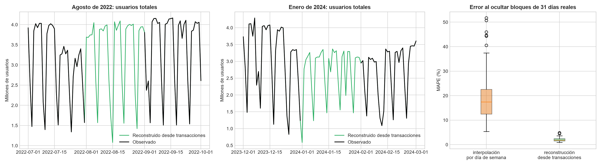

### P-1. Demanda ante los hitos

**Tarifas reales.** A la izquierda, la tarifa de cada modo en pesos constantes de enero de 2022 (deflactada por IPC); a la derecha, el costo de 40 viajes mensuales como porcentaje del salario (RIPTE). La mayor parte del aumento nominal es inflación; el subte es el único cuyo peso en el salario sigue subiendo.
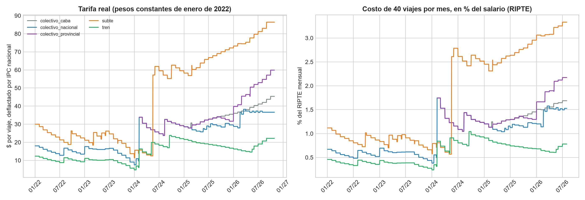

**Saltos tarifarios y respuesta de la demanda.** Cada punto es un salto tarifario; cambio de la demanda (neto de lo ocurrido un año antes) contra el cambio de la tarifa, en logaritmos. Caen los dos saltos grandes del colectivo nacional (ene–feb 2024) y del subte (may-2024); el tren, con un salto grande, no cae.
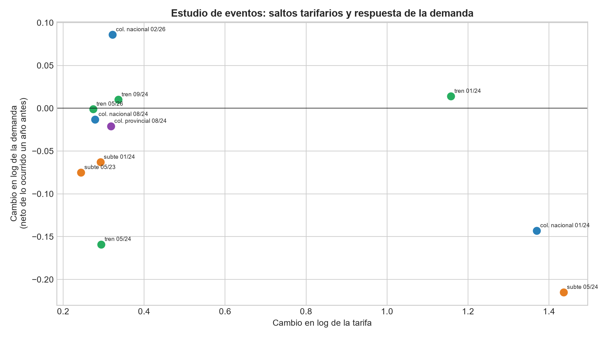

**Transacciones en días hábiles contra el mismo día del año anterior** (mediana móvil de 7 días hábiles), por modo, alrededor de los saltos tarifarios de 2024 (líneas verticales). El subte se despega de los demás con sus saltos.
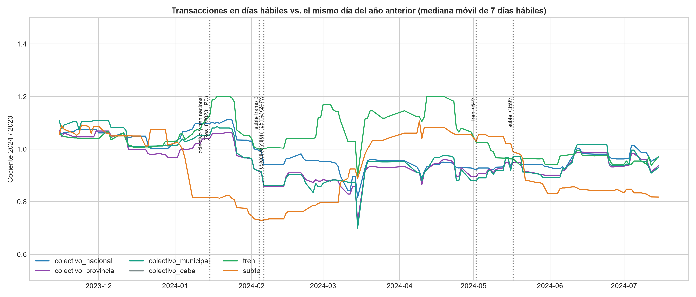

**Control sintético para los saltos tarifarios del colectivo nacional.** La línea azul es el AMBA real; la punteada, el AMBA que habría resultado sin el salto (combinación de ciudades del interior). La línea vertical marca el salto.
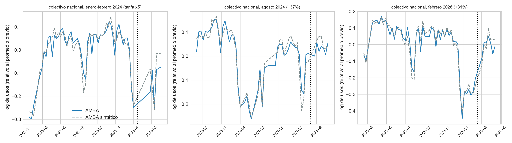

**Subte por línea.** Cambio neto de la demanda de cada línea en cuatro saltos tarifarios, con las líneas ordenadas por ingreso de la zona (de menor a mayor); la línea D, en rojo, es la de mayor ingreso. No se ve que la D reaccione menos (hipótesis de ingreso).
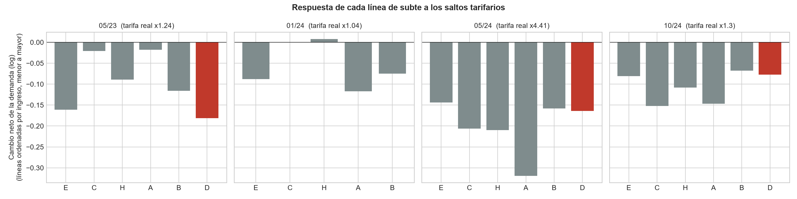

**Demanda en días de feriado, elección y paro**, como cociente contra un día normal del mismo día de la semana (cada punto es un día). La banda gris es el ruido de los días ordinarios.
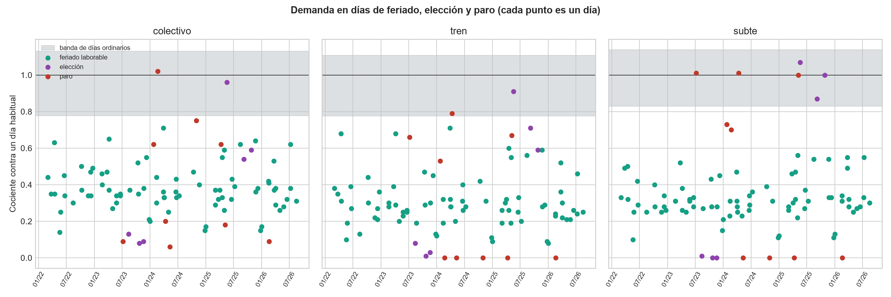

**Paros según quién paró.** Cociente de cada modo en cada paro; el borde negro marca el modo que paró. Cuando para el colectivo, el subte no sube y el tren cae; cuando paran tren y subte, el colectivo tampoco absorbe la demanda.
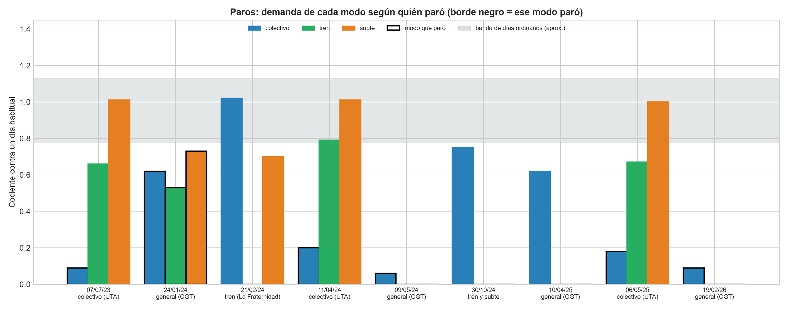

**Pandemia (descriptivo).** Demanda semanal de días hábiles de cada modo, como porcentaje del promedio de enero–marzo de 2020.
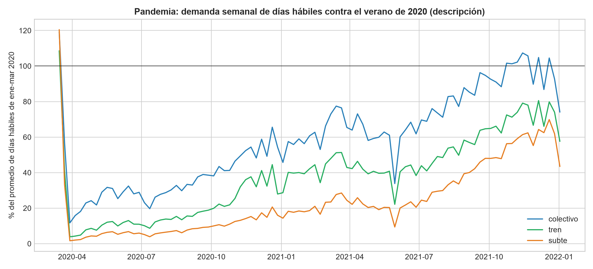

### P-2. Pronóstico

**Identificación del SARIMAX.** ACF y PACF de la serie con diferencia estacional de 7 días; guían los órdenes autorregresivo y de medias móviles.
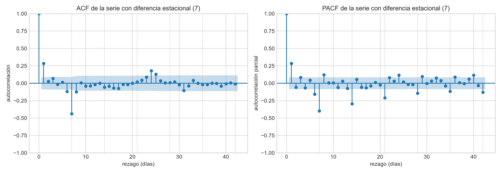

**Error por tipo de día** (total AMBA, 28 días). Los feriados concentran la diferencia entre los modelos con calendario y los Naive.
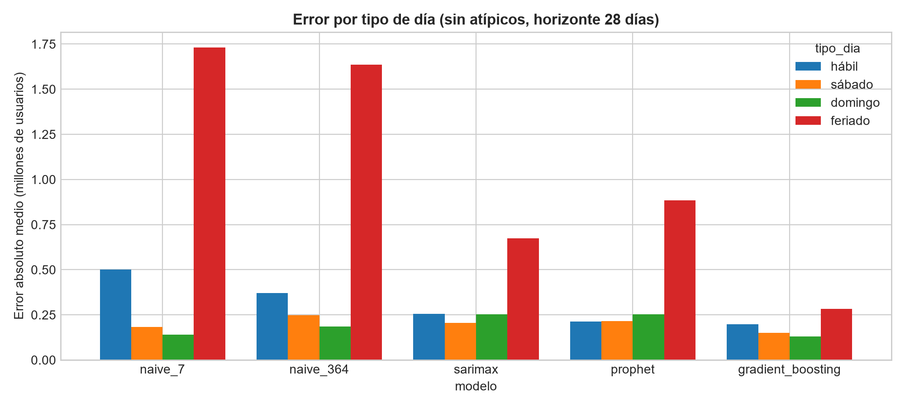

**Error de cada bloque de 28 días** a lo largo del tiempo, por método.
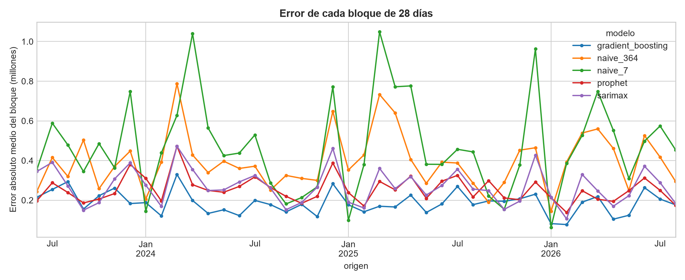

**MASE por modo.** En el colectivo gana el Gradient Boosting; en tren y subte empata con el SARIMAX.
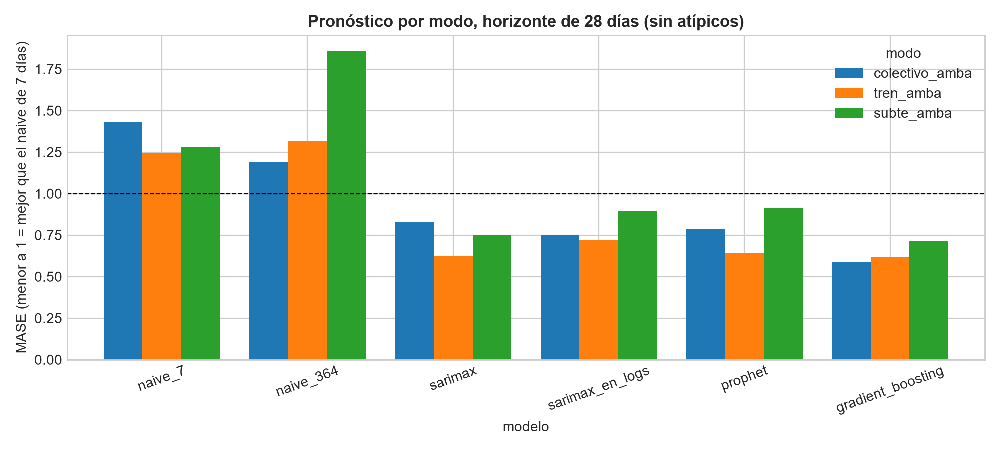

**Híbrido por tipo de día** contra los métodos individuales. Mejora a ambos en tren y subte.
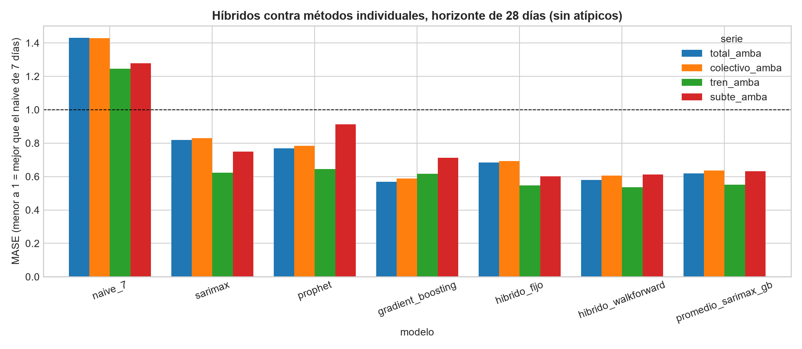

**Horizontes de 7, 28 y 90 días.** El ranking de métodos no cambia.
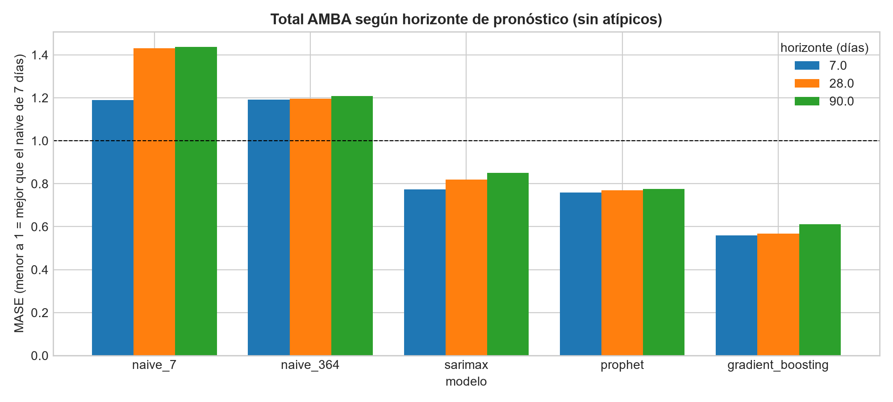

**Pronóstico de los hitos de P-1.** A la izquierda, error de cada método según el tipo de día (total AMBA): los feriados se anticipan con el calendario; paros y elecciones gratuitas no. A la derecha, el error del Gradient Boosting en días de paro y elección sin y con el cociente típico medido en P-1.
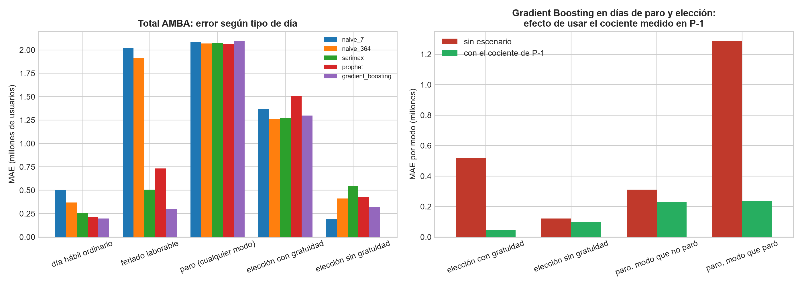

### Herramientas de la materia
**Espectro de la serie (FFT):** los picos en 1/7, 2/7 y 3/7 ciclos por día son el ciclo semanal. **Correlación cruzada tren–colectivo y ACF del total:** los modos se mueven juntos (pico en rezago 0, sin adelantos) y la autocorrelación tiene picos en múltiplos de 7 días.
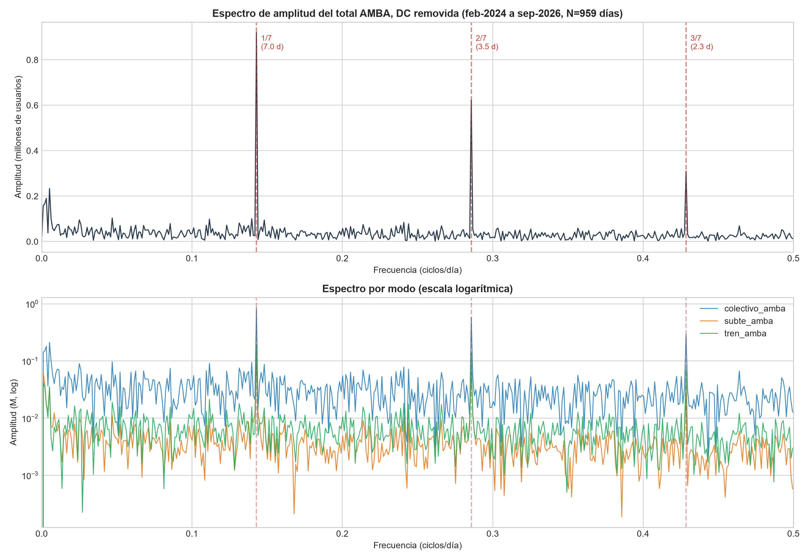
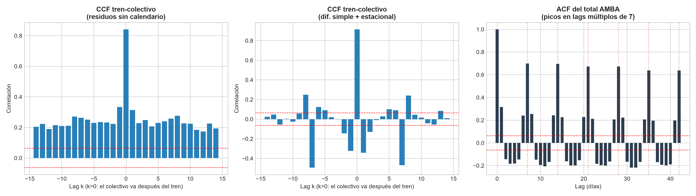

> Las figuras `fig4`, `fig5` y `fig6` (recuperación post-COVID, comparativa de pronósticos de 90 días y residuos del SARIMAX original) pertenecen al análisis de la versión inicial. Se conservan como referencia, pero ya no sustentan ninguna conclusión del trabajo.

---

## 💻 Guía de Reproducibilidad

### 1. Clonar el repositorio
```bash
git clone https://github.com/Arey14/sube-series-tiempo-amba.git
cd sube-series-tiempo-amba
```

### 2. Crear y activar un entorno virtual
```bash
python3 -m venv venv
source venv/bin/activate   # En Linux / macOS
# venv\Scripts\activate    # En Windows
```

### 3. Instalar dependencias
```bash
pip install -r requirements.txt
```

### 4. Reproducir los resultados (en este orden)
```bash
# Datos
python scripts/usos_transacciones.py        # baja las transacciones (~60 MB por año) y reconstruye los huecos
python scripts/usos_por_linea.py

# P-1
python scripts/tarifas_serie.py
python scripts/modelo_precio_demanda.py
python scripts/clasificacion_lineas_subte.py
python scripts/panel_subte_lineas.py
python scripts/efectos_cruzados_granger.py
python scripts/hitos_efectos.py
python scripts/control_sintetico.py

# P-2 (la evaluación con origen móvil tarda; se puede interrumpir y retomar)
python scripts/identificacion_sarimax.py
python scripts/evaluacion_pronosticos.py                 # total AMBA, 28 días
python scripts/analisis_pronosticos_p2.py
python scripts/modelo_hibrido_p2.py
```
Variantes de la evaluación: `ablaciones`, `col=colectivo_amba|tren_amba|subte_amba` y `h=7|90`. Los datos externos (IPC, ingreso por comuna, geografía del subte) ya están en `data/externos/`.

### 5. Notebook
```bash
jupyter notebook notebooks/TP_Final_Series_de_Tiempo.ipynb
```

---

## 📚 Referencias Bibliográficas

1. **Box, G. E., Jenkins, G. M., Reinsel, G. C., & Ljung, G. M. (2015).** *Time series analysis: forecasting and control*. John Wiley & Sons.
2. **Cleveland, R. B., Cleveland, W. S., McRae, J. E., & Terpenning, I. (1990).** *STL: A seasonal-trend decomposition procedure based on loess*. Journal of Official Statistics, 6(1), 3-73.
3. **Taylor, S. J., & Letham, B. (2018).** *Forecasting at scale*. The American Statistician, 72(1), 37-45.
4. **Hyndman, R. J., & Athanasopoulos, G. (2018).** *Forecasting: principles and practice*. OTexts.
5. **Dickey, D. A., & Fuller, W. A. (1979).** *Distribution of the estimators for autoregressive time series with a unit root*. Journal of the American Statistical Association, 74(366a), 427-431.
6. **Kwiatkowski, D., Phillips, P. C., Schmidt, P., & Shin, Y. (1992).** *Testing the null hypothesis of stationarity against the alternative of a unit root*. Journal of Econometrics, 54(1-3), 159-178.

---

## 📄 Licencia

Este proyecto se distribuye bajo la licencia **MIT**. Para más detalles, consulte el archivo [LICENSE](LICENSE).
