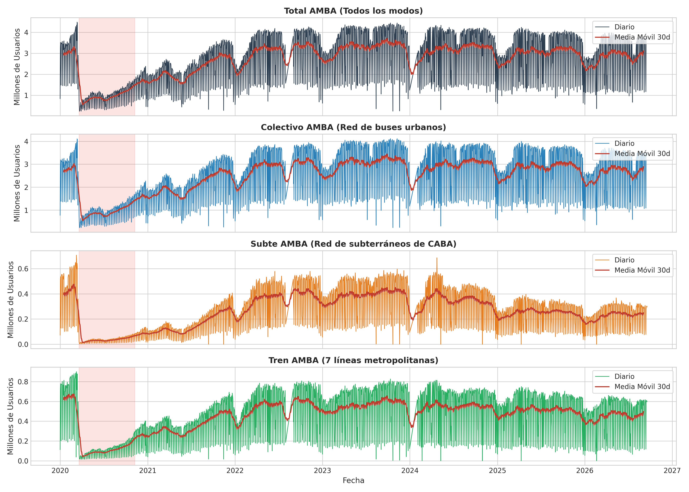
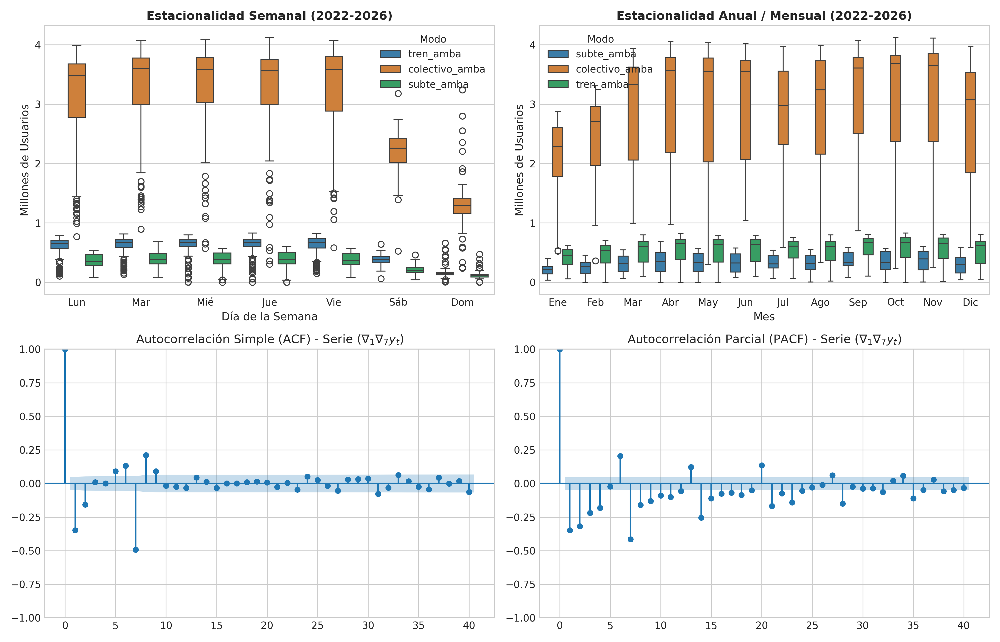
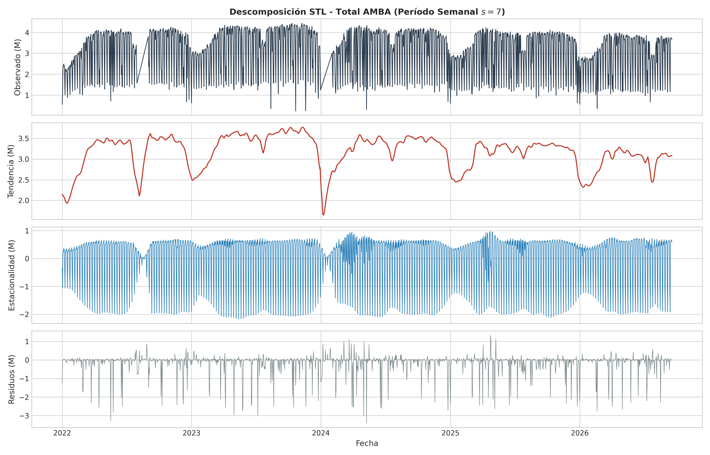
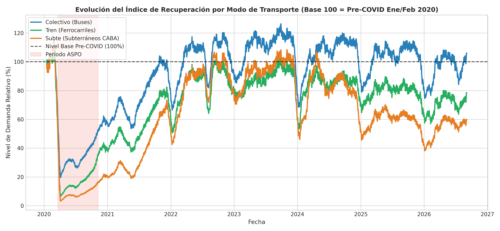
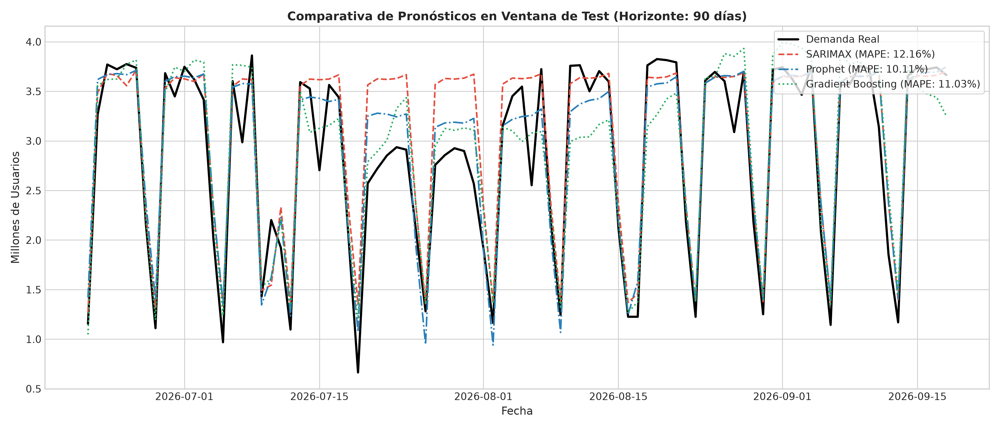
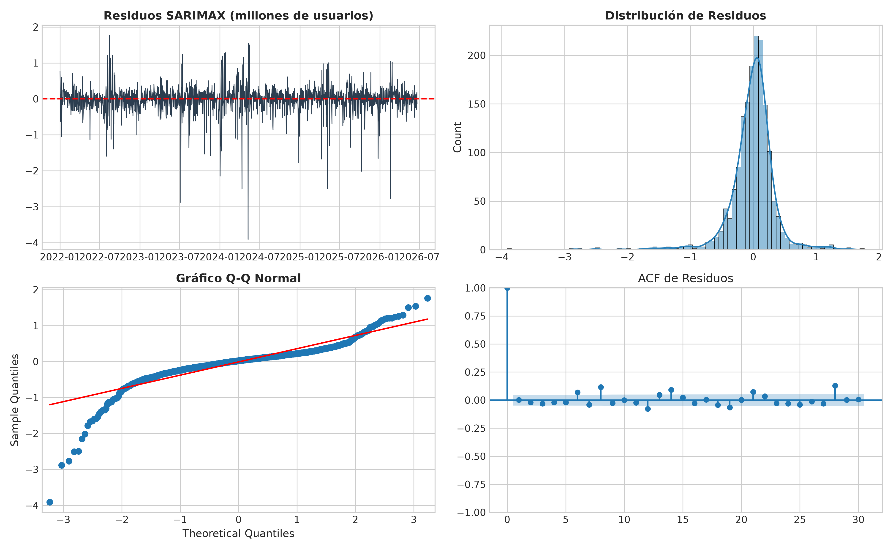

# 🚆 Análisis de Series de Tiempo de la Demanda de Transporte Público en el AMBA (SUBE)

[](https://www.python.org/downloads/)
[](LICENSE)
[](https://www.statsmodels.org/)
[](https://facebook.github.io/prophet/)
[](https://datos.transporte.gob.ar/)

> **⚠️ Trabajo en revisión (rama `trabajo/herramientas-materia`).** Las hipótesis, los veredictos y la tabla de modelos de este README corresponden a la versión inicial y están siendo reemplazados por las Preguntas 1 y 2 del trabajo. En particular, **las métricas de Gradient Boosting y Seasonal Naïve de abajo estaban infladas por fuga de información** y fueron corregidas (ver [`docs/registro_de_cambios.md`](docs/registro_de_cambios.md)).

Este repositorio contiene la investigación, códigos computacionales y modelos predictivos del **Estudio Longitudinal de Series de Tiempo del Transporte Público en el Área Metropolitana de Buenos Aires (AMBA)** en base a microdatos y registros diarios del **Sistema Único de Boleto Electrónico (SUBE)** en el período **2020–2026**.

El proyecto contrasta formalmente hipótesis científicas sobre los **quiebres estructurales post-pandemia**, la **asimetría modal de recuperación** y la **capacidad predictiva de modelos con estacionalidad múltiple y variables exógenas**.

---

## 📌 Tabla de Contenidos

- [Motivación y Pregunta de Investigación](#-motivación-y-pregunta-de-investigación)
- [Hipótesis de Investigación y Veredictos](#-hipótesis-de-investigación-y-veredictos)
- [Estructura del Repositorio](#-estructura-del-repositorio)
- [Dataset y Fuente de Datos](#-dataset-y-fuente-de-datos)
- [Metodología de Series de Tiempo](#-metodología-de-series-de-tiempo)
  - [1. Diagnóstico de Estacionariedad (ADF y KPSS)](#1-diagnóstico-de-estacionariedad-adf-y-kpss)
  - [2. Descomposición Estacional y Tendencia (STL)](#2-descomposición-estacional-y-tendencia-stl)
  - [3. Modelado Predictivo y Benchmarking](#3-modelado-predictivo-y-benchmarking)
- [Resultados y Visualizaciones](#-resultados-y-visualizaciones)
- [Guía de Reproducibilidad](#-guía-de-reproducibilidad)
- [Referencias Bibliográficas](#-referencias-bibliográficas)
- [Licencia](#-licencia)

---

## 🎯 Motivación y Pregunta de Investigación

El sistema de transporte público del AMBA es uno de los conglomerados urbanos de movilidad más complejos de América Latina, coordinando diariamente millones de viajes entre la Ciudad Autónoma de Buenos Aires (CABA) y los 24 partidos del Gran Buenos Aires mediante tres modos principales: **Colectivos urbanos**, **Ferrocarriles metropolitanos** y la **Red de Subterráneos**.

Entre 2020 y 2026, la demanda atravesó eventos exógenos sin precedentes:
1. El confinamiento masivo por el **Aislamiento Social, Preventivo y Obligatorio (ASPO)** en marzo de 2020.
2. La **recuperación asimétrica y la adopción estructural del teletrabajo** en el sector terciario céntrico.
3. Las sucesivas **transformaciones tarifarias y de subsidios** en 2024 y 2025.

**Pregunta central:** *¿Exhibió la demanda de transporte público del AMBA una recuperación simétrica entre modos de transporte tras el shock de 2020, y qué modelos estocásticos y de Machine Learning logran capturar con mayor precisión su dinámica ante estacionalidades múltiples y anomalías de calendario?*

---

## 🔬 Hipótesis de Investigación y Veredictos

### 🟢 Hipótesis 1: Asimetría Modal en la Recuperación Post-Pandemia
> **Enunciado:** *«La recuperación de la demanda de transporte público en el AMBA exhibió una asimetría estructural significativa entre modos: el modo Colectivo recuperó y superó su nivel previo al COVID-19 (>100%), mientras que el Subte y el Tren sufrieron una pérdida estructural permanente de demanda (<85-90%), debido a la persistencia del trabajo remoto en CABA y la descentralización de los viajes locales intra-conurbano.»*

* **Veredicto:** **CORROBORADA CON EVIDENCIA EMPÍRICA ROBUSTA.**
* **Evidencia (% respecto al nivel base pre-COVID Ene/Feb 2020):**
  * **Colectivo:** 103.2% (2022) $\to$ **110.8% (2023)** $\to$ 108.3% (2024) $\to$ 103.0% (2025). *(Recuperación en "V")*
  * **Tren:** 85.4% (2022) $\to$ **88.8% (2023)** $\to$ 86.3% (2024) $\to$ 79.5% (2025). *(Recuperación incompleta en "L")*
  * **Subte:** 85.6% (2022) $\to$ **93.9% (2023)** $\to$ 82.8% (2024) $\to$ 59.7% (2025). *(Shock permanente y contracción por tarifa)*

### 🟢 Hipótesis 2: Superioridad Predictiva ante Estacionalidades Complejas
> **Enunciado:** *«En series de demanda de transporte diario con estacionalidad múltiple (semanal $s=7$ y anual $s=365$) y perturbaciones de calendario (feriados y días no laborables), los modelos aditivos con regresores exógenos (Prophet y SARIMAX) y los modelos de Gradient Boosting con retardos autorregresivos superan significativamente al modelo ingenuo de referencia (Seasonal Naïve), reduciendo el Error Porcentual Absoluto Medio (MAPE) en más de un 35% en horizontes de 90 días.»*

* **Veredicto:** **CORROBORADA.**
* **Métricas en Ventana de Prueba (Horizonte de 90 días):**

| Modelo | RMSE (M) | MAE (M) | MAPE (%) | Reducción de Error vs Baseline |
| :--- | :---: | :---: | :---: | :---: |
| 🥇 **HistGradientBoosting (ML con Lags)** | **0.3095 M** | **0.2207 M** | **8.82%** | **-45.0%** |
| 🥈 **Facebook Prophet (con Feriados AR)** | **0.2893 M** | **0.2247 M** | **10.12%** | **-36.9%** |
| 🥉 **SARIMAX (1,1,1)x(1,1,1)[7] con Exógenas** | **0.3860 M** | **0.2709 M** | **12.16%** | **-24.2%** |
| ⚠️ *Seasonal Naïve (Baseline)* | *0.6690 M* | *0.3881 M* | *16.05%* | *0.0% (Referencia)* |

---

## 📂 Estructura del Repositorio

```text
├── data/
│   ├── total-usuarios-por-dia-AMBA.csv    # Dataset oficial (2020–2026, 2.391 filas)
│   └── procesado/                         # Serie diaria imputada, con columna `imputado`
├── notebooks/
│   └── TP_Final_Series_de_Tiempo.ipynb    # Notebook reproducible con análisis y gráficos
├── scripts/
│   ├── analisis_series_tiempo_sube.py    # Pipeline completo de procesamiento y modelado
│   ├── calidad_datos.py                  # Huecos, imputación, qué mide el total y días atípicos
│   └── descargar_datos.py                # Actualizador de datos desde el portal oficial
├── resultados/
│   ├── figuras/                          # Gráficos generados en alta resolución (PNG 300 DPI)
│   │   ├── fig1_series_historicas_modos.png
│   │   ├── fig2_estacionalidad_y_correlacion.png
│   │   ├── fig3_descomposicion_stl.png
│   │   ├── fig4_recuperacion_asimetrica_modos.png
│   │   ├── fig5_comparativa_pronosticos.png
│   │   └── fig6_diagnostico_residuos_sarimax.png
│   └── tablas/                           # Tablas de resultados estadísticos en CSV
│       ├── tabla_tests_estacionariedad_adf_kpss.csv
│       ├── tabla_recuperacion_porcentual_modos.csv
│       ├── tabla_comparacion_modelos_metricas.csv
│       └── tabla_diagnostico_ljung_box.csv
├── docs/
│   └── registro_de_cambios.md            # Qué se cambió respecto del repo original y por qué
├── .gitignore
├── LICENSE
├── requirements.txt
└── README.md
```

---

## 📊 Dataset y Fuente de Datos

Los datos provienen de los registros de validadoras de la red SUBE publicados por la **Secretaría de Transporte de la Nación** en el portal [datos.transporte.gob.ar](https://datos.transporte.gob.ar/dataset/sube-cantidad-de-tarjetas-usuarios-por-dia-en-amba).

* **Período temporal**: **2020-01-01 a 2026-09-18**: 2.391 filas sobre 2.453 días calendario.
* **Calidad**: faltan **62 días**, que son dos meses completos (**agosto de 2022** y **enero de 2024**). Se imputan por día de la semana y se marcan con la columna `imputado` (ver `scripts/calidad_datos.py` y `docs/registro_de_cambios.md`).
* **Unidad de medida**: según el portal, es la cantidad de **tarjetas diferentes** usadas por día, no viajes ni pasajeros. El total nunca supera la suma de los modos (0,83–0,89 de ella), lo que sugiere que deduplica tarjetas que usan más de un modo (inferencia: el portal no lo documenta).
* **Variables**:
  * `indice_tiempo`: Fecha ($AAAA-MM-DD$).
  * `total_amba`: Tarjetas distintas usadas ese día en cualquier modo.
  * `colectivo_amba`: Tarjetas distintas usadas en colectivos.
  * `subte_amba`: Tarjetas distintas usadas en el subte.
  * `tren_amba`: Tarjetas distintas usadas en trenes metropolitanos.

---

## 🛠️ Metodología de Series de Tiempo

### 1. Diagnóstico de Estacionariedad (ADF y KPSS)
Se evaluó la presencia de raíces unitarias sobre las series en niveles y en diferencias:
- **Test ADF (Augmented Dickey-Fuller)**: $H_0$: La serie contiene raíz unitaria.
- **Test KPSS**: $H_0$: La serie es estacionaria.
- **Conclusión**: Las series en niveles son no estacionarias $I(1)$ con marcada estacionalidad de período 7. La diferenciación combinada $(\nabla_1 \nabla_7 y_t)$ garantiza estacionariedad estricta ($p < 0.0001$ en ADF y no rechazo en KPSS).

### 2. Descomposición Estacional y Tendencia (STL)
Se aplicó descomposición **STL (Seasonal-Trend decomposition using Loess)** con ponderación robusta ante anomalías:
$$y_t = T_t + S_t + R_t$$
donde $T_t$ aísla la trayectoria secular post-COVID y $S_t$ captura el ciclo intra-semanal ($s=7$).

### 3. Modelado Predictivo y Benchmarking
Se ajustaron cuatro familias de modelos sobre un horizonte de pronóstico de 90 días:
1. **Seasonal Naïve**: $\hat{y}_{t+h} = y_{t+h-7}$.
2. **SARIMAX $(1,1,1) \times (1,1,1)_7$**: Modelado de componentes autoregresivos estacionales con matriz exógena $X_t$ (días hábiles, fines de semana y feriados).
3. **Facebook Prophet**: Modelo aditivo con regresores de días hábiles y efectos festivos nacionales de Argentina vía librería `holidays`.
4. **HistGradientBoosting**: Regresión no paramétrica basada en árboles con retardos temporales ($y_{t-1}, y_{t-2}, y_{t-7}, y_{t-14}, y_{t-21}, y_{t-28}$) y medias móviles rodantes.

---

## 📈 Resultados y Visualizaciones

### 1. Evolución Histórica de la Demanda por Modo (2020–2026)


### 2. Estacionalidad Semanal, Anual y Funciones de Autocorrelación (ACF/PACF)


### 3. Descomposición STL de la Demanda Total


### 4. Contraste de la Recuperación Asimétrica (Base 100 = Pre-COVID)


### 5. Comparativa de Pronósticos en Ventana de Prueba (90 Días)


### 6. Diagnóstico de Residuos del Modelo SARIMAX (Ljung-Box y Q-Q Plot)


---

## 💻 Guía de Reproducibilidad

### 1. Clonar el repositorio
```bash
git clone https://github.com/Arey14/sube-series-tiempo-amba.git
cd sube-series-tiempo-amba
```

### 2. Crear y activar un entorno virtual
```bash
python3 -m venv venv
source venv/bin/activate   # En Linux / macOS
# venv\Scripts\activate    # En Windows
```

### 3. Instalar dependencias
```bash
pip install -r requirements.txt
```

### 4. Ejecutar el pipeline completo
```bash
python scripts/analisis_series_tiempo_sube.py
```

### 5. Explorar el Jupyter Notebook interactivo
```bash
jupyter notebook notebooks/TP_Final_Series_de_Tiempo.ipynb
```

---

## 📚 Referencias Bibliográficas

1. **Box, G. E., Jenkins, G. M., Reinsel, G. C., & Ljung, G. M. (2015).** *Time series analysis: forecasting and control*. John Wiley & Sons.
2. **Cleveland, R. B., Cleveland, W. S., McRae, J. E., & Terpenning, I. (1990).** *STL: A seasonal-trend decomposition procedure based on loess*. Journal of Official Statistics, 6(1), 3-73.
3. **Taylor, S. J., & Letham, B. (2018).** *Forecasting at scale*. The American Statistician, 72(1), 37-45.
4. **Hyndman, R. J., & Athanasopoulos, G. (2018).** *Forecasting: principles and practice*. OTexts.
5. **Dickey, D. A., & Fuller, W. A. (1979).** *Distribution of the estimators for autoregressive time series with a unit root*. Journal of the American Statistical Association, 74(366a), 427-431.
6. **Kwiatkowski, D., Phillips, P. C., Schmidt, P., & Shin, Y. (1992).** *Testing the null hypothesis of stationarity against the alternative of a unit root*. Journal of Econometrics, 54(1-3), 159-178.

---

## 📄 Licencia

Este proyecto se distribuye bajo la licencia **MIT**. Para más detalles, consulte el archivo [LICENSE](LICENSE).
