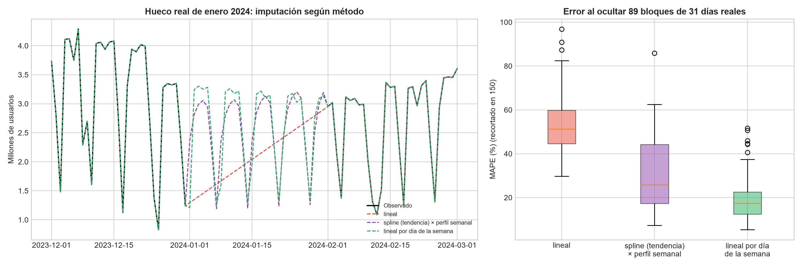

# Informe final

**Demanda de transporte público en el AMBA (SUBE, 2020–2026): hitos, causalidad y pronóstico**

Trabajo final de Series Temporales, Maestría en Ciencia de Datos.

> **Estado de este documento (15-nov-2026).** Está reescrito con el criterio acordado (definir cada término, explicar cada método y de qué clase proviene, y leer cada resultado) hasta la **sección 4 inclusive**. Las secciones 5 (P-1), 6 (P-2) y 7 (discusión) siguen en el notebook con su redacción anterior y se reescriben con la misma plantilla cuando se apruebe el estilo de las primeras. El notebook (`notebooks/TP_Final_Series_de_Tiempo.ipynb`) es el soporte computacional: contiene el código y las figuras. Este informe es el texto de referencia para el guion y la presentación.

**Cómo se explica cada método.** Cada vez que se aplica una técnica se responde, en este orden: (1) **qué es**, en palabras simples y con su definición; (2) **por qué se aplica acá** y de qué clase del curso proviene; (3) **cómo se lee** el resultado (qué significan los ejes, las columnas y los números); (4) **qué se obtuvo**; (5) **qué se concluye y qué no**.

**Material de la cátedra citado.** Las referencias a las clases usan los nombres de los archivos del curso (Dr. Marcelo Risk, *Data Mining de Series Temporales*, FCEyN UBA):

| Abreviatura | Archivo | Temas |
|---|---|---|
| **Clase Introducción** | `Clase_Introduccion_DMST.pdf` | Qué es una serie temporal y para qué se analiza. |
| **Clase Representación** | `Clase_RepresentacionSeriesTemporales_DMST.pdf` | Definición de serie temporal; modelar, descomponer, interpolar y extrapolar. |
| **Clase Señales** | `Clase_Seniales_Analogicas_Digitales_DMST.pdf` | Muestreo en el tiempo y teorema del muestreo. |
| **Clase Interpolación** | `Clase_Interpolacion_DMST.pdf` | Interpolación como imputación de muestras perdidas (`approx`, `spline`). |
| **Clase Frecuencia** y **Frecuencia R/Python** | `Clase_Dominio_Frecuencia_DMST.pdf`, `Dominio_Frecuencia_R_Python.pdf` | Transformada de Fourier, FFT, eje de frecuencias, teorema de Parseval. |
| **Clase Forecasting** | `Clase_Forecasting_DMST.pdf` | Estacionaridad, pruebas ADF y KPSS, descomposición STL, modelos ARMA y ARIMA. |
| **Filtrado MA** | `Filtrado_MA_R_Python.pdf` | Filtro de media móvil, bordes. |
| **Filtrado en frecuencia** | `Filtrado_Dominio_Frecuencia_R_Python.pdf` | Filtros que operan sobre el espectro. |
| **Convolución y correlación** | `Convolucion_Correlacion_R_Python.pdf` | Convolución, correlación cruzada (`ccf`) y autocorrelación. |

---

## Glosario mínimo

- **Serie temporal:** conjunto de valores de una misma variable ordenados en el tiempo. Acá, un valor por día.
- **Muestra, observación:** cada valor de la serie (el de un día).
- **Nivel:** el valor de la serie tal cual, sin transformar.
- **Tendencia:** movimiento lento y persistente del nivel (meses o años).
- **Ciclo o estacionalidad:** patrón que se repite con período fijo. Acá: el ciclo semanal (7 días) y el anual (~365 días).
- **Rezago (*lag*):** desplazamiento en el tiempo. El rezago 1 compara cada día con el anterior; el rezago 7, con el mismo día de la semana anterior.
- **Diferenciar:** restar a cada valor otro valor anterior de la misma serie (se explica en 4.3).
- **Estacionaria:** serie cuyas propiedades estadísticas (promedio, dispersión, relación entre un día y los anteriores) no cambian con el tiempo (se define en 4.3).
- **Frecuencia:** cuántos ciclos completos ocurren por unidad de tiempo. Se mide aquí en ciclos por día. **Período:** días que dura un ciclo; es la inversa de la frecuencia (frecuencia 1/7 ciclos por día = período de 7 días).
- **Amplitud:** altura de una onda; acá, en millones de usuarios.
- **Hito:** día o episodio que altera la demanda (feriado, paro, elección, aumento de tarifa, pandemia).
- **Pronóstico a 28 días:** estimar los valores de los próximos 28 días con la información disponible hasta hoy.

---

## 1. Introducción y motivación

El Área Metropolitana de Buenos Aires (AMBA) tiene uno de los sistemas de transporte público más grandes de América Latina: millones de viajes diarios en colectivo, tren y subte, que se pagan con la misma tarjeta SUBE. Entre 2020 y 2026 la demanda atravesó una pandemia, un cambio de hábitos de trabajo, una secuencia de aumentos de tarifa y, intercalados, paros, elecciones y feriados que alteran un día cualquiera.

Dos preguntas prácticas ordenan el trabajo:

- **Entender.** Cuando algo cambia (el precio, el calendario, un paro), ¿cuánto se mueve la demanda y es posible atribuir ese movimiento a la causa, o solo se lo observa al mismo tiempo que ocurre?
- **Anticipar.** Para planificar el servicio, ¿qué método de pronóstico funciona mejor con la demanda diaria y por qué?

Son preguntas distintas y requieren herramientas distintas. Entender una causa exige aislar su efecto del de todo lo demás, es decir, construir un **contrafactual** (qué habría pasado sin el cambio). Pronosticar exige un modelo que acierte, aunque no explique. El trabajo trata las dos por separado y muestra cuándo conviene cada enfoque (la sección 7 explica cómo se complementan).

## 2. Preguntas de trabajo

**P-1. ¿Cómo se comportó la demanda alrededor de los hitos y por qué?** Hitos: pandemia (solo descriptivo), aumentos de tarifa, feriados, paros y elecciones. El "por qué" se aborda con herramientas de causalidad (contrafactual con controles, control sintético, prueba de Granger) y en cada caso se declara qué supuestos hacen falta.

**P-2. ¿Qué métodos pronostican mejor la demanda diaria y por qué?** Se comparan siete métodos con una evaluación de **origen móvil** (42 cortes sucesivos de 28 días), una prueba de significancia de las diferencias de error y variantes que explican por qué uno gana.

**Qué cambió respecto del trabajo original.** (1) Las hipótesis originales se reemplazaron por estas preguntas, porque sus "veredictos" no eran sostenibles con los datos. (2) Se descartó medir la "recuperación contra el nivel anterior a la pandemia": solo hay enero y febrero de 2020 como base y son temporada baja. (3) Se corrigió una fuga de información (uso de datos del período de prueba para ajustar el modelo) en dos de los modelos. (4) La comparación pasó de una ventana de 90 días a 42 cortes sucesivos.

---

## 3. Datos y calidad

### 3.1 Fuentes: dos conjuntos de datos del mismo portal

Los datos de la demanda provienen del portal de datos abiertos de la Secretaría de Transporte de la Nación (datos.transporte.gob.ar), que publica registros de las validadoras de la red SUBE. El trabajo usa **dos conjuntos de datos distintos del mismo portal**:

| | Usuarios | Transacciones |
|---|---|---|
| **Archivo** | `total-usuarios-por-dia-AMBA.csv` | `dat-ab-usos-AAAA.csv` (uno por año) |
| **Qué cuenta** | **Tarjetas distintas** que se usaron al menos una vez en el día, por modo (colectivo, tren, subte) y total. | **Usos de la tarjeta** registrados en el día, por línea, modo y jurisdicción. Una tarjeta usada cinco veces suma cinco. |
| **Cobertura** | Solo AMBA; faltan 62 días (agosto de 2022 y enero de 2024). | AMBA y ciudades del interior; sin días faltantes. |
| **Dónde se usa** | Sección 4 y P-2. | P-1 (elasticidad, hitos, panel por línea de subte, control sintético) y reconstrucción de los días faltantes. |

Ambos conjuntos los publica el mismo organismo en el mismo portal, y es razonable suponer que salen del mismo sistema de validadoras, pero el portal **no documenta** cómo se construye cada uno. Por eso lo que se afirma es que *la fuente principal es la misma (registros de validadoras SUBE publicados por la Secretaría de Transporte), en dos conjuntos de datos distintos*, y que su relación (cuántas tarjetas distintas por transacción) se mide con los datos, no se da por conocida. Se verificó que se mueven casi igual: la correlación de sus logaritmos diarios es de 0,995 para el total y de 0,999 para tren y subte.

### 3.2 Qué mide la "demanda" en este trabajo

- **Usuarios** (tarjetas distintas por día) se usan en la exploración (sección 4) y en el pronóstico (P-2).
- **Transacciones** (usos) se usan en P-1 y para reconstruir los días faltantes.

**Ninguna de las dos medidas es una cantidad de personas ni de viajes completos.** Una persona con dos tarjetas cuenta dos veces como usuario; una tarjeta compartida por varias personas cuenta una; una combinación entre dos colectivos son dos transacciones; y el conjunto de datos no trae origen, destino ni distancia. Tampoco se registran los viajes que no se pagan con SUBE, como los del multipago del subte desde diciembre de 2024 (ver 5.2). En consecuencia, cuando el texto dice que "sube" o "baja la demanda", significa más o menos **tarjetas distintas por día** (P-2) o más o menos **transacciones** (P-1). Leerlo como "pasajeros" es una simplificación razonable, porque las dos medidas se mueven casi igual, pero no es una igualdad.

> **Supuesto sin verificar.** En 6.9 los cocientes de P-1, medidos con transacciones, se aplican a pronósticos de usuarios. Se supone que ambas medidas reaccionan igual ante un evento; no se comprobó.

### 3.3 Días faltantes: cómo se completaron y por qué ese método

**Problema.** La serie de usuarios no tiene datos para 62 días: agosto de 2022 y enero de 2024. Un modelo de series temporales necesita una observación por día, sin huecos. Completar los huecos es **interpolar** (calcular valores intermedios dentro de la serie): según la **Clase Interpolación**, es un método de imputación de muestras perdidas, el cuarto de los cuatro casos que se presentan ("muestrear uniformemente una serie temporal con muestras perdidas").

**Qué se comparó.** Se evaluaron dos familias de interpolación vistas en la Clase Interpolación (`approx`, que traza rectas, y `spline`, que traza curvas cúbicas) y, para cada una, varias formas de aplicarla. Se ocultaron 89 bloques reales de 31 días consecutivos (de datos que sí se conocían), se estimaron con cada método y se compararon con el valor real. El indicador es el **MAPE** (*error porcentual absoluto medio*): para cada día se calcula |estimado − real| / real y se promedia. Un MAPE de 17% significa que, en promedio, el estimado se aparta 17% del valor real. Se informa la **mediana** de los 89 bloques y el **percentil 90** (el error que solo superan el 10% de los bloques más difíciles). Además se mide cuánto del **ciclo semanal** conserva el estimado (1 = todo; 0 = ninguno; más de 1 = lo exagera).

**Cómo se aplica cada método.**

- **Aplicado directamente a la serie diaria:** la *recta* une el último día conocido antes del hueco con el primero después; el *spline cúbico original* une los puntos conocidos con tramos de polinomios de grado 3 que empalman sin quiebres.
- **Por día de la semana:** se interpola cada día de la semana por separado (lunes con lunes, etc.), de modo que cada sub-serie no tiene ciclo semanal. Se probó con rectas, con spline cúbico y con PCHIP (una curva cúbica por tramos que no oscila: nunca se sale del rango de los puntos que une).
- **Tendencia × perfil semanal:** se combinan dos componentes, como en una descomposición. (1) La *tendencia* se estima interpolando la media móvil de 7 días (que no tiene ciclo semanal) con recta, spline cúbico o PCHIP. (2) El *perfil semanal* es el cociente medio de cada día de la semana respecto de esa tendencia en las 4 semanas vecinas al hueco. El estimado de cada día es tendencia × perfil de ese día.

**Resultados** (`tabla_simulacion_interpolacion`; ordenados de menor a mayor error mediano):

| Método | Familia | MAPE mediano | MAPE p. 90 | Ciclo semanal conservado |
|---|---|---|---|---|
| PCHIP × perfil semanal | curva sin oscilación | **17,2%** | 29,0% | 0,89 |
| Recta × perfil semanal | recta | 17,3% | 28,9% | 0,89 |
| Lineal por día de la semana | recta | 17,4% | 32,3% | 0,95 |
| PCHIP por día de la semana | curva sin oscilación | 17,7% | 33,2% | 0,96 |
| **Spline cúbico × perfil semanal** | **spline** | **25,9%** | 56,3% | 0,87 |
| Spline cúbico por día de la semana | spline | 28,9% | 44,8% | 1,31 |
| Lineal (directa sobre la serie) | recta | 51,3% | 70,7% | 0,01 |
| Spline cúbico original (directo sobre la serie) | spline | 76,3% | 323,4% | 0,15 |

*Figura 7b. A la izquierda, el hueco real de enero de 2024 completado por cada método. A la derecha, la distribución del error (MAPE) al ocultar 89 bloques de 31 días reales; los métodos están ordenados de menor a mayor error mediano.*

**El mejor spline y el mejor método de cada familia.** Entre las variantes del spline, la de menor error es el **spline cúbico sobre la tendencia × perfil semanal (25,9%)**; es la que se muestra en la Figura 7. Reduce a un tercio el error del spline original (76,3%). Entre las rectas, la mejor es la lineal por día de la semana o la recta × perfil semanal (17,3%–17,4%), y el mejor método de todos es el PCHIP × perfil semanal (17,2%), aunque su diferencia con las rectas por día de la semana es muy pequeña (17,2% contra 17,4%) y no se evaluó su significancia. La elección del mejor spline se hizo sobre los mismos 89 bloques con los que se mide el error, lo que podría favorecerla levemente; como las diferencias entre variantes del spline son de varios puntos, no cambia la conclusión.

*Figura 7. El hueco de enero de 2024 con la recta, el mejor spline y la lineal por día de la semana, y el error de los tres.*

**Por qué el spline cúbico original da tan mal.** Un spline cúbico fuerza que la curva sea suave y pase por los puntos de los bordes. Con una serie que sube y baja cada semana (días hábiles contra fin de semana), la pendiente con la que la curva sale de cada borde del hueco depende de si el último día conocido fue, por ejemplo, un domingo bajo o un martes alto. Esa pendiente arbitraria se arrastra por 31 días: en el gráfico, la curva llega a valores negativos de usuarios. Es una explicación consistente con lo medido (sesgo medio de +26%), no una demostración.

**Qué se aprende de la comparación.**

1. **La forma de aplicar el método importa más que el método.** Separar el ciclo semanal antes de interpolar (por día de la semana o con tendencia × perfil) mejora al spline de 76% a 26%–29% y a la recta de 51% a 17%. El spline original y la recta directa fallan por lo mismo: intentan ajustar con una sola curva una serie con un ciclo fuerte.
2. **Una vez separado el ciclo, el spline cúbico es peor que las opciones sin oscilación** (recta o PCHIP): con solo 7 puntos por mes en cada día de la semana, o con una tendencia que solo cambia lentamente, la flexibilidad del polinomio de grado 3 no aporta y agrega oscilaciones.
3. **Ninguna variante baja del 17%.** Lo que falta en un hueco de un mes no es un problema de la curva sino de información: en enero, por ejemplo, hay receso de verano y ninguna curva trazada entre diciembre y febrero puede saberlo. Si no hubiera ninguna fuente adicional, el método recomendado sería PCHIP o recta × perfil semanal.

**Reconstrucción desde transacciones (el método elegido para completar la serie).** No es un método de interpolación pura sino el uso de una **fuente adicional del mismo organismo**: el portal publica también las transacciones diarias, que no tienen huecos y sí traen el nivel y el ciclo semanal de los días faltantes. Se eligió para completar la serie porque, cuando existe una fuente así, es muy superior a cualquier interpolación; pero en la mayoría de las series reales no se dispone de ella, y por eso la comparación de interpolaciones de arriba se evalúa por separado. El método se aplica a las **cuatro series** (total, colectivo, tren y subte) en tres pasos:

1. En cada serie se calcula el **cociente usuarios / transacciones** de los 28 días anteriores y de los 28 posteriores al hueco, por separado para días hábiles, sábados y domingos.
2. Ese cociente se **interpola** entre los dos bordes del hueco.
3. Los usuarios de cada día faltante se estiman como **transacciones del día × cociente**.

Ejemplo con cifras ilustrativas: si en los días hábiles vecinos hay 0,8 usuarios por transacción y un martes del hueco tiene 5 millones de transacciones, se estiman 4 millones de usuarios. Funciona porque el cociente es muy estable (desvío de 0,03 en la validación), mientras que lo que cambia de un día a otro (el nivel y el ciclo semanal) ya está en las transacciones. En meses de vacaciones el error baja a **1,6%–3,2%**, frente a **12,1%–20,8%** de la interpolación lineal por día de la semana. Una particularidad: el archivo de transacciones del subte no trae jurisdicción, por lo que el subte se toma completo, sin filtrar. Los días reconstruidos quedan marcados con la columna `imputado`.

**Octubre de 2026** es preliminar (sus transacciones son 100% preliminares) y queda fuera de las evaluaciones.

---

## 4. Exploración de la serie

El objetivo de esta sección es **conocer la serie antes de modelarla**: qué patrones tiene, qué se repite y cada cuánto, qué cambios bruscos hubo y si cumple los supuestos de los modelos. Cada subsección responde una pregunta distinta y sus resultados se usan después en P-1 y P-2.

### 4.1 Nivel y ciclos: gráficos

La serie del total AMBA (media móvil de 7 días en los gráficos, para que no se vea el ciclo semanal) cae casi a cero en el aislamiento estricto de 2020, se recupera y se estabiliza desde 2022. Por eso **el análisis y los modelos usan datos desde enero de 2022**; la pandemia se estudia solo de forma descriptiva (5.6). Dos patrones se repiten: el **ciclo semanal** (los días hábiles muy por encima de sábados y domingos) y el **ciclo anual** (valles en las vacaciones de verano e invierno). Ambos explican gran parte del error de los modelos de pronóstico.

### 4.2 Estacionariedad y diferenciación (ADF, KPSS)

*Base teórica: Clase Forecasting, secciones "Estacionaridad de una ST", "Pruebas de estacionaridad: Augmented Dickey-Fuller test" y "KPSS Test", y "Forecasting ARIMA".*

#### Qué es la estacionariedad y por qué importa

Una serie es **estacionaria** (en el sentido débil, el que se usa en la práctica) si su **promedio**, su **dispersión** y la **relación entre un día y los anteriores** (autocovarianza) no cambian con el tiempo. Una serie con tendencia (sube o baja de manera sostenida) o con saltos de nivel no es estacionaria: su promedio depende de cuándo se lo calcule. La Clase Forecasting plantea que "la condición fundamental" para pronosticar es que el pasado sea estacionario, o que se lo transforme hasta que lo sea, porque los modelos ARMA/ARIMA aprenden regularidades que deben mantenerse en el tiempo.

#### Qué es diferenciar y entre qué y qué se resta

**Diferenciar es restar a cada valor de la serie otro valor anterior de la misma serie.** Hay dos formas, que se distinguen por el rezago:

- **Diferencia simple (rezago 1):** $y_t - y_{t-1}$, el valor de un día menos el del día anterior. Mide cuánto cambió de un día al siguiente. Si la serie tiene una tendencia suave, la diferencia simple la elimina, porque el cambio diario de una tendencia es aproximadamente constante.
- **Diferencia estacional (rezago 7):** $y_t - y_{t-7}$, el valor de un día menos el del mismo día de la semana anterior. Mide cuánto cambió respecto de la semana pasada. Elimina el ciclo semanal, porque un lunes y el lunes anterior comparten el mismo "efecto lunes".

**Ejemplo con datos reales (total AMBA, usuarios en millones):** el domingo 6 de septiembre de 2026 hubo 1,182; el lunes 7, 3,641; el domingo 13, 1,208; el lunes 14, 3,722.

| Cálculo | Cuenta | Resultado | Qué dice |
|---|---|---|---|
| Diferencia simple del lunes 14 | 3,722 − 1,208 (domingo 13) | +2,514 | Casi todo es el salto de domingo a lunes: el ciclo semanal. |
| Diferencia estacional del lunes 14 | 3,722 − 3,641 (lunes 7) | +0,081 | Ese lunes fue prácticamente igual al lunes anterior: se quitó el ciclo semanal. |
| Diferencia estacional + simple del lunes 14 | (3,722 − 3,641) − (1,208 − 1,182) = 0,081 − 0,026 | +0,055 | Cómo cambió la diferencia semanal de un día al siguiente. |

**Para qué se diferencia.** Para que la serie transformada sea estacionaria y el modelo pueda aprender de ella. La notación del modelo SARIMAX, $(p, d, q)(P, D, Q)_s$, indica cuántas diferencias aplica: **$d$** es la cantidad de diferencias simples, **$D$** la cantidad de diferencias estacionales y **$s$** el largo del ciclo (7 días acá).

**En síntesis.** Diferenciar es restar a cada valor otro valor anterior de la misma serie. Con datos reales:

| Cálculo | Resultado | Qué dice |
|---|---|---|
| Lunes 14-sep-2026 menos el domingo 13 (diferencia simple) | +2,514 | Casi todo es el salto de domingo a lunes: el ciclo semanal. |
| Lunes 14 menos el lunes 7 (diferencia estacional) | +0,081 | Ese lunes fue casi igual al anterior: se quitó el ciclo semanal. |

Cada una de las tres versiones de la serie responde una pregunta: si hace falta diferenciar (nivel), si alcanza con restar el mismo día de la semana anterior (diferencia estacional), o si hace falta además restar el día anterior (diferencia estacional más simple). Se busca la menor diferenciación porque diferenciar de más agrega autocorrelación negativa artificial.

#### Las dos pruebas

Ninguna prueba dice "esta serie es estacionaria" de forma directa. Se usan **dos con hipótesis nulas opuestas**, y se concluye solo cuando coinciden (tabla de decisión de la Clase Forecasting):

- **ADF** (Dickey-Fuller aumentada). Hipótesis nula: la serie tiene una **raíz unitaria**, es decir, sus movimientos se acumulan sin volver a un nivel de referencia (una "caminata aleatoria"), lo que la hace no estacionaria. Un **p-valor menor a 0,05 rechaza** la nula: hay evidencia de estacionariedad.
- **KPSS** (Kwiatkowski, Phillips, Schmidt y Shin). Hipótesis nula: la serie es **estacionaria** alrededor de un nivel constante. Un **p-valor menor a 0,05 rechaza** la nula: hay evidencia de *no* estacionariedad. (statsmodels acota este p-valor entre 0,01 y 0,10, por eso solo aparecen esos extremos.)

| p ADF | p KPSS | Decisión |
|---|---|---|
| < 0,05 | ≥ 0,05 | **Estacionaria** |
| ≥ 0,05 | < 0,05 | **No estacionaria** |
| < 0,05 | < 0,05 | Indefinida |
| ≥ 0,05 | ≥ 0,05 | Indefinida |

*(El p-valor es la probabilidad de observar datos tan extremos como los que hay si la hipótesis nula fuera cierta; si es muy chico, la nula resulta poco creíble.)*

#### Qué se evalúa: tres versiones de la serie y tres tramos

Las pruebas se aplican a **tres versiones** de la serie. Cada una corresponde a una **decisión de diferenciación** posible del modelo y responde una pregunta:

| Versión | Fórmula | Pregunta que responde | Si es estacionaria, significa que… |
|---|---|---|---|
| **Nivel** | $y_t$ | ¿Hace falta diferenciar? | No hace falta diferenciar ($d = 0$, $D = 0$ serían posibles). |
| **Diferencia estacional** | $y_t - y_{t-7}$ | ¿Alcanza con restar el mismo día de la semana anterior? | Alcanza con $D = 1$ y $d = 0$. |
| **Diferencia estacional + simple** | $(y_t - y_{t-7}) - (y_{t-1} - y_{t-8})$ | ¿Hace falta además restar el día anterior? | Hace falta $d = 1$ y $D = 1$. |

Se prueban en **tres tramos**: la serie completa desde 2020 (incluye la pandemia), el período **2022–2026** (sin pandemia, el que usan los modelos) y el **entrenamiento inicial** (enero de 2022 a junio de 2023), el único con el que se identifica el orden del SARIMAX sin mirar el período de prueba. Resultados:

| Tramo (días) | Versión | p ADF | p KPSS | Decisión |
|---|---|---|---|---|
| 2020–2026, con pandemia (2.465) | Nivel | 0,245 | 0,01 | **No estacionaria** |
| | Dif. estacional | 0,000 | 0,10 | Estacionaria |
| | Dif. estacional + simple | 0,000 | 0,10 | Estacionaria |
| 2022–2026 (1.734) | Nivel | 0,0001 | 0,10 | **Estacionaria** |
| | Dif. estacional | 0,000 | 0,10 | Estacionaria |
| | Dif. estacional + simple | 0,000 | 0,10 | Estacionaria |
| 2022 a junio 2023 (546) | Nivel | 0,009 | 0,016 | Indefinida |
| | Dif. estacional | 0,000 | 0,10 | Estacionaria |
| | Dif. estacional + simple | 0,000 | 0,10 | Estacionaria |

#### Qué se concluye y por qué se busca "la menor diferenciación"

- **Con pandemia, el nivel no es estacionario**: la caída y la recuperación de 2020–2021 cambian el promedio. Por eso esos años no se usan para modelar.
- **Desde 2022, el nivel sí es estacionario** (las dos pruebas coinciden). En el tramo corto de entrenamiento la decisión es indefinida, algo esperable con solo 546 observaciones.
- **En los tres tramos, la diferencia estacional ya deja la serie estacionaria**, y agregar la diferencia simple da el mismo veredicto. Por eso se elige **$d = 0$ y $D = 1$ con período 7**: la mínima diferenciación que alcanza.
- **Por qué la mínima.** Diferenciar de más (*sobrediferenciación*) no es gratis: cada diferencia agrega una autocorrelación negativa artificial (un valor alto queda seguido de uno bajo solo por la resta) y aumenta la variabilidad de la serie transformada, de modo que el modelo pierde precisión. Se miran las tres versiones precisamente para ver en qué paso la serie pasa a ser estacionaria y comprobar que el paso siguiente ya no aporta.
- **Limitación.** Un nivel "estacionario" en 2022–2026 no descarta cambios de nivel puntuales (como la caída del subte de 2024); las pruebas no están diseñadas para detectarlos.

> **Por qué las pruebas no ven el ciclo semanal.** ADF y KPSS detectan tendencias y raíces unitarias, no ciclos estables. Un ciclo semanal fijo es predecible y no es una raíz unitaria, pero un modelo ARIMA igualmente necesita tratarlo, y por eso se incluye $D = 1$.

### 4.3 Descomposición STL

*Base teórica: Clase Forecasting, "Forecasting STL (Seasonal and Trend decomposition using Loess)"; Cleveland et al. (1990).*

**Qué es.** Separa la serie en tres partes que suman la serie original: **tendencia** (movimiento lento), **componente estacional** (el patrón que se repite cada 7 días) y **residuo** (lo que no explican las otras dos). La versión **robusta** reduce el peso de los valores extremos al estimar tendencia y patrón, de modo que no los "contaminan".

**Cómo se lee.** El gráfico tiene cuatro paneles: la serie, la tendencia, el patrón semanal y el residuo. Lo informativo es el residuo: concentra los **feriados, paros y elecciones**, que son los días en que un modelo basado en el patrón habitual se equivoca. Por eso P-1 estudia esos días y P-2 evalúa cómo los pronostican los modelos.

### 4.4 Análisis espectral (FFT) y teorema de Parseval

*Base teórica: Clase Frecuencia y Frecuencia R/Python ("Series temporales en los dominios del tiempo y la frecuencia", "FFT de senoidales", "FFT de pulsos", "FFT de pulsos con eje de frecuencias calibrado", "Teorema de Parseval"); Clase Señales (teorema del muestreo).*

#### Qué es y qué pregunta responde

La serie se puede ver de dos maneras equivalentes. En el **dominio del tiempo** es una secuencia de valores día a día, que es como se la grafica normalmente. En el **dominio de la frecuencia** se la expresa como una **suma de ondas** (senos y cosenos) de distinta frecuencia, cada una con su amplitud. La **transformada de Fourier** pasa de un dominio al otro; la **FFT** (*Fast Fourier Transform*) es su algoritmo rápido. La pregunta que responde es: **¿qué ciclos hay en la serie y cuánto pesa cada uno?** Es la única herramienta de la sección que lo cuantifica.

#### Cómo se calculó

- Se usó el total AMBA de enero de 2022 a octubre de 2026, recortado a **251 semanas exactas (N = 1.757 días)**. El recorte importa porque la FFT supone que la serie se repite indefinidamente: con semanas completas, el ciclo de 7 días encaja exacto en una de las frecuencias que calcula la FFT y su energía no se desparrama sobre las vecinas (fenómeno de *leakage*, o fuga espectral).
- Se le **restó el promedio** de la serie (3,06 millones de usuarios). Ese promedio es la frecuencia 0, llamada componente continua o **DC**, y es tan grande que, si se dejara, taparía el resto del gráfico. Al restarlo, lo que se analiza es la **variación alrededor del promedio**.

#### Cómo se lee el eje horizontal (frecuencia)

El eje horizontal del gráfico es la **frecuencia en ciclos por día**. Un valor de 0,1429 significa 0,1429 ciclos completos por día, es decir, **un ciclo cada 7 días** (1/7). El **período** es su inversa:

| Frecuencia (ciclos/día) | Período | Qué ciclo es |
|---|---|---|
| 0,00057 (= 1/1.757) | 1.757 días | Variación lenta a lo largo de todo el período (cambios de nivel). |
| 0,00285 | ≈ 351 días | Ciclo **anual**. |
| 0,00569 | ≈ 176 días | Ciclo **semestral** (verano e invierno). |
| 0,1429 (= 1/7) | 7 días | Ciclo **semanal**. |
| 0,2857 (= 2/7) | 3,5 días | Segundo armónico del semanal. |
| 0,4286 (= 3/7) | 2,33 días | Tercer armónico del semanal. |

Por qué el eje termina en **0,5**: con un dato por día no se puede distinguir un ciclo más rápido que uno cada 2 días (0,5 ciclos/día). Es el **teorema del muestreo** de la Clase Señales: la frecuencia de muestreo debe ser al menos el doble de la frecuencia máxima que se quiere captar. Entonces, **"1" en el eje no sería "toda la serie" ni "un año"**: significaría un ciclo por día, que ni siquiera se puede observar con datos diarios. Las frecuencias bajas (cerca de 0) son los ciclos lentos y las altas (cerca de 0,5) los rápidos.

#### Cómo se lee el eje vertical (amplitud)

La **amplitud** es la altura de la onda, en millones de usuarios. Una amplitud de 0,944 en 1/7 significa que la onda semanal sube y baja 0,944 millones alrededor del promedio (de punta a punta, unos 1,9 millones).

#### Por qué la tabla tiene 8 filas y el gráfico muestra 3 picos

La tabla `tabla_fft_picos_total` lista los **8 picos más altos** del espectro, numerados de 1 a 8 en la columna `fila`; el gráfico muestra con claridad solo los **3 más altos**. En la Figura 8 cada fila está marcada con una línea punteada y un círculo con su número, y se agregaron dos ampliaciones (A y B) para ver los picos que quedan pegados al borde o a otro pico.

| Fila | Frecuencia (ciclos/día) | Período (días) | Amplitud (M) | Dónde se ve en la figura | Qué es |
|---|---|---|---|---|---|
| 1 | 0,14286 (= 1/7) | 7,00 | 0,944 | Panel superior y ampliación B | Ciclo **semanal** |
| 2 | 0,28571 (= 2/7) | 3,50 | 0,610 | Panel superior | Segundo armónico del semanal |
| 3 | 0,42857 (= 3/7) | 2,33 | 0,303 | Panel superior | Tercer armónico del semanal |
| 4 | 0,00285 | 351,4 | 0,241 | Ampliación A | Ciclo **anual** |
| 5 | 0,00569 | 175,7 | 0,217 | Ampliación A | Ciclo **semestral** (verano e invierno) |
| 6 | 0,00057 (= 1/1.757) | 1.757 | 0,193 | Ampliación A | Variación lenta a lo largo de todo el período (cambios de nivel) |
| 7 | 0,14001 | 7,14 | 0,100 | Ampliación B (pegado a la fila 1) | Probablemente la intensidad del ciclo semanal cambia con el tiempo; interpretación no probada |
| 8 | 0,01081 | 92,5 | 0,086 | Ampliación A | Ciclo de unos tres meses; no se investigó su origen |

*Figura 8. Arriba, espectro del total AMBA con las filas 1 a 3 marcadas. En el medio, ampliación A (0 a 0,02 ciclos/día: filas 4, 5, 6 y 8) y ampliación B (alrededor de 1/7: filas 1 y 7). Abajo, espectro por modo en escala logarítmica.*

Los **tres picos visibles** del panel superior son las filas 1, 2 y 3. Las otras cinco filas son más bajas: las filas 4, 5, 6 y 8 están pegadas al borde izquierdo (frecuencias entre 0,0006 y 0,011) y la fila 7 está tapada por el pico de la fila 1.

**Armónicos.** Las frecuencias 2/7 y 3/7 son múltiplos de la semanal y se llaman **armónicos**. Aparecen porque el patrón semanal no es una onda suave (cinco días altos, dos bajos y cambios bruscos): una sola onda no reproduce esas esquinas, y hay que sumar ondas de frecuencia doble y triple, igual que una onda cuadrada se arma con armónicos (Clase Frecuencia, "FFT de pulsos").

#### Cuánto pesa cada ciclo: el reparto de la variación

La amplitud muestra qué ondas existen, pero **no dice qué parte de la variación de la serie explica cada una**. Para eso se usa la **energía**: el cuadrado de la amplitud de cada frecuencia. Como la serie ya no tiene promedio, la energía total es la **variación total** de la serie alrededor de su promedio (su suma de cuadrados), y la energía de cada frecuencia, el **porcentaje de esa variación que explica ese ciclo**:

| Componente | % de la variación de la serie |
|---|---|
| Ciclo de 7 días (frecuencia 1/7) | 41,3% |
| Ciclo de 3,5 días (frecuencia 2/7) | 17,2% |
| Ciclo de 2,33 días (frecuencia 3/7) | 4,3% |
| **Las tres frecuencias semanales juntas** (1/7 + 2/7 + 3/7) | **62,8%** |
| Ciclos de más de 60 días (tendencia y ciclo anual) | 9,9% |
| Resto (feriados, paros, elecciones y ruido) | 27,3% |

**Cómo se interpreta.** **Casi dos tercios (62,8%) de toda la variación de la serie corresponde al ciclo semanal**; la frase "las tres frecuencias semanales" se refiere a esas tres filas de la tabla (1/7, 2/7 y 3/7: el ciclo de 7 días y sus dos armónicos), que son los tres picos rojos del gráfico. Los ciclos lentos (tendencia y estacionalidad anual) explican solo el 9,9%. El 27,3% restante no tiene una frecuencia propia porque corresponde a eventos puntuales (feriados, paros, elecciones), cuya energía se reparte por todo el espectro, y a ruido.

**Qué se usó después.** Los modelos de P-2 incluyen el día de la semana, términos anuales de Fourier y feriados, y con el término anual el error del SARIMAX baja 15% (de 0,318 a 0,270, apartado 6.4). La decisión $D = 1$ con período 7 (4.2) se apoya en que el ciclo semanal explica casi dos tercios de la variación.

#### Teorema de Parseval: qué dice y qué aporta

**Qué dice** (Clase Frecuencia): la **energía de una serie se conserva** al pasar del dominio del tiempo al de la frecuencia, si no se procesa la señal. En fórmula, $\sum_n x(n)^2 = \frac{1}{N}\sum_k |X(k)|^2$: la suma de los cuadrados de los valores diarios es igual a la suma de los cuadrados de los coeficientes de la FFT, dividida por N. En esta serie, ambos lados dan **18.385,3**.

**Qué aporta, con honestidad.** Hay dos usos y conviene no confundirlos:

1. **Como verificación**: comprobar que ambos lados coinciden es un control de que el código y la escala de la FFT están bien hechos. **No es un resultado sobre el transporte.**
2. **Como fundamento del reparto de energía**: como la energía se conserva, las energías por frecuencia **suman exactamente el total**, y por eso tiene sentido expresar cada ciclo como "porcentaje de la variación". Sin Parseval, los porcentajes de la tabla anterior no tendrían interpretación.

**En síntesis.**

- **Filas y picos:** la tabla tiene 8 filas. El gráfico muestra 3 picos con claridad porque los otros 5 son más bajos: cuatro están pegados al borde izquierdo y uno queda tapado por el pico semanal.
- **Eje x:** son ciclos por día. 0,1429 es un ciclo cada 7 días. El eje termina en 0,5 porque con un dato por día no se ve nada más rápido.
- **Las "tres frecuencias semanales":** son las tres primeras filas de la tabla (1/7, 2/7 y 3/7) y los tres picos de la Figura 8 marcados con 1, 2 y 3. Juntas explican el 62,8% de la variación (41,3% + 17,2% + 4,3%).
- **Parseval:** verificarlo es un control del código. Su aporte real es garantizar que las energías por frecuencia sumen el total, que es lo que permite hablar de porcentajes. No es un resultado sobre el transporte.

### 4.5 Medias móviles y filtros frente a STL

*Base teórica: Filtrado MA (filtro de media móvil y bordes) y Filtrado en frecuencia (filtros sobre el espectro).*

**Qué es una media móvil.** Para cada día, es el promedio de ese día con sus vecinos. La **MA7** promedia 7 días consecutivos y la **MA28**, 28 días. **Por qué una media móvil de 7 (o de 28) días elimina el ciclo semanal:** cualquier ventana de 7 días consecutivos contiene exactamente un lunes, un martes, etc., de modo que su promedio es el mismo sin importar en qué día de la semana empiece. Por eso la MA28 (cuatro semanas exactas) estima la **tendencia** sin el ciclo semanal. Restar la MA7 a la serie deja, al revés, la parte rápida (el ciclo semanal y los feriados).

**Qué es un filtro en el dominio de la frecuencia.** En lugar de promediar vecinos, se calcula la FFT, se **anulan o conservan frecuencias** a elección y se vuelve al tiempo. El filtro **elimina-banda** (*notch*) anula 1/7, 2/7 y 3/7. El filtro **pasa-bajos ideal** conserva solo las frecuencias lentas (por debajo de un corte).

| Método | Qué entrega | Qué hace bien | Dónde falla |
|---|---|---|---|
| **STL robusto** (período 7) | Tendencia, componente semanal y residuo. | Deja los valores extremos (feriados, paros) en el residuo en lugar de contaminar la tendencia; no pierde datos en los extremos; el patrón semanal puede cambiar de a poco. | Hay que elegir período y suavizado; es menos transparente. |
| **Media móvil centrada de 28 días (MA28)** | Tendencia. | Simple y transparente; al ser múltiplo de 7 anula el ciclo semanal; no atrasa. | Los feriados la arrastran hacia abajo (correlación 0,96 con la tendencia de STL, RMSE de 0,18 M); pierde unos 14 días en cada extremo. |
| **MA28 causal** (solo pasado) | Tendencia calculable hoy. | Sirve para monitoreo en tiempo real. | Llega unos 14 días tarde (retraso teórico $(28-1)/2 \approx 13{,}5$). |
| **Serie − MA7** | Componente rápido. | Deja los feriados como valles (media de −1,23 M contra +0,07 M en el resto). | No separa el ciclo semanal del efecto del feriado. |
| **Filtro elimina-banda (FFT)** | Serie sin ciclo semanal. | Anula exactamente 1/7, 2/7 y 3/7. | Resta un perfil semanal rígido: en feriados y paros produce valores ≤ 0 sin sentido físico; supone que la serie se repite en círculo. |
| **Filtro pasa-bajos ideal (FFT)** | Tendencia. | Sigue de cerca a la MA28. | Rizado alrededor de los cambios bruscos (**fenómeno de Gibbs**) y más error en los bordes (0,21 M contra 0,16 M en el interior). |

**Lecturas.**

1. **Los métodos coinciden en lo importante y difieren en los días raros.** Para la tendencia, MA28, STL y pasa-bajos dan resultados parecidos; las diferencias vienen de cómo tratan feriados y bordes.
2. **Por qué difieren.** (a) *Robustez a valores extremos:* STL robusto los descuenta; la media móvil y el filtro de Fourier no. (b) *Supuestos de borde:* la media centrada necesita datos a ambos lados y la FFT supone que la serie se repite en círculo. (c) *Forma del patrón semanal:* el elimina-banda lo trata como fijo y STL lo deja evolucionar.
3. **Cuál conviene según la tarea.** Para la **tendencia**, STL robusto, con la MA28 como control simple. Para **detectar días atípicos**, el residuo de STL, que es la entrada natural de P-1. Para saber **qué ciclos existen y cuánto pesan**, la FFT. Para **monitoreo en tiempo real**, la media móvil causal, con su retraso.
4. **Qué aporta cada uno que no tienen los otros.** STL: robustez y residuo interpretable. Media móvil: transparencia y la intuición de un filtro que anula un ciclo. FFT: el diagnóstico de qué frecuencias hay y cuánta variación explican.
5. **Qué conviene descartar.** El elimina-banda para desestacionalizar esta serie (valores ≤ 0 y supuesto de periodicidad) y el pasa-bajos ideal como estimador de tendencia (Gibbs y bordes). Se conservan solo como ilustración de la teoría de filtros.
6. **No hay un ganador único: depende de la tarea.** Lo que la comparación dice de la serie importa más que el ranking: el ciclo semanal domina, los feriados son el valor extremo dominante (valles de cerca de 1,2 M) y fuera de la pandemia la tendencia es estable con un valle cada enero.

### 4.6 Correlación cruzada (CCF) entre tren y colectivo

*Base teórica: Convolución y correlación ("Correlación cruzada y autocorrelación", "La ccf encuentra el desplazamiento").*

**Qué es.** La correlación entre dos series cuando una se desplaza en el tiempo. Según la clase, el resultado no es un único número sino **una serie de valores, uno por cada desplazamiento (rezago)**. Con rezago $k = 0$ se compara el tren y el colectivo del mismo día; con $k > 0$, el colectivo $k$ días *después* del tren; con $k < 0$, antes. Un valor de 1 indica que se mueven idénticos; 0, sin relación; −1, en sentido opuesto.

**Qué pregunta responde.** Si un modo anticipa a otro o si, cuando uno falla, sus usuarios pasan al otro.

**Por qué se usa sobre residuos y no sobre las series crudas.** Tren y colectivo comparten el ciclo semanal y los feriados, y sus series crudas correlacionan mucho solo por eso (correlación espuria: no dice cómo se relacionan los modos). Por eso primero se quita el efecto del día de la semana, los feriados y una tendencia lineal, y se analiza lo que queda. Una segunda versión usa las series con diferencia simple y estacional (4.2), otra forma de quitar lo común.

**Qué se esperaba.**

| Si ocurriera… | Se vería… |
|---|---|
| **Sustitución** (se interrumpe el tren y esos usuarios toman el colectivo) | Correlación **negativa** en el rezago 0 o 1. |
| **Causas comunes** (actividad económica, clima, paros generales) | Correlación **positiva** en el rezago 0. |
| **Un modo anticipa al otro** | Un pico en un rezago distinto de cero y asimetría entre positivos y negativos. |

**Qué se observó.** Un pico en el rezago 0 (**0,85** con residuos y **0,92** con diferencias), positivo y simétrico (rezago −1: 0,42; rezago +1: 0,41). Queda además un "piso" de 0,3 a 0,4 en todos los rezagos, que corresponde a movimientos lentos comunes que los residuos no eliminaron (por ejemplo la estacionalidad anual) y no a un efecto con retraso. En la versión con diferencias, los valores negativos de los rezagos ±1 (−0,33) y ±7 (−0,45) son un **artefacto del operador de diferencias** (4.2, sobrediferenciación) y no una relación inversa. Las bandas rojas del gráfico (±0,047) suponen observaciones independientes, y como los residuos están autocorrelacionados casi cualquier valor las supera; por eso la lectura se hace por la forma y no por esa banda.

**Qué se concluye.** Gana la hipótesis de **causas comunes**: los modos se mueven juntos el mismo día. No hay evidencia de sustitución ni de que un modo anticipe al otro. Aporta tres cosas: (1) los modos comparten el motor de la demanda diaria; (2) lo que pasó ayer en el tren no ayuda a pronosticar el colectivo de hoy, lo que respalda pronosticar cada modo por separado (P-2); (3) es coherente con P-1: en los paros, el modo que no para no absorbe a los usuarios del que sí. **Límite:** es una correlación y no demuestra causalidad; los shocks comunes dominan y podrían tapar una sustitución pequeña.

---

## Referencias

- Clases del curso *Data Mining de Series Temporales* (Dr. Marcelo Risk, FCEyN UBA), listadas al comienzo.
- Dickey, D. A. y Fuller, W. A. (1979). Distribution of the estimators for autoregressive time series with a unit root. *Journal of the American Statistical Association*, 74(366), 427–431.
- Kwiatkowski, D., Phillips, P. C. B., Schmidt, P. y Shin, Y. (1992). Testing the null hypothesis of stationarity against the alternative of a unit root. *Journal of Econometrics*, 54, 159–178.
- Cleveland, R. B., Cleveland, W. S., McRae, J. E. y Terpenning, I. (1990). STL: a seasonal-trend decomposition procedure based on Loess. *Journal of Official Statistics*, 6(1), 3–73.
- Secretaría de Transporte de la Nación, datos abiertos SUBE: <https://datos.transporte.gob.ar>.

*Las secciones 5, 6 y 7 se incorporan en la próxima iteración.*
