# Informe final

**Demanda de transporte público en el AMBA (SUBE, 2020–2026): hitos, causalidad y pronóstico**

Trabajo final de Series Temporales, Maestría en Ciencia de Datos.

> **Estado de este documento (15-nov-2026).** Está reescrito con el criterio acordado (definir cada término, explicar cada método, indicar de qué clase del curso proviene o de qué fuente externa, leer cada resultado) en **todas sus secciones**. Contiene todos los gráficos del notebook y gráficos de detalle nuevos. El orden sigue la lógica de la exposición: primero conocer la serie (secciones 3 y 4), luego completar los días faltantes con ese conocimiento (sección 5), después las dos preguntas del trabajo (6 y 7), la discusión (8) y una extensión final (9). El notebook (`notebooks/TP_Final_Series_de_Tiempo.ipynb`) es el soporte computacional y conserva su propio orden de ejecución (la interpolación está en su sección 3); este informe es el texto de referencia para el guion y la presentación.

**Cómo se explica cada método.** Cada vez que se aplica una técnica se responde, en este orden: (1) **qué es**, en palabras simples y con su definición; (2) **por qué se aplica acá** y de qué clase del curso proviene; (3) **cómo se lee** el resultado (qué significan los ejes, las columnas y los números); (4) **qué se obtuvo**; (5) **qué se concluye y qué no**.

**Material de la cátedra citado.** Las referencias a las clases usan los nombres de los archivos del curso (Dr. Marcelo Risk, *Data Mining de Series Temporales*, FCEyN UBA):

| Abreviatura | Archivo | Temas |
|---|---|---|
| **Clase Introducción** | `Clase_Introduccion_DMST.pdf` | Qué es una serie temporal y para qué se analiza. |
| **Clase Representación** | `Clase_RepresentacionSeriesTemporales_DMST.pdf` | Definición de serie temporal; modelar, descomponer, interpolar y extrapolar. |
| **Clase Señales** | `Clase_Seniales_Analogicas_Digitales_DMST.pdf` | Muestreo en el tiempo y teorema del muestreo. |
| **Clase Interpolación** | `Clase_Interpolacion_DMST.pdf` | Interpolación como imputación de muestras perdidas (`approx`, `spline`). |
| **Clase Frecuencia** y **Frecuencia R/Python** | `Clase_Dominio_Frecuencia_DMST.pdf`, `Dominio_Frecuencia_R_Python.pdf` | Transformada de Fourier, FFT, eje de frecuencias, teorema de Parseval. |
| **Clase Forecasting** | `Clase_Forecasting_DMST.pdf` | Estacionaridad, pruebas ADF y KPSS, descomposición STL, modelos ARMA y ARIMA. |
| **Filtrado MA** | `Filtrado_MA_R_Python.pdf` | Filtro de media móvil, bordes. |
| **Filtrado en frecuencia** | `Filtrado_Dominio_Frecuencia_R_Python.pdf` | Filtros que operan sobre el espectro. |
| **Convolución y correlación** | `Convolucion_Correlacion_R_Python.pdf` | Convolución, correlación cruzada (`ccf`) y autocorrelación. |

**Lo que no se vio en clase.** Los PDF de la cátedra no cubren varias técnicas de este trabajo: PCHIP (sección 5), elasticidad, estudio de eventos, control sintético y prueba de Granger (sección 6), y Prophet, Gradient Boosting, PatchTST, Chronos-2, la prueba de Diebold-Mariano, el MASE y los intervalos conformes (sección 7). Cuando se usan, el texto lo dice y cita la fuente original (lista al final).

---

## Glosario mínimo

- **Serie temporal:** conjunto de valores de una misma variable ordenados en el tiempo. Acá, un valor por día.
- **Muestra, observación:** cada valor de la serie (el de un día).
- **Nivel:** el valor de la serie tal cual, sin transformar.
- **Tendencia:** movimiento lento y persistente del nivel (meses o años).
- **Ciclo o estacionalidad:** patrón que se repite con período fijo. Acá: el ciclo semanal (7 días) y el anual (~365 días).
- **Rezago (*lag*):** desplazamiento en el tiempo. El rezago 1 compara cada día con el anterior; el rezago 7, con el mismo día de la semana anterior.
- **Diferenciar:** restar a cada valor otro valor anterior de la misma serie (se explica en 4.2).
- **Estacionaria:** serie cuyas propiedades estadísticas (promedio, dispersión, relación entre un día y los anteriores) no cambian con el tiempo (se define en 4.2).
- **Frecuencia:** cuántos ciclos completos ocurren por unidad de tiempo. Se mide aquí en ciclos por día. **Período:** días que dura un ciclo; es la inversa de la frecuencia (frecuencia 1/7 ciclos por día = período de 7 días).
- **Amplitud:** altura de una onda; acá, en millones de usuarios.
- **Hito:** día o episodio que altera la demanda (feriado, paro, elección, aumento de tarifa, pandemia).
- **Pronóstico a 28 días:** estimar los valores de los próximos 28 días con la información disponible hasta hoy.

---

## 1. Introducción y motivación

El Área Metropolitana de Buenos Aires (AMBA) tiene uno de los sistemas de transporte público más grandes de América Latina: millones de viajes diarios en colectivo, tren y subte, que se pagan con la misma tarjeta SUBE. Entre 2020 y 2026 la demanda atravesó una pandemia, un cambio de hábitos de trabajo, una secuencia de aumentos de tarifa y, intercalados, paros, elecciones y feriados que alteran un día cualquiera.

Dos preguntas prácticas ordenan el trabajo:

- **Entender.** Cuando algo cambia (el precio, el calendario, un paro), ¿cuánto se mueve la demanda y es posible atribuir ese movimiento a la causa, o solo se lo observa al mismo tiempo que ocurre?
- **Anticipar.** Para planificar el servicio, ¿qué método de pronóstico funciona mejor con la demanda diaria y por qué?

Son preguntas distintas y requieren herramientas distintas. Entender una causa exige aislar su efecto del de todo lo demás, es decir, construir un **contrafactual** (qué habría pasado sin el cambio). Pronosticar exige un modelo que acierte, aunque no explique. El trabajo trata las dos por separado y muestra cuándo conviene cada enfoque (la sección 8 explica cómo se complementan).

## 2. Preguntas de trabajo

**P-1. ¿Cómo se comportó la demanda alrededor de los hitos y por qué?** Hitos: pandemia (solo descriptivo), aumentos de tarifa, feriados, paros y elecciones. El "por qué" se aborda con herramientas de causalidad (contrafactual con controles, control sintético, prueba de Granger) y en cada caso se declara qué supuestos hacen falta.

**P-2. ¿Qué métodos pronostican mejor la demanda diaria y por qué?** Se comparan siete métodos con una evaluación de **origen móvil** (42 cortes sucesivos de 28 días), una prueba de significancia de las diferencias de error y variantes que explican por qué uno gana.

**Qué cambió respecto del trabajo original.** (1) Las hipótesis originales se reemplazaron por estas preguntas, porque sus "veredictos" no eran sostenibles con los datos. (2) Se descartó medir la "recuperación contra el nivel anterior a la pandemia": solo hay enero y febrero de 2020 como base y son temporada baja. (3) Se corrigió una fuga de información (uso de datos del período de prueba para ajustar el modelo) en dos de los modelos. (4) La comparación pasó de una ventana de 90 días a 42 cortes sucesivos.

---

## 3. Datos y calidad

### 3.1 Fuentes: dos conjuntos de datos del mismo portal

Los datos de la demanda provienen del portal de datos abiertos de la Secretaría de Transporte de la Nación (datos.transporte.gob.ar), que publica registros de las validadoras de la red SUBE. El trabajo usa **dos conjuntos de datos distintos del mismo portal**:

| | Usuarios | Transacciones |
|---|---|---|
| **Archivo** | `total-usuarios-por-dia-AMBA.csv` | `dat-ab-usos-AAAA.csv` (uno por año) |
| **Qué cuenta** | **Tarjetas distintas** que se usaron al menos una vez en el día, por modo (colectivo, tren, subte) y total. | **Usos de la tarjeta** registrados en el día, por línea, modo y jurisdicción. Una tarjeta usada cinco veces suma cinco. |
| **Cobertura** | Solo AMBA; faltan 62 días (agosto de 2022 y enero de 2024). | AMBA y ciudades del interior; sin días faltantes. |
| **Dónde se usa** | Sección 4 y P-2. | P-1 (elasticidad, hitos, panel por línea de subte, control sintético) y reconstrucción de los días faltantes. |

Ambos conjuntos los publica el mismo organismo en el mismo portal, y es razonable suponer que salen del mismo sistema de validadoras, pero el portal **no documenta** cómo se construye cada uno. Por eso lo que se afirma es que *la fuente principal es la misma (registros de validadoras SUBE publicados por la Secretaría de Transporte), en dos conjuntos de datos distintos*, y que su relación (cuántas tarjetas distintas por transacción) se mide con los datos, no se da por conocida. Se verificó que se mueven casi igual: la correlación de sus logaritmos diarios es de 0,995 para el total y de 0,999 para tren y subte.

### 3.2 Qué mide la "demanda" en este trabajo

- **Usuarios** (tarjetas distintas por día) se usan en la exploración (sección 4) y en el pronóstico (P-2).
- **Transacciones** (usos) se usan en P-1 y para reconstruir los días faltantes.

**Ninguna de las dos medidas es una cantidad de personas ni de viajes completos.** Una persona con dos tarjetas cuenta dos veces como usuario; una tarjeta compartida por varias personas cuenta una; una combinación entre dos colectivos son dos transacciones; y el conjunto de datos no trae origen, destino ni distancia. Tampoco se registran los viajes que no se pagan con SUBE, como los del multipago del subte desde diciembre de 2024 (ver 6.2). En consecuencia, cuando el texto dice que "sube" o "baja la demanda", significa más o menos **tarjetas distintas por día** (P-2) o más o menos **transacciones** (P-1). Leerlo como "pasajeros" es una simplificación razonable, porque las dos medidas se mueven casi igual, pero no es una igualdad.

> **Supuesto sin verificar.** En 7.9 los cocientes de P-1, medidos con transacciones, se aplican a pronósticos de usuarios. Se supone que ambas medidas reaccionan igual ante un evento; no se comprobó.

### 3.3 Los días faltantes (adelanto)

La serie de usuarios no tiene datos para **62 días**: agosto de 2022 y enero de 2024 (dos meses completos). Un modelo de series temporales necesita una observación por día, así que esos días hay que completarlos. **Cómo se completaron y por qué ese método se explica en la sección 5**, después de la exploración, porque para elegir bien cómo completar un hueco hace falta conocer la serie (su ciclo semanal, su estacionalidad anual, el efecto de los feriados). Mientras tanto, la exploración de la sección 4 usa la serie ya completada con la reconstrucción desde las transacciones (los días reconstruidos están marcados). Como control, el script de la sección 4 repite la FFT y la prueba de estacionariedad con el tramo posterior a febrero de 2024, que no tiene ningún día reconstruido, y las conclusiones se mantienen (amplitud del ciclo semanal de 0,927 M contra 0,944 M; el nivel sigue siendo estacionario).

---

## 4. Exploración de la serie

El objetivo de esta sección es **conocer la serie antes de modelarla**: qué patrones tiene, qué se repite y cada cuánto, qué cambios bruscos hubo y si cumple los supuestos de los modelos. Cada subsección responde una pregunta distinta y sus resultados se usan después en P-1 y P-2.

### 4.1 Nivel y ciclos: gráficos

La serie del total AMBA (media móvil de 7 días en los gráficos, para que no se vea el ciclo semanal) cae casi a cero en el aislamiento estricto de 2020, se recupera y se estabiliza desde 2022. Por eso **el análisis y los modelos usan datos desde enero de 2022**; la pandemia se estudia solo de forma descriptiva (6.6). Dos patrones se repiten: el **ciclo semanal** (los días hábiles muy por encima de sábados y domingos) y el **ciclo anual** (valles en las vacaciones de verano e invierno). Ambos explican gran parte del error de los modelos de pronóstico.

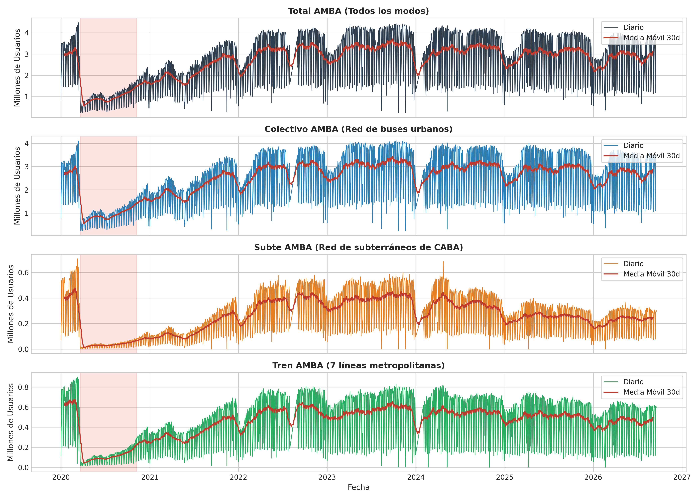

*Figura 1. Usuarios diarios del total AMBA y de cada modo (línea fina) con su media móvil de 30 días (roja). La zona rosa es el aislamiento estricto de 2020. Las rectas que unen algunos tramos (por ejemplo, en agosto de 2022 y enero de 2024) son los días faltantes de la fuente, que en este gráfico aparecen sin dato.*

**Cómo se lee.** El eje horizontal es la fecha y el vertical, los millones de usuarios distintos por día. La línea fina es el dato diario (por eso parece un "peine": cada diente es una semana, con los días hábiles arriba y el fin de semana abajo) y la roja es el promedio de 30 días, que muestra el nivel sin el ciclo semanal. Se ve la caída de 2020, la recuperación gradual hasta 2022 y, desde entonces, un nivel estable con un valle cada enero (y uno más chico a mitad de año). Los tres modos tienen la misma forma; el colectivo es por lejos el más grande y el subte el que más cayó respecto de su nivel de 2023 desde 2024 (en parte por el cambio de medio de pago, ver 3.2).

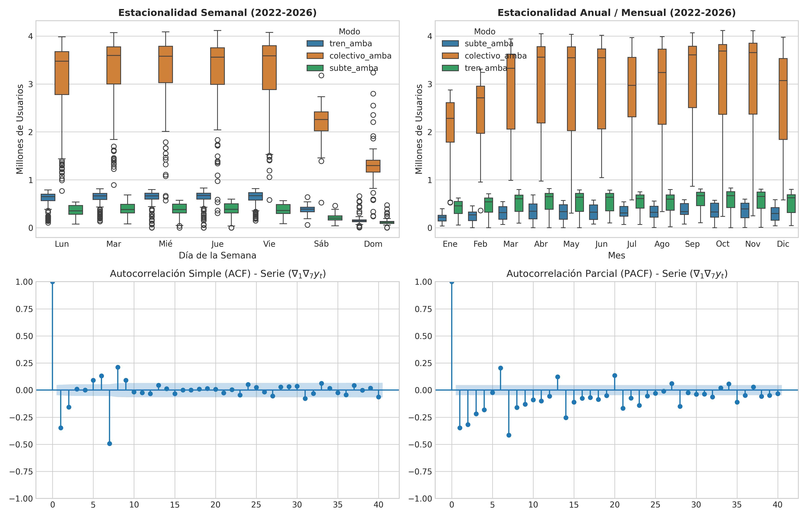

*Figura 2. Arriba, distribución de los usuarios por día de la semana (izquierda) y por mes del año (derecha) para cada modo, 2022–2026; la caja va del cuartil 25 al 75 y la línea interior es la mediana. Abajo, ACF y PACF de la serie con diferencia simple y estacional (se explican en 7.2).*

**Qué muestra.** En el total AMBA, la mediana de un día hábil es de unos 3,7 a 3,9 millones de usuarios, la de un sábado 2,4 y la de un domingo 1,4: el fin de semana es un tercio a la mitad de un día hábil. Por mes, el promedio va de 2,4 millones en enero a 3,3 o 3,4 en septiembre y octubre; julio (3,0) y diciembre (2,9) muestran las vacaciones de invierno y de verano.

### 4.2 Estacionariedad y diferenciación (ADF, KPSS)

*Base teórica: Clase Forecasting, secciones "Estacionaridad de una ST", "Pruebas de estacionaridad: Augmented Dickey-Fuller test" y "KPSS Test", y "Forecasting ARIMA".*

#### Qué es la estacionariedad y por qué importa

Una serie es **estacionaria** (en el sentido débil, el que se usa en la práctica) si su **promedio**, su **dispersión** y la **relación entre un día y los anteriores** (autocovarianza) no cambian con el tiempo. Una serie con tendencia (sube o baja de manera sostenida) o con saltos de nivel no es estacionaria: su promedio depende de cuándo se lo calcule. La Clase Forecasting plantea que "la condición fundamental" para pronosticar es que el pasado sea estacionario, o que se lo transforme hasta que lo sea, porque los modelos ARMA/ARIMA aprenden regularidades que deben mantenerse en el tiempo.

#### Qué es diferenciar y entre qué y qué se resta

**Diferenciar es restar a cada valor de la serie otro valor anterior de la misma serie.** Hay dos formas, que se distinguen por el rezago:

- **Diferencia simple (rezago 1):** $y_t - y_{t-1}$, el valor de un día menos el del día anterior. Mide cuánto cambió de un día al siguiente. Si la serie tiene una tendencia suave, la diferencia simple la elimina, porque el cambio diario de una tendencia es aproximadamente constante.
- **Diferencia estacional (rezago 7):** $y_t - y_{t-7}$, el valor de un día menos el del mismo día de la semana anterior. Mide cuánto cambió respecto de la semana pasada. Elimina el ciclo semanal, porque un lunes y el lunes anterior comparten el mismo "efecto lunes".

**Ejemplo con datos reales (total AMBA, usuarios en millones):** el domingo 6 de septiembre de 2026 hubo 1,182; el lunes 7, 3,641; el domingo 13, 1,208; el lunes 14, 3,722.

| Cálculo | Cuenta | Resultado | Qué dice |
|---|---|---|---|
| Diferencia simple del lunes 14 | 3,722 − 1,208 (domingo 13) | +2,514 | Casi todo es el salto de domingo a lunes: el ciclo semanal. |
| Diferencia estacional del lunes 14 | 3,722 − 3,641 (lunes 7) | +0,081 | Ese lunes fue prácticamente igual al lunes anterior: se quitó el ciclo semanal. |
| Diferencia estacional + simple del lunes 14 | (3,722 − 3,641) − (1,208 − 1,182) = 0,081 − 0,026 | +0,055 | Cómo cambió la diferencia semanal de un día al siguiente. |

**Para qué se diferencia.** Para que la serie transformada sea estacionaria y el modelo pueda aprender de ella. La notación del modelo SARIMAX, $(p, d, q)(P, D, Q)_s$, indica cuántas diferencias aplica: **$d$** es la cantidad de diferencias simples, **$D$** la cantidad de diferencias estacionales y **$s$** el largo del ciclo (7 días acá).

**En síntesis.** Diferenciar es restar a cada valor otro valor anterior de la misma serie. Con datos reales:

| Cálculo | Resultado | Qué dice |
|---|---|---|
| Lunes 14-sep-2026 menos el domingo 13 (diferencia simple) | +2,514 | Casi todo es el salto de domingo a lunes: el ciclo semanal. |
| Lunes 14 menos el lunes 7 (diferencia estacional) | +0,081 | Ese lunes fue casi igual al anterior: se quitó el ciclo semanal. |

Cada una de las tres versiones de la serie responde una pregunta: si hace falta diferenciar (nivel), si alcanza con restar el mismo día de la semana anterior (diferencia estacional), o si hace falta además restar el día anterior (diferencia estacional más simple). Se busca la menor diferenciación porque diferenciar de más agrega autocorrelación negativa artificial.

#### Las dos pruebas

Ninguna prueba dice "esta serie es estacionaria" de forma directa. Se usan **dos con hipótesis nulas opuestas**, y se concluye solo cuando coinciden (tabla de decisión de la Clase Forecasting):

- **ADF** (Dickey-Fuller aumentada). Hipótesis nula: la serie tiene una **raíz unitaria**, es decir, sus movimientos se acumulan sin volver a un nivel de referencia (una "caminata aleatoria"), lo que la hace no estacionaria. Un **p-valor menor a 0,05 rechaza** la nula: hay evidencia de estacionariedad.
- **KPSS** (Kwiatkowski, Phillips, Schmidt y Shin). Hipótesis nula: la serie es **estacionaria** alrededor de un nivel constante. Un **p-valor menor a 0,05 rechaza** la nula: hay evidencia de *no* estacionariedad. (statsmodels acota este p-valor entre 0,01 y 0,10, por eso solo aparecen esos extremos.)

| p ADF | p KPSS | Decisión |
|---|---|---|
| < 0,05 | ≥ 0,05 | **Estacionaria** |
| ≥ 0,05 | < 0,05 | **No estacionaria** |
| < 0,05 | < 0,05 | Indefinida |
| ≥ 0,05 | ≥ 0,05 | Indefinida |

*(El p-valor es la probabilidad de observar datos tan extremos como los que hay si la hipótesis nula fuera cierta; si es muy chico, la nula resulta poco creíble.)*

#### Qué se evalúa: tres versiones de la serie y tres tramos

Las pruebas se aplican a **tres versiones** de la serie. Cada una corresponde a una **decisión de diferenciación** posible del modelo y responde una pregunta:

| Versión | Fórmula | Pregunta que responde | Si es estacionaria, significa que… |
|---|---|---|---|
| **Nivel** | $y_t$ | ¿Hace falta diferenciar? | No hace falta diferenciar ($d = 0$, $D = 0$ serían posibles). |
| **Diferencia estacional** | $y_t - y_{t-7}$ | ¿Alcanza con restar el mismo día de la semana anterior? | Alcanza con $D = 1$ y $d = 0$. |
| **Diferencia estacional + simple** | $(y_t - y_{t-7}) - (y_{t-1} - y_{t-8})$ | ¿Hace falta además restar el día anterior? | Hace falta $d = 1$ y $D = 1$. |

Se prueban en **tres tramos**: la serie completa desde 2020 (incluye la pandemia), el período **2022–2026** (sin pandemia, el que usan los modelos) y el **entrenamiento inicial** (enero de 2022 a junio de 2023), el único con el que se identifica el orden del SARIMAX sin mirar el período de prueba. Resultados:

| Tramo (días) | Versión | p ADF | p KPSS | Decisión |
|---|---|---|---|---|
| 2020–2026, con pandemia (2.465) | Nivel | 0,245 | 0,01 | **No estacionaria** |
| | Dif. estacional | 0,000 | 0,10 | Estacionaria |
| | Dif. estacional + simple | 0,000 | 0,10 | Estacionaria |
| 2022–2026 (1.734) | Nivel | 0,0001 | 0,10 | **Estacionaria** |
| | Dif. estacional | 0,000 | 0,10 | Estacionaria |
| | Dif. estacional + simple | 0,000 | 0,10 | Estacionaria |
| 2022 a junio 2023 (546) | Nivel | 0,009 | 0,016 | Indefinida |
| | Dif. estacional | 0,000 | 0,10 | Estacionaria |
| | Dif. estacional + simple | 0,000 | 0,10 | Estacionaria |

#### Evidencia gráfica: qué le hace cada diferencia a la serie

Las figuras siguientes muestran las tres versiones con las que se trabaja y su autocorrelación.

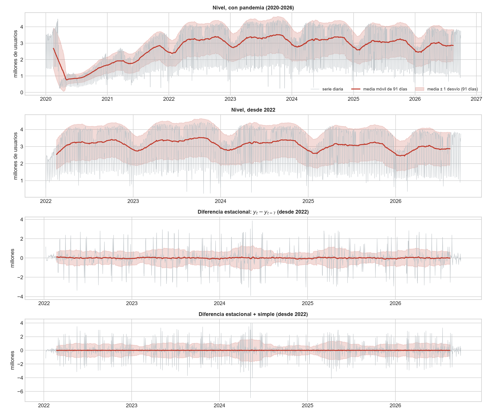

*Figura 3. Total AMBA: nivel con pandemia, nivel desde 2022, diferencia estacional y diferencia estacional + simple. La línea roja es la media de una ventana móvil de 91 días y la banda, esa media ± 1 desvío.*

**Cómo se lee.** Una serie estacionaria debería tener la media (roja) y el ancho de la banda (el desvío) aproximadamente constantes. En el **nivel con pandemia** la media cae de 2,7 a menos de 1 millón y vuelve a subir en dos años: no es estacionaria. En el **nivel desde 2022** la media oscila (valles de enero) pero vuelve siempre al mismo rango, y por eso las pruebas la consideran estacionaria. Las dos **diferencias** tienen la media pegada a 0 y la banda de ancho casi constante; la banda se ensancha en pocos momentos (por ejemplo, durante 2024, un año con el cierre de la línea D, saltos tarifarios y paros).

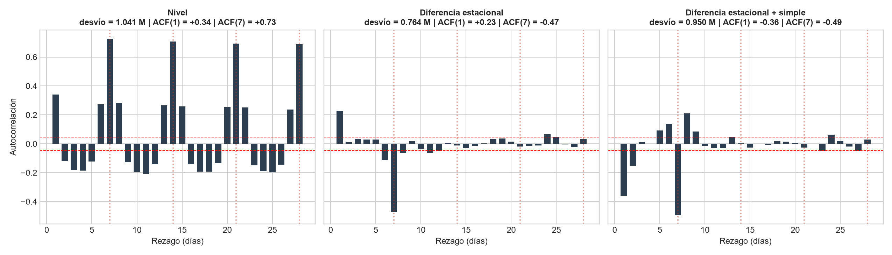

*Figura 4. ACF (autocorrelación) del nivel, de la diferencia estacional y de la diferencia estacional + simple, desde 2022, hasta 28 rezagos. Las líneas rojas punteadas son la banda de ±1,96/√n; las verticales marcan los múltiplos de 7.*

| version | dias | desvio_M | ACF_rezago_1 | ACF_rezago_7 | ACF_rezago_14 |
|---|---|---|---|---|---|
| Nivel | 1.734 | 1,041 | 0,341 | 0,726 | 0,706 |
| Diferencia estacional | 1.727 | 0,764 | 0,227 | -0,470 | -0,011 |
| Diferencia estacional + simple | 1.726 | 0,950 | -0,360 | -0,493 | 0,002 |

*(`desvio_M` es el desvío estándar de la serie en millones; `ACF_rezago_k` es la correlación de la serie con ella misma k días antes.)*

**Qué se observa.**

- **Nivel:** autocorrelación alta y positiva en todos los múltiplos de 7 (0,73 en el rezago 7 y 0,71 en el 14): el ciclo semanal se repite y la serie "recuerda" la semana anterior.
- **Diferencia estacional:** el desvío baja de 1,04 a 0,76 millones y la autocorrelación del rezago 14 cae a −0,01: se eliminó el ciclo. Queda un valor de −0,47 en el rezago 7, que es el rastro típico de restar la semana anterior y que el modelo absorbe con el término de media móvil estacional (7.2).
- **Diferencia estacional + simple:** el desvío **sube** a 0,95 y la autocorrelación del rezago 1 pasa de +0,23 a **−0,36**. Es la **sobrediferenciación**: restar una segunda vez no aportó información, aumentó la dispersión y creó una autocorrelación negativa que no existía en los datos. Es la evidencia directa de por qué se elige la mínima diferenciación.

#### Qué se concluye y por qué se busca "la menor diferenciación"

- **Con pandemia, el nivel no es estacionario**: la caída y la recuperación de 2020–2021 cambian el promedio. Por eso esos años no se usan para modelar.
- **Desde 2022, el nivel sí es estacionario** (las dos pruebas coinciden). En el tramo corto de entrenamiento la decisión es indefinida, algo esperable con solo 546 observaciones.
- **En los tres tramos, la diferencia estacional ya deja la serie estacionaria**, y agregar la diferencia simple da el mismo veredicto. Por eso se elige **$d = 0$ y $D = 1$ con período 7**: la mínima diferenciación que alcanza.
- **Por qué la mínima.** Diferenciar de más (*sobrediferenciación*) no es gratis: cada diferencia agrega una autocorrelación negativa artificial (un valor alto queda seguido de uno bajo solo por la resta) y aumenta la variabilidad de la serie transformada, de modo que el modelo pierde precisión. Se miran las tres versiones precisamente para ver en qué paso la serie pasa a ser estacionaria y comprobar que el paso siguiente ya no aporta.
- **Limitación.** Un nivel "estacionario" en 2022–2026 no descarta cambios de nivel puntuales (como la caída del subte de 2024); las pruebas no están diseñadas para detectarlos.

> **Por qué las pruebas no ven el ciclo semanal.** ADF y KPSS detectan tendencias y raíces unitarias, no ciclos estables. Un ciclo semanal fijo es predecible y no es una raíz unitaria, pero un modelo ARIMA igualmente necesita tratarlo, y por eso se incluye $D = 1$.

### 4.3 Descomposición STL

*Base teórica: Clase Forecasting, "Forecasting STL (Seasonal and Trend decomposition using Loess)"; Cleveland et al. (1990).*

**Qué es.** Separa la serie en tres partes que suman la serie original: **tendencia** (movimiento lento), **componente estacional** (el patrón que se repite cada 7 días) y **residuo** (lo que no explican las otras dos). *Loess* es una regresión local suavizada que estima tendencia y patrón mirando solo los datos cercanos; por eso el patrón semanal puede cambiar de a poco en el tiempo. La versión **robusta** reduce el peso de los valores extremos al estimar tendencia y patrón, de modo que los feriados o paros no los "contaminan".

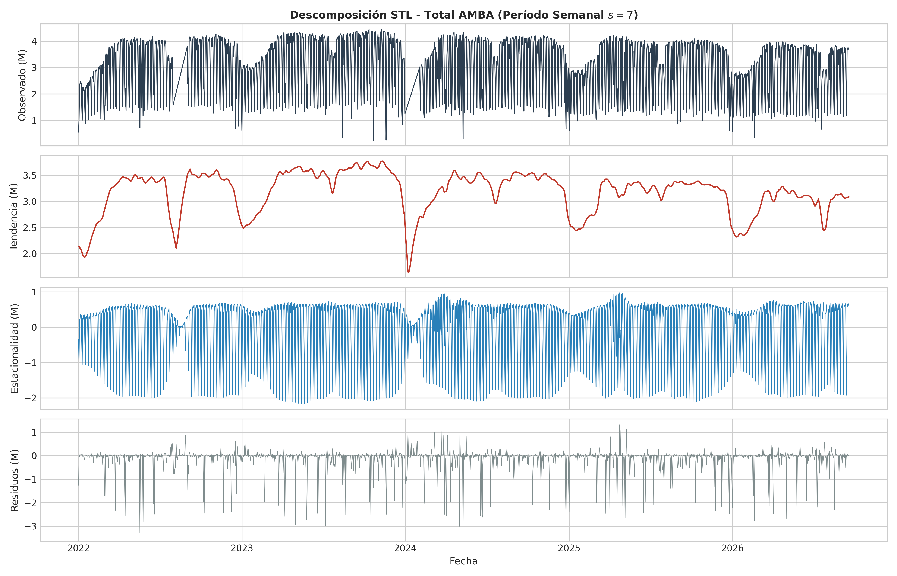

*Figura 5. Descomposición STL robusta (período 7) del total AMBA, 2022–2026: serie observada, tendencia, componente semanal y residuo.*

**Cómo se lee.** Cuatro paneles, de arriba abajo: la serie, la tendencia (valles de enero y de mitad de año, con una caída general en 2025), el patrón semanal (se repite cada 7 días y su amplitud cambia de a poco: es el efecto del Loess) y el residuo. **Lo informativo es el residuo**: casi siempre es cercano a 0 y tiene caídas bruscas hacia abajo, que concentran los **feriados, paros y elecciones**, los días en que un modelo basado en el patrón habitual se equivoca. Por eso P-1 estudia esos días y P-2 evalúa cómo los pronostican los modelos.

#### ¿El residuo detecta efectivamente los hitos?

**Qué se hizo.** Para comprobar la afirmación anterior se expresó el residuo como porcentaje del valor esperado (tendencia + patrón semanal) y se marcaron como atípicos los días con un residuo mayor a ±20% (es un umbral práctico, del orden de la banda de días ordinarios de P-1; usar 3 desvíos robustos marcaba como atípico el 18% de los días ordinarios, porque el residuo típico es muy chico y de cola pesada). Se clasificó cada día según el calendario de feriados (paquete `holidays` de Python), la lista de paros y elecciones de P-1 y, aparte, Nochebuena y fin de año. Es la misma lógica que el cociente de P-1 (6.6), medida con otro método.

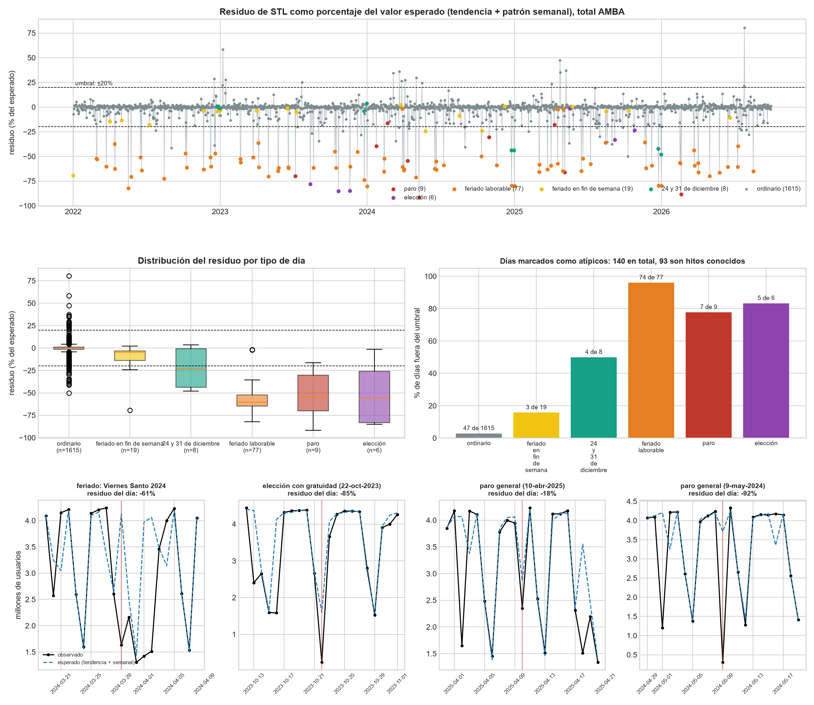

*Figura 6. Arriba, el residuo diario de STL en porcentaje del valor esperado, con cada día coloreado según su tipo y el umbral de ±20%. En el medio, a la izquierda, la distribución del residuo por tipo de día; a la derecha, el porcentaje de días de cada tipo que supera el umbral. Abajo, cuatro hitos en detalle: el valor observado, el esperado por STL y el día del hito.*

| tipo_de_dia | dias | mediana_residuo_pct | dias_fuera_de_umbral | pct_fuera_de_umbral |
|---|---|---|---|---|
| ordinario | 1.615 | -0,1 | 47 | 2,9 |
| feriado en fin de semana | 19 | -4,5 | 3 | 15,8 |
| 24 y 31 de diciembre | 8 | -23,2 | 4 | 50,0 |
| feriado laborable | 77 | -60,5 | 74 | 96,1 |
| paro | 9 | -54,4 | 7 | 77,8 |
| elección | 6 | -55,7 | 5 | 83,3 |

*(`mediana_residuo_pct` es la mediana del residuo en % del esperado; `dias_fuera_de_umbral` cuenta los días con |residuo| > 20%.)*

**Qué se observa.**

- **Los hitos se detectan.** Superan el umbral **74 de 77 feriados laborables (96%), 7 de 9 paros y 5 de 6 elecciones**; la mediana del residuo en esos días es de −54% a −61%, contra −0,1% en los días ordinarios. En los cuatro recuadros de detalle el valor observado se separa claramente del esperado el día del hito (residuos de −61% el Viernes Santo de 2024, −85% en la elección con gratuidad de octubre de 2023 y −92% en el paro general de mayo de 2024).
- **Los que no se detectan tienen explicación.** Los dos paros que quedan dentro del umbral (el de trenes del 21 de febrero de 2024, −16%, y el general del 10 de abril de 2025, −18%) son paros en los que **el colectivo no paró** o adhirió poco, y el colectivo es la gran mayoría de los usuarios del total; la caída aparece en tren y subte (6.6), no en el total. La elección de mayo de 2025 (−1,6%) es una de las que no tuvo gratuidad. Los tres feriados laborables que no se detectan (28-mar-2024, 17-abr-2025 y 2-may-2025) son, hasta donde se pudo ver, días no laborables optativos (como el Jueves Santo) que figuran como feriado en el paquete de calendario pero en los que la demanda no cayó; no se verificó contra el calendario oficial.
- **También detecta eventos que no estaban en la lista.** El umbral marca 140 días y 93 son hitos conocidos (66%). Los otros 47 son el 2,9% de los días ordinarios; muchos son viernes o lunes cercanos a feriados (por ejemplo el viernes 10-oct-2025 y el viernes 2-sep-2022), compatibles con fines de semana largos o feriados trasladados, y hay también caídas en fines de semana puntuales. No se verificó cada fecha; la lista está en `tabla_stl_residuo_dias_sin_hito.csv`.
- **Nochebuena y fin de año** (24 y 31 de diciembre) superan el umbral en 4 de 8 casos: el efecto depende de si caen en día hábil.
- Los **feriados que caen en fin de semana** casi no se distinguen (3 de 19): igual que en P-1, un feriado en sábado o domingo casi no cambia la demanda.

**Qué se concluye.** El residuo de STL es una herramienta adecuada para **detectar días atípicos**: recupera la gran mayoría de los feriados, paros y elecciones, y señala otros días que merecerían revisarse. Su límite es que el total AMBA está dominado por el colectivo: un evento que afecta solo a tren y subte se ve poco en el total (por eso P-1 trabaja por modo).

### 4.4 Análisis espectral (FFT) y teorema de Parseval

*Base teórica: Clase Frecuencia y Frecuencia R/Python ("Series temporales en los dominios del tiempo y la frecuencia", "FFT de senoidales", "FFT de pulsos", "FFT de pulsos con eje de frecuencias calibrado", "Teorema de Parseval"); Clase Señales (teorema del muestreo).*

#### Qué es y qué pregunta responde

La serie se puede ver de dos maneras equivalentes. En el **dominio del tiempo** es una secuencia de valores día a día, que es como se la grafica normalmente. En el **dominio de la frecuencia** se la expresa como una **suma de ondas** (senos y cosenos) de distinta frecuencia, cada una con su amplitud. La **transformada de Fourier** pasa de un dominio al otro; la **FFT** (*Fast Fourier Transform*) es su algoritmo rápido. La pregunta que responde es: **¿qué ciclos hay en la serie y cuánto pesa cada uno?** Es la única herramienta de la sección que lo cuantifica.

#### Cómo se calculó

- Se usó el total AMBA de enero de 2022 a octubre de 2026, recortado a **251 semanas exactas (N = 1.757 días)**. El recorte importa porque la FFT supone que la serie se repite indefinidamente: con semanas completas, el ciclo de 7 días encaja exacto en una de las frecuencias que calcula la FFT y su energía no se desparrama sobre las vecinas (fenómeno de *leakage*, o fuga espectral).
- Se le **restó el promedio** de la serie (3,06 millones de usuarios). Ese promedio es la frecuencia 0, llamada componente continua o **DC**, y es tan grande que, si se dejara, taparía el resto del gráfico. Al restarlo, lo que se analiza es la **variación alrededor del promedio**.

#### Cómo se lee el eje horizontal (frecuencia)

El eje horizontal del gráfico es la **frecuencia en ciclos por día**. Un valor de 0,1429 significa 0,1429 ciclos completos por día, es decir, **un ciclo cada 7 días** (1/7). El **período** es su inversa:

| Frecuencia (ciclos/día) | Período | Qué ciclo es |
|---|---|---|
| 0,00057 (= 1/1.757) | 1.757 días | Variación lenta a lo largo de todo el período (cambios de nivel). |
| 0,00285 | ≈ 351 días | Ciclo **anual**. |
| 0,00569 | ≈ 176 días | Ciclo **semestral** (verano e invierno). |
| 0,1429 (= 1/7) | 7 días | Ciclo **semanal**. |
| 0,2857 (= 2/7) | 3,5 días | Segundo armónico del semanal. |
| 0,4286 (= 3/7) | 2,33 días | Tercer armónico del semanal. |

Por qué el eje termina en **0,5**: con un dato por día no se puede distinguir un ciclo más rápido que uno cada 2 días (0,5 ciclos/día). Es el **teorema del muestreo** de la Clase Señales: la frecuencia de muestreo debe ser al menos el doble de la frecuencia máxima que se quiere captar. Entonces, **"1" en el eje no sería "toda la serie" ni "un año"**: significaría un ciclo por día, que ni siquiera se puede observar con datos diarios. Las frecuencias bajas (cerca de 0) son los ciclos lentos y las altas (cerca de 0,5) los rápidos.

#### Cómo se lee el eje vertical (amplitud)

La **amplitud** es la altura de la onda, en millones de usuarios. Una amplitud de 0,944 en 1/7 significa que la onda semanal sube y baja 0,944 millones alrededor del promedio (de punta a punta, unos 1,9 millones).

#### Por qué la tabla tiene 8 filas y el gráfico muestra 3 picos

La tabla `tabla_fft_picos_total` lista los **8 picos más altos** del espectro, numerados de 1 a 8 en la columna `fila`; el gráfico muestra con claridad solo los **3 más altos**. En la Figura 7 cada fila está marcada con una línea punteada y un círculo con su número, y se agregaron dos ampliaciones (A y B) para ver los picos que quedan pegados al borde o a otro pico.

| Fila | Frecuencia (ciclos/día) | Período (días) | Amplitud (M) | Dónde se ve en la figura | Qué es |
|---|---|---|---|---|---|
| 1 | 0,14286 (= 1/7) | 7,00 | 0,944 | Panel superior y ampliación B | Ciclo **semanal** |
| 2 | 0,28571 (= 2/7) | 3,50 | 0,610 | Panel superior | Segundo armónico del semanal |
| 3 | 0,42857 (= 3/7) | 2,33 | 0,303 | Panel superior | Tercer armónico del semanal |
| 4 | 0,00285 | 351,4 | 0,241 | Ampliación A | Ciclo **anual** |
| 5 | 0,00569 | 175,7 | 0,217 | Ampliación A | Ciclo **semestral** (verano e invierno) |
| 6 | 0,00057 (= 1/1.757) | 1.757 | 0,193 | Ampliación A | Variación lenta a lo largo de todo el período (cambios de nivel) |
| 7 | 0,14001 | 7,14 | 0,100 | Ampliación B (pegado a la fila 1) | Probablemente la intensidad del ciclo semanal cambia con el tiempo; interpretación no probada |
| 8 | 0,01081 | 92,5 | 0,086 | Ampliación A | Ciclo de unos tres meses; no se investigó su origen |

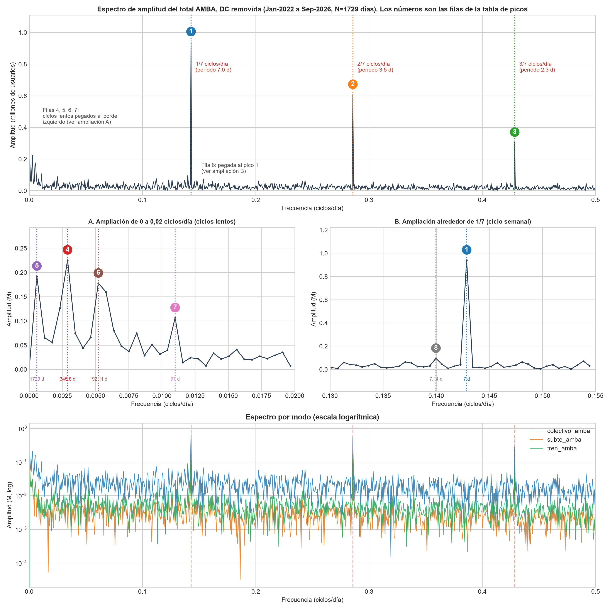

*Figura 7. Arriba, espectro del total AMBA con las filas 1 a 3 marcadas. En el medio, ampliación A (0 a 0,02 ciclos/día: filas 4, 5, 6 y 8) y ampliación B (alrededor de 1/7: filas 1 y 7). Abajo, espectro por modo en escala logarítmica.*

Los **tres picos visibles** del panel superior son las filas 1, 2 y 3. Las otras cinco filas son más bajas: las filas 4, 5, 6 y 8 están pegadas al borde izquierdo (frecuencias entre 0,0006 y 0,011) y la fila 7 está tapada por el pico de la fila 1.

**Armónicos.** Las frecuencias 2/7 y 3/7 son múltiplos de la semanal y se llaman **armónicos**. Aparecen porque el patrón semanal no es una onda suave (cinco días altos, dos bajos y cambios bruscos): una sola onda no reproduce esas esquinas, y hay que sumar ondas de frecuencia doble y triple, igual que una onda cuadrada se arma con armónicos (Clase Frecuencia, "FFT de pulsos").

#### Cuánto pesa cada ciclo: el reparto de la variación

La amplitud muestra qué ondas existen, pero **no dice qué parte de la variación de la serie explica cada una**. Para eso se usa la **energía**: el cuadrado de la amplitud de cada frecuencia. Como la serie ya no tiene promedio, la energía total es la **variación total** de la serie alrededor de su promedio (su suma de cuadrados), y la energía de cada frecuencia, el **porcentaje de esa variación que explica ese ciclo**:

| Componente | % de la variación de la serie |
|---|---|
| Ciclo de 7 días (frecuencia 1/7) | 41,3% |
| Ciclo de 3,5 días (frecuencia 2/7) | 17,2% |
| Ciclo de 2,33 días (frecuencia 3/7) | 4,3% |
| **Las tres frecuencias semanales juntas** (1/7 + 2/7 + 3/7) | **62,8%** |
| Ciclos de más de 60 días (tendencia y ciclo anual) | 9,9% |
| Resto (feriados, paros, elecciones y ruido) | 27,3% |

**Cómo se interpreta.** **Casi dos tercios (62,8%) de toda la variación de la serie corresponde al ciclo semanal**; la frase "las tres frecuencias semanales" se refiere a esas tres filas de la tabla (1/7, 2/7 y 3/7: el ciclo de 7 días y sus dos armónicos), que son los tres picos rojos del gráfico. Los ciclos lentos (tendencia y estacionalidad anual) explican solo el 9,9%. El 27,3% restante no tiene una frecuencia propia porque corresponde a eventos puntuales (feriados, paros, elecciones), cuya energía se reparte por todo el espectro, y a ruido.

**Qué se usó después.** Los modelos de P-2 incluyen el día de la semana, términos anuales de Fourier y feriados, y con el término anual el error del SARIMAX baja 15% (de 0,318 a 0,270, apartado 7.4). La decisión $D = 1$ con período 7 (4.2) se apoya en que el ciclo semanal explica casi dos tercios de la variación.

#### Teorema de Parseval: qué dice y qué aporta

**Qué dice** (Clase Frecuencia): la **energía de una serie se conserva** al pasar del dominio del tiempo al de la frecuencia, si no se procesa la señal. En fórmula, $\sum_n x(n)^2 = \frac{1}{N}\sum_k |X(k)|^2$: la suma de los cuadrados de los valores diarios es igual a la suma de los cuadrados de los coeficientes de la FFT, dividida por N. En esta serie, ambos lados dan **18.385,3**.

**Qué aporta, con honestidad.** Hay dos usos y conviene no confundirlos:

1. **Como verificación**: comprobar que ambos lados coinciden es un control de que el código y la escala de la FFT están bien hechos. **No es un resultado sobre el transporte.**
2. **Como fundamento del reparto de energía**: como la energía se conserva, las energías por frecuencia **suman exactamente el total**, y por eso tiene sentido expresar cada ciclo como "porcentaje de la variación". Sin Parseval, los porcentajes de la tabla anterior no tendrían interpretación.

**En síntesis.**

- **Filas y picos:** la tabla tiene 8 filas. El gráfico muestra 3 picos con claridad porque los otros 5 son más bajos: cuatro están pegados al borde izquierdo y uno queda tapado por el pico semanal.
- **Eje x:** son ciclos por día. 0,1429 es un ciclo cada 7 días. El eje termina en 0,5 porque con un dato por día no se ve nada más rápido.
- **Las "tres frecuencias semanales":** son las tres primeras filas de la tabla (1/7, 2/7 y 3/7) y los tres picos de la Figura 7 marcados con 1, 2 y 3. Juntas explican el 62,8% de la variación (41,3% + 17,2% + 4,3%).
- **Parseval:** verificarlo es un control del código. Su aporte real es garantizar que las energías por frecuencia sumen el total, que es lo que permite hablar de porcentajes. No es un resultado sobre el transporte.

### 4.5 Medias móviles y filtros frente a STL

*Base teórica: Filtrado MA (filtro de media móvil y bordes) y Filtrado en frecuencia (filtros sobre el espectro).*

**Qué es una media móvil.** Para cada día, es el promedio de ese día con sus vecinos. La **MA7** promedia 7 días consecutivos y la **MA28**, 28 días. **Por qué una media móvil de 7 (o de 28) días elimina el ciclo semanal:** cualquier ventana de 7 días consecutivos contiene exactamente un lunes, un martes, etc., de modo que su promedio es el mismo sin importar en qué día de la semana empiece. Por eso la MA28 (cuatro semanas exactas) estima la **tendencia** sin el ciclo semanal. Restar la MA7 a la serie deja, al revés, la parte rápida (el ciclo semanal y los feriados). La media puede ser **centrada** (usa días de ambos lados; es la que se muestra, pero no se puede calcular en los extremos) o **causal** (solo usa el pasado; sirve en tiempo real pero llega tarde).

**Qué es un filtro en el dominio de la frecuencia.** En lugar de promediar vecinos, se calcula la FFT (4.4), se **anulan o conservan frecuencias** a elección y se vuelve al tiempo. El filtro **elimina-banda** (*notch*) anula 1/7, 2/7 y 3/7. El filtro **pasa-bajos ideal** conserva solo las frecuencias lentas (por debajo de un corte, acá 1/28).

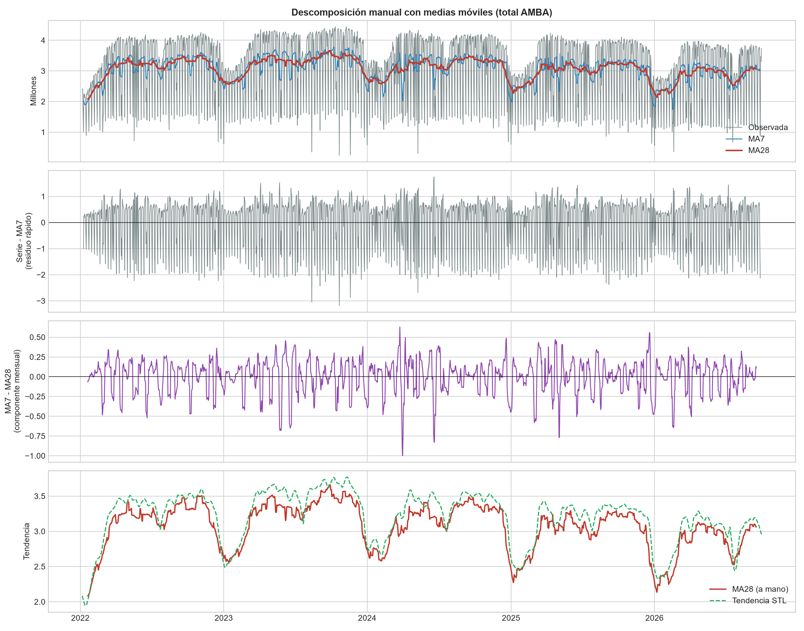

*Figura 8. Descomposición manual del total AMBA. Primer panel: serie observada, MA7 y MA28. Segundo: serie − MA7 (parte rápida). Tercero: MA7 − MA28 (componente mensual). Cuarto: MA28 contra la tendencia de STL.*

**Cómo se lee.** En el primer panel, la MA7 (azul) ya no tiene el "peine" semanal y la MA28 (roja) es más suave. El segundo panel es lo que sobra al restar la MA7: oscila alrededor de 0 por el ciclo semanal y tiene valles profundos en los feriados. En el cuarto, la MA28 y la tendencia de STL casi se superponen, con diferencias donde hay feriados o paros.

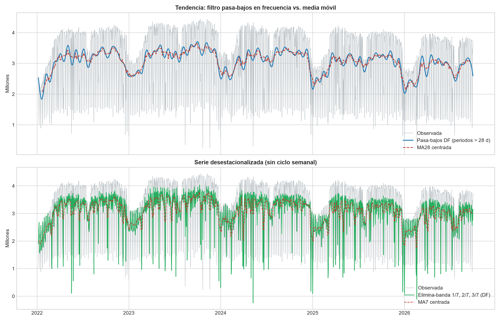

*Figura 9. Arriba, tendencia con el filtro pasa-bajos en frecuencia (azul) y con la MA28 centrada (roja). Abajo, serie desestacionalizada con el elimina-banda en frecuencia (verde) y con la MA7 centrada (roja).*

**Cómo se lee.** Arriba, las dos tendencias son parecidas; la del filtro de frecuencias ondula más cerca de los cambios bruscos. Abajo, ambas desestacionalizadas son más estables que la serie original, pero la del filtro conserva los feriados como valles angostos mientras que la MA7 los reparte en una ventana de 7 días.

#### Detalle: dónde difieren los métodos

La Figura 10 muestra seis situaciones concretas.

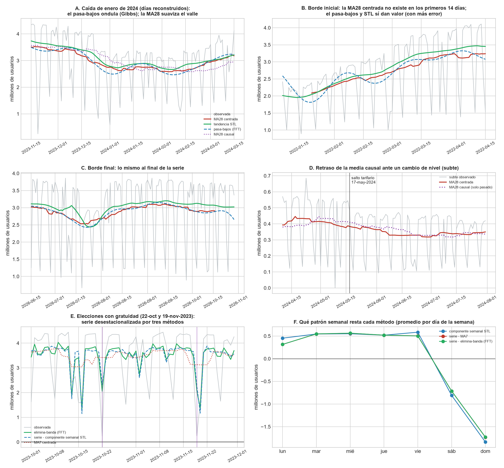

*Figura 10. A. Caída de enero de 2024 con los cuatro estimadores de tendencia. B y C. Bordes inicial y final de la serie. D. Retraso de la media causal ante el salto tarifario del subte (17-may-2024). E. Serie desestacionalizada alrededor de las elecciones con gratuidad de 2023 por tres métodos. F. Patrón semanal promedio que resta cada método (las curvas de "serie − MA7" y "serie − elimina-banda" casi coinciden).*

- **A. Cambios bruscos.** Ante la caída de enero, la MA28 y STL bajan de forma gradual; el pasa-bajos ondula (fenómeno de Gibbs: un filtro que corta frecuencias de golpe produce rizado alrededor de los saltos); la MA28 causal reacciona más tarde.
- **B y C. Bordes.** La MA28 centrada **no tiene valor en los primeros ni los últimos 14 días** (pierde 27 en total); STL y el pasa-bajos sí, pero con más error: el RMSE del pasa-bajos contra STL pasa de 0,20 M en el interior a 0,25 M en los bordes.
- **D. Retraso.** Después del salto de mayo de 2024 la MA28 centrada refleja el nuevo nivel de inmediato (porque mira hacia adelante), mientras que la causal tarda unas dos semanas (retraso teórico de (28 − 1)/2 ≈ 13,5 días).
- **E. Desestacionalizar en días de colapso.** En las elecciones con gratuidad, la serie sin componente semanal de STL y la del elimina-banda dejan el día de la elección con valores bajos (en promedio 2,3 y 2,1 M, contra 3,3 M de la MA7, que reparte el valle en 7 días y contamina la semana entera).
- **F. Qué patrón se resta.** Los tres métodos restan un patrón parecido (más alto de lunes a viernes, muy negativo en sábado y domingo); STL difiere en que el patrón puede evolucionar y los otros dos restan uno fijo.

### 4.6 Comparación de métodos de descomposición

**Para qué.** Hasta acá se aplicaron cinco herramientas que separan una serie en partes: STL, medias móviles (centrada y causal), filtro pasa-bajos y filtro elimina-banda en frecuencia. Esta sección las compara de manera cuantitativa y resume cuál conviene según la tarea. Aporta, además de la teoría de las clases (STL en la Clase Forecasting, media móvil en Filtrado MA, filtros en Filtrado en frecuencia), una **medida concreta** de en qué se parecen y en qué difieren.

**Tendencia: qué tan lejos queda cada método de STL.** STL se toma como referencia porque es el único que separa tendencia, patrón semanal y residuo a la vez y es robusto a valores extremos; no es "la verdad", es un punto de comparación. `RMSE_vs_STL_interior_M` y `RMSE_vs_STL_bordes_M` son la raíz del error cuadrático medio (en millones de usuarios) de cada tendencia contra la de STL, en el interior de la serie y en los 14 días de cada extremo; `correlacion_con_STL` es su correlación lineal.

| metodo | dias_con_valor | dias_sin_valor | RMSE_vs_STL_interior_M | RMSE_vs_STL_bordes_M | correlacion_con_STL |
|---|---|---|---|---|---|
| MA28 centrada | 1.730 | 27 | 0,178 | 0,161 | 0,957 |
| MA28 causal | 1.730 | 27 | 0,220 | 0,133 | 0,883 |
| Pasa-bajos ideal (FFT) | 1.757 | 0 | 0,200 | 0,253 | 0,924 |

**Serie desestacionalizada: qué pasa en los días de colapso.** Aquí se mira qué valor mínimo toma cada serie sin ciclo semanal y qué valor toma en las tres elecciones con gratuidad de 2023 (demanda cercana a cero).

| metodo | minimo_M | dias_con_valor_menor_o_igual_a_0 | valor_medio_en_elecciones_gratuitas_M |
|---|---|---|---|
| Serie - componente semanal STL | -0,080 | 1 | 2,304 |
| MA7 centrada | 1,739 | 0 | 3,318 |
| Elimina-banda (FFT) | -0,237 | 2 | 2,092 |

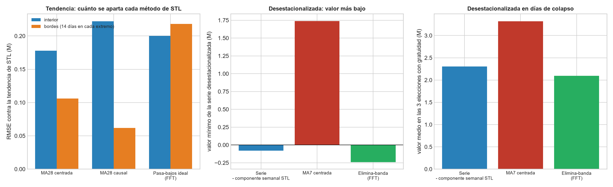

*Figura 11. Izquierda: RMSE de cada tendencia contra la de STL, en el interior y en los bordes. Centro: valor mínimo de la serie desestacionalizada. Derecha: valor medio de la serie desestacionalizada en las tres elecciones con gratuidad de 2023.*

**Qué se observa.** (1) Las tres tendencias son parecidas a la de STL (correlación entre 0,88 y 0,96; error de 0,18 a 0,22 M en el interior, de 6% a 7% del nivel medio). (2) La media causal es la que más se aparta en el interior y la centrada pierde 27 días. (3) El pasa-bajos es el único que empeora en los bordes. (4) En la desestacionalizada, el elimina-banda y STL dan valores ≤ 0 en uno o dos días (−0,24 y −0,08 M), mientras que la MA7 no baja de 1,74 M porque reparte el efecto de un día en toda la ventana.

**Resumen.**

| Método | Qué entrega | Qué hace bien | Dónde falla |
|---|---|---|---|
| **STL robusto** (período 7) | Tendencia, componente semanal y residuo. | Deja los valores extremos (feriados, paros) en el residuo en lugar de contaminar la tendencia; no pierde datos en los extremos; el patrón semanal puede cambiar de a poco. | Hay que elegir período y suavizado; es menos transparente. También puede dar valores levemente negativos al restar el patrón semanal de un día de colapso (mínimo de −0,08 M, un solo día). |
| **Media móvil centrada de 28 días (MA28)** | Tendencia. | Simple y transparente; al ser múltiplo de 7 anula el ciclo semanal; no atrasa. | Los feriados la arrastran hacia abajo (correlación 0,96 con la tendencia de STL, RMSE de 0,18 M); pierde unos 14 días en cada extremo. |
| **MA28 causal** (solo pasado) | Tendencia calculable hoy. | Sirve para monitoreo en tiempo real. | Llega unos 14 días tarde (retraso teórico $(28-1)/2 \approx 13{,}5$). |
| **Serie − MA7** | Componente rápido. | Deja los feriados como valles (media de −1,23 M contra +0,07 M en el resto). | No separa el ciclo semanal del efecto del feriado. |
| **Filtro elimina-banda (FFT)** | Serie sin ciclo semanal. | Anula exactamente 1/7, 2/7 y 3/7. | Resta un perfil semanal fijo: en días hábiles de colapso (paros, elecciones) puede dar valores ≤ 0 sin sentido físico (mínimo de −0,24 M, 2 días); supone que la serie se repite en círculo. |
| **Filtro pasa-bajos ideal (FFT)** | Tendencia. | Sigue de cerca a la MA28. | Rizado alrededor de los cambios bruscos (**fenómeno de Gibbs**) y más error en los bordes (RMSE de 0,25 M contra STL en los bordes y de 0,20 M en el interior). |

**Qué conviene según la tarea.**

| Si se quiere… | Conviene | Por qué |
|---|---|---|
| Estimar la **tendencia** | STL robusto, con la MA28 centrada como control simple | Las dos coinciden (correlación 0,96) y STL no pierde extremos |
| **Detectar días atípicos** | El residuo de STL (4.3) | Recupera 96% de los feriados laborables, 7 de 9 paros y 5 de 6 elecciones |
| Saber **qué ciclos existen y cuánto pesan** | La FFT (4.4) | Es la única que los cuantifica |
| **Monitorear en tiempo real** | La media móvil causal | Es la única calculable hoy, con unos 14 días de retraso |
| Ilustrar la **teoría de filtros** | Pasa-bajos y elimina-banda | Muestran Gibbs, bordes y supuesto de periodicidad; no se recomiendan como método de trabajo |

**Lecturas.**

1. **Los métodos coinciden en lo importante y difieren en los días raros.** Para la tendencia, MA28, STL y pasa-bajos dan resultados parecidos; las diferencias vienen de cómo tratan feriados y bordes.
2. **Por qué difieren.** (a) *Robustez a valores extremos:* STL robusto los descuenta; la media móvil y el filtro de Fourier no. (b) *Supuestos de borde:* la media centrada necesita datos a ambos lados y la FFT supone que la serie se repite en círculo. (c) *Forma del patrón semanal:* el elimina-banda lo trata como fijo y STL lo deja evolucionar.
3. **Cuál conviene según la tarea.** Para la **tendencia**, STL robusto, con la MA28 como control simple. Para **detectar días atípicos**, el residuo de STL, que es la entrada natural de P-1. Para saber **qué ciclos existen y cuánto pesan**, la FFT. Para **monitoreo en tiempo real**, la media móvil causal, con su retraso.
4. **Qué aporta cada uno que no tienen los otros.** STL: robustez y residuo interpretable. Media móvil: transparencia y la intuición de un filtro que anula un ciclo. FFT: el diagnóstico de qué frecuencias hay y cuánta variación explican.
5. **Qué conviene descartar.** El elimina-banda para desestacionalizar esta serie (supone periodicidad, resta un perfil fijo y es el que más se aleja de cero en los días de colapso) y el pasa-bajos ideal como estimador de tendencia (Gibbs y bordes). Se conservan solo como ilustración de la teoría de filtros.
6. **No hay un ganador único: depende de la tarea.** Lo que la comparación dice de la serie importa más que el ranking: el ciclo semanal domina, los feriados son el valor extremo dominante (valles de cerca de 1,2 M) y fuera de la pandemia la tendencia es estable con un valle cada enero.

### 4.7 Correlación cruzada (CCF) entre tren y colectivo

*Base teórica: Convolución y correlación ("Correlación cruzada y autocorrelación", "La ccf encuentra el desplazamiento").*

**Qué es.** La correlación entre dos series cuando una se desplaza en el tiempo. Según la clase, el resultado no es un único número sino **una serie de valores, uno por cada desplazamiento (rezago)**. Con rezago $k = 0$ se compara el tren y el colectivo del mismo día; con $k > 0$, el colectivo $k$ días *después* del tren; con $k < 0$, antes. Un valor de 1 indica que se mueven idénticos; 0, sin relación; −1, en sentido opuesto.

**Qué pregunta responde.** Si un modo anticipa a otro o si, cuando uno falla, sus usuarios pasan al otro.

**Por qué se usa sobre residuos y no sobre las series crudas.** Tren y colectivo comparten el ciclo semanal y los feriados, y sus series crudas correlacionan mucho solo por eso (correlación espuria: no dice cómo se relacionan los modos). Por eso primero se quita el efecto del día de la semana, los feriados y una tendencia lineal, y se analiza lo que queda. Una segunda versión usa las series con diferencia simple y estacional (4.2), otra forma de quitar lo común.

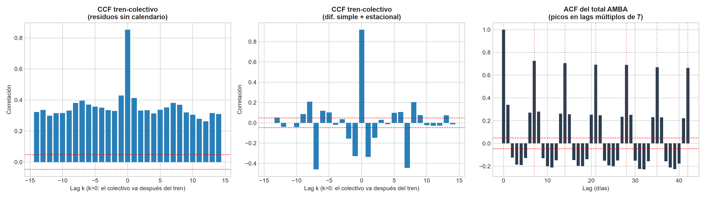

*Figura 12. Izquierda y centro: CCF entre tren y colectivo con residuos sin calendario y con diferencia simple + estacional (barras: correlación para cada rezago; rojo: banda ingenua de ±1,96/√n). Derecha: ACF del total AMBA, con picos en los múltiplos de 7.*

**Cómo se lee.** En el eje horizontal está el rezago k (días de desplazamiento) y en el vertical la correlación. La barra central (k = 0) compara el mismo día; las de k > 0, el colectivo posterior al tren.

**Qué se esperaba.**

| Si ocurriera… | Se vería… |
|---|---|
| **Sustitución** (se interrumpe el tren y esos usuarios toman el colectivo) | Correlación **negativa** en el rezago 0 o 1. |
| **Causas comunes** (actividad económica, clima, paros generales) | Correlación **positiva** en el rezago 0. |
| **Un modo anticipa al otro** | Un pico en un rezago distinto de cero y asimetría entre positivos y negativos. |

**Qué se observó.** Un pico en el rezago 0 (**0,85** con residuos y **0,92** con diferencias), positivo y simétrico (rezago −1: 0,42; rezago +1: 0,41). Queda además un "piso" de 0,3 a 0,4 en todos los rezagos, que corresponde a movimientos lentos comunes que los residuos no eliminaron (por ejemplo la estacionalidad anual) y no a un efecto con retraso. En la versión con diferencias, los valores negativos de los rezagos ±1 (−0,33) y ±7 (−0,45) son un **artefacto del operador de diferencias** (4.2, sobrediferenciación) y no una relación inversa. Las bandas rojas del gráfico (±0,047) suponen observaciones independientes y, como los residuos están autocorrelacionados, casi cualquier valor las supera; por eso la lectura se hace por la forma, y el detalle de abajo usa la banda de Bartlett.

#### Detalle: ¿es robusta esa correlación?

La Figura 13 pone a prueba tres cosas: que la relación sea realmente lineal (A), que la banda de significancia sea la adecuada (B) y que sea estable en el tiempo (C y D).

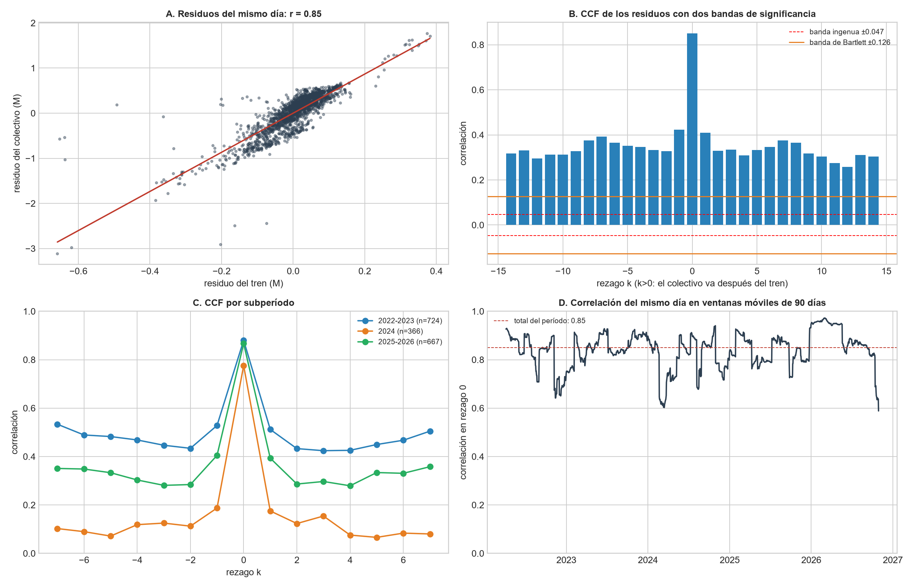

*Figura 13. A. Dispersión de los residuos del tren y del colectivo del mismo día. B. CCF de los residuos con la banda ingenua (±0,047) y la banda de Bartlett (±0,126). C. CCF por subperíodo. D. Correlación del mismo día en ventanas móviles de 90 días.*

| periodo | dias | ccf_lag_0 | ccf_lag_-1 | ccf_lag_1 |
|---|---|---|---|---|
| 2022-2023 | 724 | 0,880 | 0,528 | 0,512 |
| 2024 | 366 | 0,776 | 0,187 | 0,175 |
| 2025-2026 | 667 | 0,867 | 0,405 | 0,393 |

- **A. Dispersión.** Los residuos de ambos modos se alinean sobre una recta (r = 0,85): cuando el tren está por encima o por debajo de lo esperado, el colectivo también. Hay unos pocos puntos aislados (días con paros o eventos de un solo modo).
- **B. Banda de significancia.** La banda de ±0,047 supone observaciones independientes. Como los residuos están autocorrelacionados, la **banda de Bartlett** (que incorpora esa autocorrelación; ±0,126) es más honesta. El pico en el rezago 0 (0,85) la supera por mucho; los valores de 0,3 a 0,4 en los demás rezagos **también superan la banda**, es decir, el "piso" no es ruido.
- **C. Subperíodos.** El rezago 0 es alto en los tres (0,88 en 2022–2023, 0,78 en 2024, 0,87 en 2025–2026), pero el "piso" cambia mucho: 0,45 aproximadamente en 2022–2023, 0,1 en 2024 y 0,3 en 2025–2026. Eso respalda que el piso es un movimiento lento común (cambios de nivel dentro de cada período que los residuos no eliminaron) y no una relación con retraso: si fuera una relación estable, no desaparecería en 2024.
- **D. Estabilidad.** La correlación del mismo día se mantiene entre 0,59 y 0,97 en ventanas de 90 días; baja hacia fines de 2022, a principios de 2024 y al final de la serie, períodos que incluyen cambios de nivel (por ejemplo, el verano de 2024); no se investigó la causa de cada baja.

**Qué se concluye.** Gana la hipótesis de **causas comunes**: los modos se mueven juntos el mismo día. No hay evidencia de sustitución ni de que un modo anticipe al otro. Aporta tres cosas: (1) los modos comparten el motor de la demanda diaria; (2) lo que pasó ayer en el tren no ayuda a pronosticar el colectivo de hoy, lo que respalda pronosticar cada modo por separado (P-2); (3) es coherente con P-1: en los paros, el modo que no para no absorbe a los usuarios del que sí. **Límite:** es una correlación y no demuestra causalidad; los shocks comunes dominan y podrían tapar una sustitución pequeña.

---

## 5. Interpolación de los días faltantes

**Qué se quiere responder.** Cómo conviene completar los 62 días sin dato de la serie de usuarios y cuánto error se comete al hacerlo.

### 5.1 Qué se aprendió en la exploración y cómo se usa acá

Esta sección va después de explorar la serie (sección 4) porque lo aprendido allí orienta la elección del método:

1. **El ciclo semanal domina la variación** (explica 62,8% según la FFT, 4.4). Un método que ignora el ciclo semanal va a fallar: una recta o una curva que une el último día antes del hueco con el primero después no sabe si ese día fue domingo o martes.
2. **La serie se puede separar en tendencia y patrón semanal** (STL, 4.3) y **una media móvil de 7 o 28 días anula el ciclo semanal** (4.5). Eso sugiere interpolar solo la tendencia y volver a poner el patrón semanal.
3. **Enero es el valle anual** (4.1, 4.4): es el mes más bajo, con 2,4 M de usuarios en promedio contra 3,0 a 3,4 M en la mayoría de los otros meses. Esa información no está en los días vecinos del hueco; ningún método de interpolación pura puede conocerla.

### 5.2 Problema y método de evaluación

**Problema.** La serie de usuarios no tiene datos para 62 días: agosto de 2022 y enero de 2024. Completar los huecos es **interpolar** (calcular valores intermedios dentro de la serie): según la **Clase Interpolación**, es un método de imputación de muestras perdidas, el cuarto de los cuatro casos que se presentan ("muestrear uniformemente una serie temporal con muestras perdidas").

**Qué se comparó.** Se evaluaron dos familias de interpolación vistas en la Clase Interpolación (`approx`, que traza rectas, y `spline`, que traza curvas cúbicas) y, para cada una, varias formas de aplicarla. Se ocultaron 89 bloques reales de 31 días consecutivos (de datos que sí se conocían), se estimaron con cada método y se compararon con el valor real. El indicador es el **MAPE** (*error porcentual absoluto medio*): para cada día se calcula |estimado − real| / real y se promedia. Un MAPE de 17% significa que, en promedio, el estimado se aparta 17% del valor real. Se informa la **mediana** de los 89 bloques y el **percentil 90** (el error que solo superan el 10% de los bloques más difíciles). Además se mide cuánto del **ciclo semanal** conserva el estimado (1 = todo; 0 = ninguno; más de 1 = lo exagera).

**Métodos probados.**

- **Aplicado directamente a la serie diaria:** la *recta* une el último día conocido antes del hueco con el primero después; el *spline cúbico original* une los puntos conocidos con tramos de polinomios de grado 3 que empalman sin quiebres.
- **Por día de la semana:** se interpola cada día de la semana por separado (lunes con lunes, etc.), de modo que cada sub-serie no tiene ciclo semanal. Se probó con rectas, con spline cúbico y con PCHIP (una curva cúbica por tramos que no oscila: nunca se sale del rango de los puntos que une).
- **Tendencia × perfil semanal:** se combinan dos componentes, como en una descomposición. (1) La *tendencia* se estima interpolando la media móvil de 7 días (que no tiene ciclo semanal) con recta, spline cúbico o PCHIP. (2) El *perfil semanal* es el cociente medio de cada día de la semana respecto de esa tendencia en las 4 semanas vecinas al hueco. El estimado de cada día es tendencia × perfil de ese día.

**De dónde sale cada método.** La **Clase Interpolación** presenta dos funciones: `approx` (recta entre los puntos conocidos) y `spline` (spline cúbico). Son las dos familias de partida. Las formas de aplicarlas por día de la semana o sobre tendencia × perfil semanal son **construcciones propias** que combinan lo visto en la exploración: la media móvil que anula el ciclo (4.5) y la separación de tendencia y patrón semanal de la descomposición (4.3). **PCHIP no se vio en clase.** Se incorporó porque el spline cúbico oscila: su nombre completo es *Piecewise Cubic Hermite Interpolating Polynomial* (polinomio de Hermite cúbico por tramos). Igual que el spline, une los puntos con tramos de polinomios de grado 3, pero elige las pendientes en cada punto de modo que la curva **no se salga del rango de los puntos que une** (conserva la monotonía en cada tramo), en lugar de exigir que la curvatura sea continua, que es lo que produce las oscilaciones del spline. Su fuente es Fritsch y Carlson (1980) y se usa la implementación `PchipInterpolator` de SciPy.

### 5.3 Resultados

**Resultados** (`tabla_simulacion_interpolacion`; ordenados de menor a mayor error mediano):

| Método | Bloques | MAPE mediano (%) | MAPE p. 90 (%) | MAE medio (M) | Ciclo semanal conservado |
|---|---|---|---|---|---|
| PCHIP × perfil semanal | 89 | 17,21 | 28,98 | 0,39 | 0,89 |
| Recta × perfil semanal | 89 | 17,25 | 28,93 | 0,38 | 0,89 |
| Lineal por día de la semana | 89 | 17,40 | 32,30 | 0,39 | 0,95 |
| PCHIP por día de la semana | 89 | 17,73 | 33,20 | 0,40 | 0,96 |
| Spline cúbico × perfil semanal | 89 | 25,89 | 56,32 | 0,75 | 0,87 |
| Spline cúbico por día de la semana | 89 | 28,86 | 44,79 | 0,77 | 1,31 |
| Lineal (directa sobre la serie) | 89 | 51,25 | 70,66 | 0,90 | 0,01 |
| Spline cúbico original (directo sobre la serie) | 89 | 76,26 | 323,42 | 3,25 | 0,15 |

*MAE medio en millones de usuarios; la última columna es la fracción del ciclo semanal que conserva el estimado (1 = todo).*

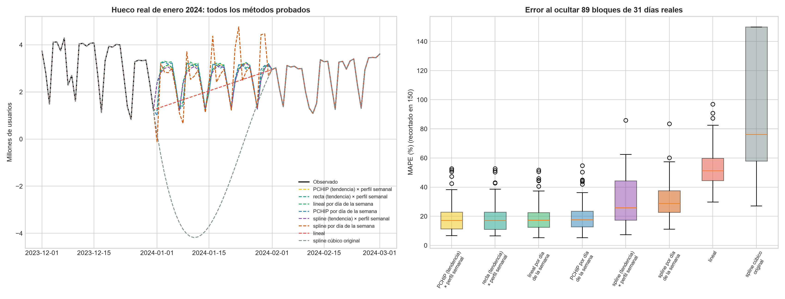

*Figura 14. A la izquierda, el hueco real de enero de 2024 completado por cada método. A la derecha, la distribución del error (MAPE) al ocultar 89 bloques de 31 días reales; los métodos están ordenados de menor a mayor error mediano.*

**El mejor spline y el mejor método de cada familia.** Entre las variantes del spline, la de menor error es el **spline cúbico sobre la tendencia × perfil semanal (25,9%)**; es la que se muestra en la Figura 15. Reduce a un tercio el error del spline original (76,3%). Entre las rectas, la mejor es la lineal por día de la semana o la recta × perfil semanal (17,3%–17,4%), y el mejor método de todos es el PCHIP × perfil semanal (17,2%), aunque su diferencia con las rectas por día de la semana es muy pequeña (17,2% contra 17,4%) y no se evaluó su significancia. La elección del mejor spline se hizo sobre los mismos 89 bloques con los que se mide el error, lo que podría favorecerla levemente; como las diferencias entre variantes del spline son de varios puntos, no cambia la conclusión.

*Figura 15. El hueco de enero de 2024 con la recta, el mejor spline y la lineal por día de la semana, y el error de los tres.*

**Por qué el spline cúbico original da tan mal.** Un spline cúbico fuerza que la curva sea suave y pase por los puntos de los bordes. Con una serie que sube y baja cada semana (días hábiles contra fin de semana), la pendiente con la que la curva sale de cada borde del hueco depende de si el último día conocido fue, por ejemplo, un domingo bajo o un martes alto. Esa pendiente arbitraria se arrastra por 31 días: en el gráfico, la curva llega a valores negativos de usuarios. Es una explicación consistente con lo medido (sesgo medio de +26%), no una demostración.

**Qué se aprende de la comparación.**

1. **La forma de aplicar el método importa más que el método.** Separar el ciclo semanal antes de interpolar (por día de la semana o con tendencia × perfil) mejora al spline de 76% a 26%–29% y a la recta de 51% a 17%. El spline original y la recta directa fallan por lo mismo: intentan ajustar con una sola curva una serie con un ciclo fuerte.
2. **Una vez separado el ciclo, el spline cúbico es peor que las opciones sin oscilación** (recta o PCHIP): con solo 7 puntos por mes en cada día de la semana, o con una tendencia que solo cambia lentamente, la flexibilidad del polinomio de grado 3 no aporta y agrega oscilaciones.
3. **Ninguna variante baja del 17%.** Lo que falta en un hueco de un mes no es un problema de la curva sino de información: en enero, por ejemplo, hay receso de verano y ninguna curva trazada entre diciembre y febrero puede saberlo. Si no hubiera ninguna fuente adicional, el método recomendado sería PCHIP o recta × perfil semanal.

### 5.4 Reconstrucción desde transacciones (el método elegido para completar la serie)

No es un método de interpolación pura sino el uso de una **fuente adicional del mismo organismo**: el portal publica también las transacciones diarias, que no tienen huecos y sí traen el nivel y el ciclo semanal de los días faltantes. Se eligió para completar la serie porque, cuando existe una fuente así, es muy superior a cualquier interpolación; pero en la mayoría de las series reales no se dispone de ella, y por eso la comparación de interpolaciones de arriba se evalúa por separado. El método se aplica a las **cuatro series** (total, colectivo, tren y subte) en tres pasos:

1. En cada serie se calcula el **cociente usuarios / transacciones** de los 28 días anteriores y de los 28 posteriores al hueco, por separado para días hábiles, sábados y domingos.
2. Ese cociente se **interpola** entre los dos bordes del hueco.
3. Los usuarios de cada día faltante se estiman como **transacciones del día × cociente**.

Ejemplo con cifras ilustrativas: si en los días hábiles vecinos hay 0,8 usuarios por transacción y un martes del hueco tiene 5 millones de transacciones, se estiman 4 millones de usuarios. Funciona porque el cociente es muy estable (desvío de 0,03 en la validación), mientras que lo que cambia de un día a otro (el nivel y el ciclo semanal) ya está en las transacciones. En meses de vacaciones el error baja a **1,6%–3,2%**, frente a **12,1%–20,8%** de la interpolación lineal por día de la semana. Una particularidad: el archivo de transacciones del subte no trae jurisdicción, por lo que el subte se toma completo, sin filtrar. Los días reconstruidos quedan marcados con la columna `imputado`.

Para comprobarlo se comparó la reconstrucción con la mejor interpolación en meses de vacaciones **que sí tienen dato** (enero y julio de 2025 y 2026), ocultándolos y estimándolos con cada método. `MAPE (%)` es el error porcentual absoluto medio contra el dato real y `sesgo (%)` el error medio con signo.

| mes | metodo | MAPE (%) | sesgo (%) |
|---|---|---|---|
| ene-2025 | reconstruccion_desde_transacciones | 1,57 | -0,52 |
| ene-2025 | lineal_por_dia_semana | 15,92 | -3,76 |
| ene-2026 | reconstruccion_desde_transacciones | 1,64 | 0,40 |
| ene-2026 | lineal_por_dia_semana | 12,07 | -5,73 |
| jul-2025 | reconstruccion_desde_transacciones | 2,21 | 1,00 |
| jul-2025 | lineal_por_dia_semana | 16,46 | 6,81 |
| jul-2026 | reconstruccion_desde_transacciones | 3,22 | 0,03 |
| jul-2026 | lineal_por_dia_semana | 20,75 | 13,50 |

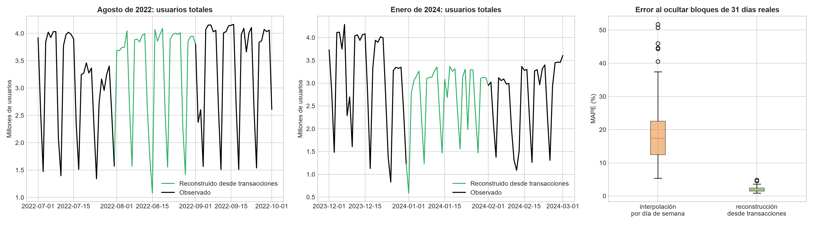

*Figura 16. Izquierda y centro: los dos huecos (agosto de 2022 y enero de 2024) completados con la reconstrucción desde transacciones (verde) junto al dato observado (negro). Derecha: error (MAPE) al ocultar bloques de 31 días reales y estimarlos con la interpolación por día de la semana o con la reconstrucción.*

**Octubre de 2026** es preliminar (sus transacciones son 100% preliminares) y queda fuera de las evaluaciones.

---

## 6. P-1. Demanda ante los hitos: precio, calendario y causalidad

**Qué se quiere responder.** Cómo se comportó la demanda alrededor de los hitos (aumentos de tarifa, feriados, paros, elecciones y pandemia) y si es posible decir *por qué*, es decir, atribuir el cambio a la causa.

**Qué parte viene de la cátedra y qué se incorpora de afuera.** Las clases del curso cubren la exploración de la serie (sección 4), la interpolación (sección 5), el pronóstico lineal, STL, ARMA y ARIMA (sección 7). **No cubren** las técnicas de esta sección: elasticidad, estudio de eventos, control sintético, prueba de causalidad de Granger y errores estándar robustos. Se incorporan porque la pregunta ("¿por qué cayó la demanda?") exige comparar lo ocurrido con lo que habría ocurrido sin el hito, y eso no se obtiene con las herramientas de la serie sola. De la cátedra se usan la prueba de estacionariedad ADF/KPSS (4.2, previa a Granger) y la regresión lineal (Clase Forecasting, "Forecasting Lineal"). Cada técnica indica su fuente original.

### 6.0 Cómo se entiende "causalidad" y términos de la sección

Dos ideas ordenan la sección:

1. **Granger** (Granger, 1969) pregunta si el pasado de una serie (acá, la tarifa) mejora la predicción de otra (la demanda). Sirve para *predecir*; no demuestra que el precio *cause* la demanda ni sirve para intervenir en el sistema. Se usa como evidencia complementaria y se informa con ese límite.
2. **Efecto de una intervención (contrafactual).** Se compara lo ocurrido con lo que *habría* ocurrido sin el cambio, estimado con series de control que no recibieron el tratamiento. Requiere supuestos: que los controles sean comparables y que no haya otros eventos simultáneos propios de lo estudiado. Es lo que hacen el **estudio de eventos con control del año anterior** y el **control sintético** con ciudades del interior.

Ningún diseño de este trabajo es un experimento: todos dependen de supuestos que se declaran junto a cada resultado.

**Términos que se usan en toda la sección.**

- **Salto tarifario:** aumento de la tarifa mínima con SUBE de al menos **10% en un solo cambio** (hay 29 en la serie de 2022 a 2026). Un cambio menor se llama **ajuste** (en general, ajustes mensuales de alrededor de 5%; hay 76). El umbral de 10% es el que usa el código para distinguir saltos de ajustes.
- **Salto tarifario grande:** aquel en que la tarifa **se duplica o más**. Hay tres, todos en 2024: colectivo nacional (+251%) y tren (+169%) el 6 de febrero, y subte (+359%) el 17 de mayo. Los demás saltos son **moderados** (de +10% a +40%). "Grande" es una convención de este trabajo.
- **Elasticidad precio de la demanda:** ε = variación porcentual de la demanda / variación porcentual del precio. Aquí se calcula como el cambio en el logaritmo de la demanda dividido por el cambio en el logaritmo de la tarifa. Si ε = −0,2, un aumento de 10% de la tarifa se asocia con una caída de 2% de la demanda. Con |ε| < 1 la demanda es **inelástica** (el gasto total sube cuando sube la tarifa); con ε = 0 no reacciona. Como referencia, la literatura internacional reporta elasticidades de corto plazo del orden de −0,3 a −0,4 para el colectivo y de −0,3 para el metro (Balcombe et al., 2004, informe TRL593), con valores de largo plazo más altos en valor absoluto.
- **Tarifa real:** tarifa nominal dividida por el IPC, para descontar la inflación.
- **Intervalo de confianza de 95%:** rango de valores de la elasticidad compatibles con los datos. Si **incluye el 0**, no se puede descartar que el efecto sea nulo.
- **Medida de demanda en P-1:** la cantidad de **transacciones** (usos de la SUBE) por día, no la de tarjetas distintas (ver 3.2). "Cae la demanda" significa que se registran menos usos, lo que puede reflejar menos personas viajando, menos viajes por persona o viajes que pasan a pagarse con otros medios.

### 6.1 Tarifas

**Qué es y por qué.** Para medir una elasticidad hace falta la serie de precios. Se armó la serie de la tarifa mínima por modo y jurisdicción con resoluciones oficiales (Boletín Oficial) y, donde no había norma a mano, inferida del dato (cada fila indica su fuente y su estado de verificación).

**Cómo se lee.** La tarifa nominal creció muchísimo, pero casi todo es inflación; por eso se muestra también la tarifa **real** (en pesos constantes de enero de 2022, deflactada por el IPC nacional) y el costo de **40 viajes por mes** (20 días hábiles, ida y vuelta; supuesto ilustrativo) como porcentaje del **RIPTE**, una medida del salario formal promedio.

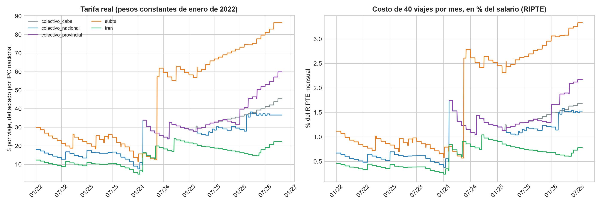

*Figura 17. A la izquierda, la tarifa real (pesos constantes de enero de 2022). A la derecha, el costo de 40 viajes por mes como porcentaje del RIPTE.*

| serie | primer_valor | nominal_x | real_x | pct_ripte_inicial | pct_ripte_julio_2026 | pct_ripte_maximo |
|---|---|---|---|---|---|---|
| colectivo_caba | 2024-08-12 | 2,50 | 1,39 | 1,44 | 1,69 | 1,69 |
| colectivo_nacional | 2022-01-01 | 41,30 | 2,03 | 0,67 | 1,53 | 1,74 |
| colectivo_provincial | 2024-02-06 | 4,50 | 1,77 | 1,74 | 2,17 | 2,17 |
| subte | 2022-01-01 | 58,40 | 2,88 | 1,12 | 3,33 | 3,33 |
| tren | 2022-01-01 | 36,50 | 1,80 | 0,46 | 0,78 | 1,04 |

**Qué se obtuvo.**

- **La inflación explica la mayor parte del aumento nominal.** El colectivo nacional pasó de $18 a $743 (×41 nominal), pero en pesos constantes de enero de 2022 pasó de $18 a $37 (×2,0). Entre 2022 y fines de 2023 la tarifa real **cayó** a $7,5 (enero de 2024) porque la tarifa nominal casi no se movió con una inflación muy alta; el salto de febrero de 2024 la llevó a $33,9, casi el doble de su valor de enero de 2022, y desde entonces la inflación la fue erosionando (unos $26 a mediados de 2024). El salto de 2024 fue en parte una recomposición de una tarifa real que se había derrumbado y en parte un aumento real. En el tren, de $4,7 a $16,3; en el subte, de $15,6 a $62 con el salto de mayo; en pesos constantes, el subte pasó de $30 a $86 (×2,9) y el tren de $12 a $22 (×1,8).
- **El subte es el único modo cuyo peso en el salario sigue subiendo.** Cuarenta viajes mensuales en subte pasaron de 1,1% a 3,3% del RIPTE entre enero de 2022 y julio de 2026; en colectivo nacional, de 0,7% a 1,5%, y en tren, de 0,5% a 0,8%. El colectivo nacional y el tren alcanzaron su máximo relativo en 2024 y desde entonces el salario recuperó terreno; el subte, no.

**Qué se concluye.** Las variaciones de la tarifa real son más pequeñas y graduales que las nominales, salvo en los tres saltos grandes de 2024. Por eso la elasticidad se estima con la tarifa real y, como robustez, con la tarifa en salarios (6.7).

### 6.2 Elasticidad precio de la demanda

**Qué es y por qué.** Mide cuánto cambia la demanda cuando cambia el precio. Se estima con tres métodos, de menos a más exigentes en lo que controlan, porque ninguno es concluyente por sí solo. En todos la demanda es la cantidad de usos (transacciones) del modo, por semana, de días hábiles normales (sin feriados, paros ni elecciones) cuando corresponde. *Fuente de la técnica:* regresión lineal (Clase Forecasting, "Forecasting Lineal"); errores estándar robustos de Newey y West (1987).

**Método A. Niveles semanales.** Regresión de log(demanda semanal) sobre log(tarifa) con controles de mes del año, feriados, paros y elecciones. Se hace **con tendencia** y **sin tendencia**:

- *Sin tendencia:* el coeficiente del precio toma toda la covariación entre el nivel de la demanda y el nivel de la tarifa. Si la demanda tiene su propia evolución (recuperación, cambios de hábitos) y la tarifa también se mueve en una dirección, el coeficiente atribuye esa evolución al precio. Como el precio nominal solo sube, es una **cota superior** del efecto.
- *Con tendencia:* se agrega un término lineal en el tiempo; el coeficiente se identifica solo por las desviaciones de la tarifa respecto de su propia tendencia, es decir, por los saltos. Es más conservador.

Si el resultado cambia mucho (en signo o tamaño) entre las dos versiones, el parámetro **no está identificado**: los datos no permiten separar el efecto del precio del efecto del tiempo.

**Método B. Diferencias interanuales (52 semanas).** Se regresa el cambio interanual de log(demanda) sobre el cambio interanual de log(tarifa). Comparar cada semana con la misma de un año antes elimina la estacionalidad y el nivel lento de cada serie (es la misma idea de la diferencia estacional de 4.2, con rezago de 52 semanas).

**Método C. Estudio de eventos con contrafactual estacional.** Para cada salto tarifario (agrupando los que están a menos de 45 días) se compara la demanda de días hábiles normales de las 6 semanas anteriores con la de las 6 semanas posteriores (dejando una semana de margen), y a ese cambio se le **resta el cambio de las mismas semanas del año anterior**. El año anterior es el contrafactual: lo que habría pasado por estacionalidad y tendencia sin el salto. La **elasticidad de arco** es el cociente entre ese cambio neto (en logaritmos) y el cambio del log de la tarifa.

**Cómo leer las tablas.** `elasticidad` es el coeficiente estimado; `error_std_HAC` es su error estándar robusto a heterocedasticidad y autocorrelación (HAC, Newey-West con 8 rezagos), necesario porque las semanas consecutivas no son independientes (se usa la misma idea que en la prueba de Diebold-Mariano de 7.1); `ic95_inf` e `ic95_sup` delimitan el intervalo de confianza de 95%; `R2` es la proporción de la variación explicada por el modelo completo (con sus controles), no por el precio solo; `semanas` es el tamaño de muestra (el colectivo provincial tiene menos porque su tarifa se conoce desde febrero de 2024).

*A. Niveles semanales (tarifa real):*

| modo | con_tendencia | semanas | elasticidad | error_std_HAC | ic95_inf | ic95_sup | R2 |
|---|---|---|---|---|---|---|---|
| colectivo_nacional | no | 238 | -0,268 | 0,043 | -0,351 | -0,184 | 0,635 |
| colectivo_nacional | sí | 238 | -0,016 | 0,068 | -0,150 | 0,118 | 0,742 |
| colectivo_provincial | no | 138 | -0,362 | 0,023 | -0,408 | -0,317 | 0,785 |
| colectivo_provincial | sí | 138 | -0,256 | 0,053 | -0,361 | -0,152 | 0,792 |
| tren | no | 238 | -0,180 | 0,028 | -0,235 | -0,124 | 0,647 |
| tren | sí | 238 | -0,037 | 0,034 | -0,103 | 0,030 | 0,756 |
| subte | no | 238 | -0,371 | 0,021 | -0,412 | -0,330 | 0,862 |
| subte | sí | 238 | -0,255 | 0,032 | -0,317 | -0,192 | 0,888 |

*B. Diferencias interanuales (tarifa real):*

| modo | semanas | elasticidad | error_std_HAC | ic95_inf | ic95_sup | R2 |
|---|---|---|---|---|---|---|
| colectivo_nacional | 186 | -0,012 | 0,046 | -0,102 | 0,078 | 0,294 |
| colectivo_provincial | 86 | -0,268 | 0,058 | -0,382 | -0,155 | 0,651 |
| tren | 186 | -0,043 | 0,028 | -0,097 | 0,012 | 0,478 |
| subte | 186 | -0,224 | 0,026 | -0,275 | -0,173 | 0,634 |

**Qué se obtuvo (métodos A y B).**

- **Subte:** negativa y estadísticamente distinta de cero en todas las versiones: de **−0,22** (interanual) a **−0,26** (niveles con tendencia) con tarifa real. Sin tendencia da −0,37, pero esa versión no controla la evolución del tiempo y se la considera una cota superior. Desde diciembre de 2024 la apertura del pago *contactless*/QR con promociones bancarias desplazó parte de los viajes fuera de SUBE justo cuando la tarifa real era alta; por eso se verificó la estimación interanual **restringiendo la muestra hasta noviembre de 2024** (90 semanas interanuales, 100% SUBE): la elasticidad real del subte se mantiene negativa y significativa en **−0,175** (IC 95%: [−0,216; −0,134], y **−0,178** controlando por salario real). La sensibilidad al precio del subte ya existía antes del cambio en los medios de pago, aunque en la muestra completa la estimación puntual sin control salarial (−0,224) captura en parte la migración de medio de pago.
- **Colectivo nacional y tren:** con tendencia o en interanual, la elasticidad es cercana a cero (de −0,04 a −0,01) y su intervalo incluye el 0. Sin tendencia sale de −0,27 y −0,18, y desaparece al agregarla: el signo y el tamaño dependen de la especificación, y por eso se concluye que **no están identificadas**.
- **Colectivo provincial:** −0,27 en interanual y −0,26 en niveles con tendencia, estadísticamente distinta de cero. La muestra es corta (86 semanas, cuatro saltos moderados) y, como se verá en 6.7, el resultado desaparece al controlar por el salario real.

**Método C: gráficos y tablas del estudio de eventos.** La primera figura muestra, para los modos y las ventanas alrededor de los saltos de 2024, la **razón entre las transacciones de días hábiles de 2024 y las del mismo día de 2023** (mediana móvil de 7 días hábiles). Un valor de 1,0 significa la misma demanda que un año antes; las líneas verticales marcan los saltos tarifarios. La segunda es el estudio de eventos propiamente dicho: cada punto es un salto; el eje horizontal es el aumento de la tarifa (cambio en log, neto de lo ocurrido un año antes: 0,3 equivale a +35%, 1,2 a ×3,3 y 1,4 a ×4,1) y el eje vertical es el cambio de la demanda en logaritmos, neto del año anterior (−0,2 equivale a −18%). Si el precio redujera la demanda, los puntos deberían bajar hacia la derecha.

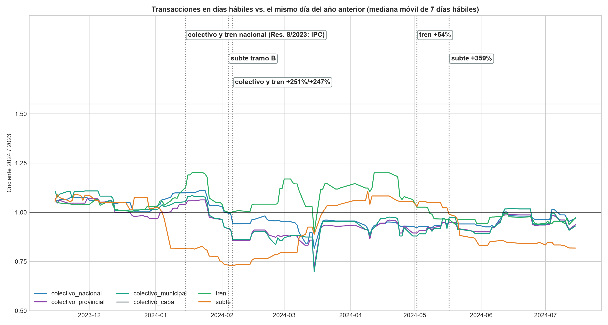

*Figura 18. Razón entre los usos de días hábiles de 2024 y los del mismo día de 2023, por modo, con los saltos tarifarios marcados.*

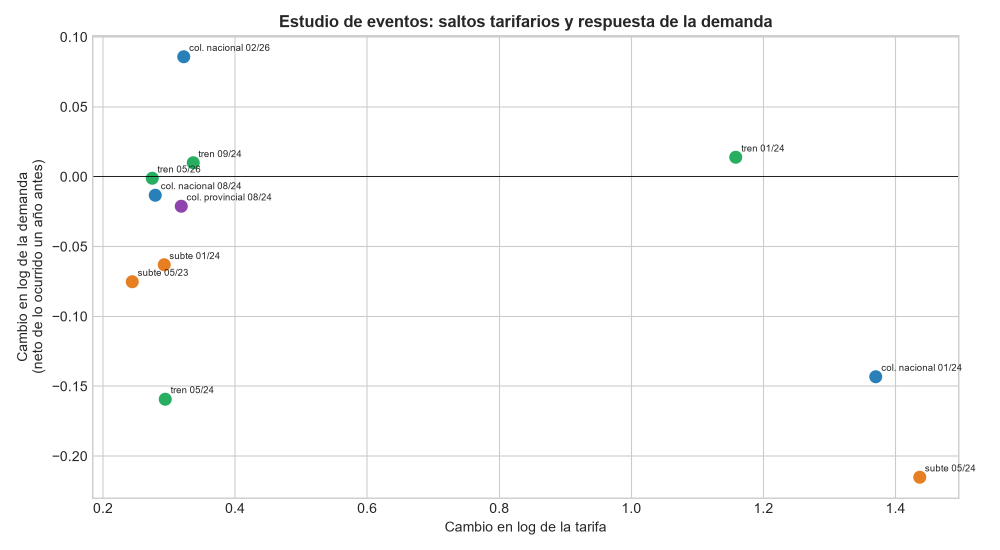

*Figura 19. Estudio de eventos: cambio de la demanda (en log, neto del año anterior) contra el aumento de la tarifa, un punto por salto.*

*Estudio de eventos (tarifa real):*

| modo | desde | hasta | tarifa_x | dlog_tarifa | dlog_demanda_neto | cambio_demanda_pct | elasticidad_arco | dlog_tarifa_real | elasticidad_arco_real |
|---|---|---|---|---|---|---|---|---|---|
| colectivo_nacional | 2024-01-15 | 2024-02-06 | 3,930 | 1,370 | -0,143 | -13,300 | -0,104 | 1,207 | -0,118 |
| colectivo_nacional | 2024-08-12 | 2024-08-12 | 1,320 | 0,279 | -0,013 | -1,300 | -0,045 | 0,420 | -0,030 |
| colectivo_nacional | 2026-02-18 | 2026-02-18 | 1,380 | 0,322 | 0,086 | 9,000 | 0,268 | 0,323 | 0,268 |
| colectivo_provincial | 2024-08-12 | 2024-08-12 | 1,370 | 0,318 | -0,021 | -2,100 | -0,066 | 0,255 | -0,082 |
| colectivo_provincial | 2025-03-01 | 2025-03-01 | 1,120 | 0,115 | 0,162 | 17,600 | 1,410 | 0,201 | 0,806 |
| colectivo_provincial | 2026-03-01 | 2026-03-01 | 1,080 | 0,073 | -0,046 | -4,500 | -0,635 | 0,075 | -0,618 |
| colectivo_provincial | 2026-05-04 | 2026-05-04 | 1,060 | 0,054 | 0,036 | 3,700 | 0,667 | 0,046 | 0,780 |
| subte | 2023-05-06 | 2023-06-05 | 1,280 | 0,244 | -0,075 | -7,200 | -0,306 | 0,212 | -0,353 |
| subte | 2024-01-05 | 2024-02-04 | 1,340 | 0,292 | -0,063 | -6,100 | -0,215 | 0,039 | -1,613 |
| subte | 2024-05-17 | 2024-06-01 | 4,210 | 1,436 | -0,215 | -19,400 | -0,150 | 1,484 | -0,145 |
| subte | 2024-10-01 | 2024-10-01 | 1,140 | 0,128 | -0,110 | -10,400 | -0,859 | 0,261 | -0,422 |
| tren | 2024-01-15 | 2024-02-06 | 3,180 | 1,158 | 0,014 | 1,400 | 0,012 | 0,995 | 0,014 |
| tren | 2024-05-06 | 2024-05-06 | 1,340 | 0,294 | -0,159 | -14,700 | -0,540 | 0,331 | -0,480 |
| tren | 2024-09-16 | 2024-09-16 | 1,400 | 0,336 | 0,010 | 1,000 | 0,029 | 0,469 | 0,020 |
| tren | 2026-05-18 | 2026-06-01 | 1,320 | 0,274 | -0,001 | -0,100 | -0,003 | 0,266 | -0,003 |

**Banda placebo.** Para saber si un cambio de demanda es grande o normal, se repite el mismo cálculo en fechas donde **la tarifa no cambió** (placebos: 20 para el colectivo nacional, 35 para el tren, 22 para el subte). La tabla da, para cada modo, los percentiles 5 y 95 del cambio neto de la demanda en log que se observa **sin** cambio de precio, y su desvío. Es la medida del ruido: un salto solo se considera distinguible del azar si su cambio de demanda cae **fuera** de esa banda.

| modo | n_placebos | p05_dlog_demanda | p95_dlog_demanda | sd_dlog_demanda |
|---|---|---|---|---|
| colectivo_nacional | 20 | -0,043 | 0,026 | 0,023 |
| tren | 35 | -0,052 | 0,050 | 0,034 |
| subte | 22 | -0,007 | 0,083 | 0,033 |

**Qué se obtuvo (método C).**

- **Primer gráfico.** El **subte** cae a 0,73–0,82 de la demanda del año anterior entre enero y marzo de 2024, antes del salto grande de mayo. Esa caída coincide con el **cierre de la línea D** (8 de enero a 6 de marzo de 2024) y con los saltos de enero y febrero; por eso el análisis del subte se hace **sin la línea D**. Cuando la línea reabre, la razón vuelve a 1,05–1,10 hacia abril. Después del salto de **+359%** del 17 de mayo, la razón baja de alrededor de 1,05 a 0,85 y se mantiene hasta julio: es la caída persistente más clara. En el **colectivo y el tren**, la razón baja de 1,10–1,20 a 0,9–1,0 alrededor del 6 de febrero; la caída es menor y se recupera en parte en marzo y abril.
- **Segundo gráfico.** Los dos saltos grandes cuya demanda cae son el del **colectivo nacional de enero–febrero de 2024** (−0,14 en logaritmos, −13%) y el del **subte de mayo de 2024** (−0,22, −19%). El **tren**, ante un salto de tarifa también grande (×3,2), **no cae** (+0,01): ese contraste entre modos impide atribuir sin más la caída a la tarifa. Entre los saltos moderados, el subte baja entre 6% y 10% (los tres moderados), el tren de mayo de 2024 baja 15% y los demás están cerca de cero. El tren de mayo de 2024 queda a una semana del **paro general del 9 de mayo**, un efecto superpuesto que el método no separa. El colectivo nacional de febrero de 2026 **sube** 9%, lo contrario del signo esperado: ahí actuó otro factor.
- **Con la banda placebo.** Para el colectivo nacional la banda es de −0,043 a +0,026; para el tren, de −0,052 a +0,050; para el subte, de −0,007 a +0,083. *Colectivo nacional:* enero–febrero de 2024 (−0,143) cae por debajo de la banda; agosto de 2024 (−0,013) queda dentro (no se distingue del ruido); febrero de 2026 (+0,086) queda por encima, con signo contrario al esperado. *Subte:* los cuatro saltos (−0,075, −0,063, −0,215 y −0,110) caen fuera de la banda y todos con el signo esperado: es la evidencia más consistente de la sección. *Tren:* solo el de mayo de 2024 (−0,159) cae fuera de la banda, y coincide con el paro general; los otros tres están dentro.

### 6.3 Control sintético para los saltos tarifarios del colectivo nacional

**Qué es y por qué.** El estudio de eventos usa el año anterior como contrafactual, pero un salto grande puede coincidir con otros cambios (precios en general, ingreso, vacaciones). El **control sintético** (Abadie, Diamond y Hainmueller, 2010) construye un AMBA "sin salto" como combinación ponderada de **ciudades del interior** (también con SUBE, y cuyas tarifas no cambiaron con el aumento nacional del AMBA), de modo que esa combinación replique la demanda del AMBA en las 52 semanas previas al salto. La diferencia entre el AMBA real y el AMBA sintético después del salto es el efecto estimado. Los controles absorben los shocks nacionales comunes (inflación, ingreso, clima); no absorben lo propio del AMBA.

**Cómo se lee.** En los gráficos, la línea azul es el AMBA real y la punteada el AMBA sintético, ambos en log de usos relativo al promedio previo; la línea vertical marca el salto. Si el salto hubiera reducido la demanda, la azul debería quedar por debajo de la punteada después de la vertical. En la tabla, `brecha_log` y `cambio_pct` son la diferencia (AMBA real menos sintético) promedio posterior al salto, en logaritmos y en porcentaje. `rmspe_previo` es el error cuadrático medio de ajuste en las 52 semanas anteriores (qué tan bien imita al AMBA antes del salto: 0,03 es un error de alrededor de 3%) y `rmspe_posterior` el mismo error después; `razon_post_pre` es su cociente. Para saber **cuán grande es una razón** se hace una **inferencia por placebos en el espacio**: se aplica el mismo procedimiento a cada ciudad donante como si hubiera sido la tratada, y `p_placebos` es la proporción de esas ciudades con una razón igual o mayor a la del AMBA (con `n_placebos` ciudades). La última tabla muestra las ciudades que más pesan en el control del primer salto (`peso` suma 1).

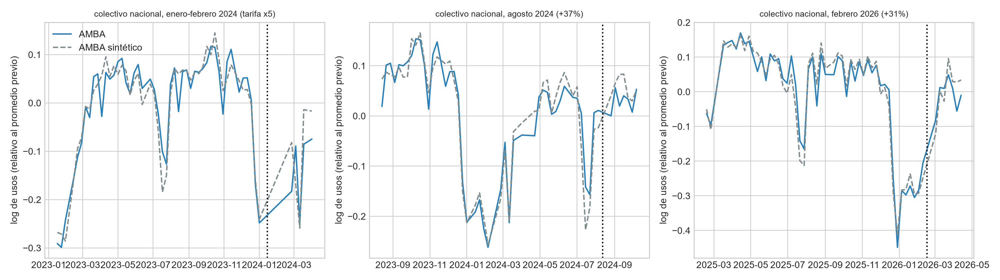

*Figura 20. AMBA real y AMBA sintético alrededor de cada salto tarifario del colectivo nacional.*

| evento | brecha_log | cambio_pct | rmspe_previo | rmspe_posterior | razon_post_pre | p_placebos | n_placebos | placebo_p5_brecha | placebo_p95_brecha |
|---|---|---|---|---|---|---|---|---|---|
| colectivo nacional, enero-febrero 2024 (tarifa x5) | -0,028 | -2,800 | 0,030 | 0,071 | 2,380 | 0,433 | 30 | -0,203 | 0,228 |
| colectivo nacional, agosto 2024 (+37%) | -0,026 | -2,500 | 0,029 | 0,034 | 1,150 | 0,267 | 30 | -0,087 | 0,127 |
| colectivo nacional, febrero 2026 (+31%) | -0,015 | -1,500 | 0,028 | 0,046 | 1,630 | 0,267 | 30 | -0,176 | 0,134 |

*Ciudades donantes con más peso en el primer salto:*

| evento | donante | peso |
|---|---|---|
| colectivo nacional, enero-febrero 2024 (tarifa x5) | SANTA FE - SN | 0,233 |
| colectivo nacional, enero-febrero 2024 (tarifa x5) | JUJUY - SN | 0,215 |
| colectivo nacional, enero-febrero 2024 (tarifa x5) | BUENOS AIRES - GENERAL PUEYRREDON | 0,209 |
| colectivo nacional, enero-febrero 2024 (tarifa x5) | RÍO NEGRO - SAN CARLOS DE BARILOCHE | 0,131 |
| colectivo nacional, enero-febrero 2024 (tarifa x5) | SANTA FE - SANTA FE | 0,068 |
| colectivo nacional, enero-febrero 2024 (tarifa x5) | NEUQUÉN - NEUQUEN | 0,061 |

**Qué se obtuvo y se concluye.** El control sintético da −2,8%, −2,5% y −1,5% para los tres saltos del colectivo nacional (enero–febrero de 2024, agosto de 2024 y febrero de 2026), con `p_placebos` de 0,43, 0,27 y 0,27: entre 27% y 43% de las ciudades sin tratamiento muestran una brecha igual o mayor por puro azar, de modo que **ningún efecto es distinguible del ruido**. **No confirma** el −13% del estudio de eventos para enero–febrero de 2024: es una discrepancia entre dos métodos. Las limitaciones son reales: los precios de las ciudades donantes no se pudieron verificar y varias son turísticas, con estacionalidad distinta; los tramos rectos del primer gráfico corresponden a semanas sin datos suficientes de días normales. Conclusión: el colectivo cae poco ante el precio y el −13% queda como cota superior poco confiable.

### 6.4 Sustitución entre modos y causalidad de Granger

**Qué se pregunta.** Si sube la tarifa de un modo, ¿se desplaza demanda a los otros? Si fuera así, el **coeficiente cruzado** (efecto de la tarifa de un modo sobre la demanda de otro) sería **positivo**: más caro el modo A, más demanda en el modo B. Se estima de dos maneras.

**A. Efecto cruzado en diferencias interanuales.** Para cada modo se regresa el cambio interanual (52 semanas) de log(demanda) sobre el cambio interanual de log(tarifa real) de **los tres modos a la vez**, con controles de feriados, paros y elecciones. Cada fila de la tabla es un coeficiente: `demanda_de` es el modo cuya demanda se explica; `tarifa_de`, la tarifa usada como regresora; `tipo`, **propia** (elasticidad propia) o **cruzada** (la de otro modo). `VIF` (factor de inflación de la varianza) mide cuánto se confunde cada tarifa con las demás: 1 indica que no hay colinealidad; 5 o más, que los coeficientes no se pueden separar con confiabilidad. Acá las tres tarifas subieron al mismo tiempo en 2024 y los VIF llegan a 4–7.

| demanda_de | tarifa_de | tipo | coeficiente | error_std_HAC | ic95_inf | ic95_sup | VIF | semanas |
|---|---|---|---|---|---|---|---|---|
| colectivo_nacional | colectivo_nacional | propia | -0,11 | 0,08 | -0,27 | 0,04 | 4,40 | 186 |
| colectivo_nacional | tren | cruzada | 0,16 | 0,08 | 0,00 | 0,33 | 6,90 | 186 |
| colectivo_nacional | subte | cruzada | -0,10 | 0,04 | -0,19 | -0,02 | 2,40 | 186 |
| tren | colectivo_nacional | cruzada | -0,21 | 0,03 | -0,27 | -0,15 | 4,40 | 186 |
| tren | tren | propia | 0,22 | 0,03 | 0,15 | 0,28 | 6,90 | 186 |
| tren | subte | cruzada | -0,13 | 0,03 | -0,19 | -0,07 | 2,40 | 186 |
| subte | colectivo_nacional | cruzada | 0,02 | 0,06 | -0,10 | 0,14 | 4,40 | 186 |
| subte | tren | cruzada | 0,06 | 0,06 | -0,07 | 0,18 | 6,90 | 186 |
| subte | subte | propia | -0,26 | 0,03 | -0,32 | -0,20 | 2,40 | 186 |

**B. Granger.** (*Fuente de la técnica:* Granger, 1969.) La prueba pregunta si agregar los valores pasados de la tarifa a una regresión de la demanda sobre sus propios valores pasados **mejora significativamente** la predicción. Como la prueba exige series estacionarias, se las lleva antes a estacionariedad (primera diferencia del logaritmo de la demanda, descontados feriados, paros, elecciones y mes; primera diferencia del logaritmo de la tarifa real) y se verifica con ADF y KPSS (**Clase Forecasting**, ver 4.2). El número de rezagos se elige por criterio AIC (hasta 8 semanas). `rezago_AIC` es el elegido, `p_valor` el de la prueba F de que los rezagos del precio no aportan, y `p_Holm` el p-valor corregido por las **nueve** pruebas de cada sentido (corrección de Holm, 1979, que controla la probabilidad de algún falso positivo entre varias pruebas). Como control se prueba también el sentido inverso (demanda → tarifa).

| demanda_de | tarifa_de | tipo | rezago_AIC | p_valor | p_Holm |
|---|---|---|---|---|---|
| colectivo_nacional | colectivo_nacional | propia | 3 | 0,797 | 1,000 |
| colectivo_nacional | tren | cruzada | 3 | 0,793 | 1,000 |
| colectivo_nacional | subte | cruzada | 3 | 0,311 | 1,000 |
| tren | colectivo_nacional | cruzada | 5 | 0,026 | 0,181 |
| tren | tren | propia | 5 | 0,018 | 0,141 |
| tren | subte | cruzada | 4 | 0,181 | 1,000 |
| subte | colectivo_nacional | cruzada | 3 | 0,993 | 1,000 |
| subte | tren | cruzada | 3 | 0,397 | 1,000 |
| subte | subte | propia | 4 | 0,002 | 0,019 |

**Qué se obtuvo.**

- **Efecto cruzado interanual.** Las elasticidades propias son −0,26 en el subte (distinta de cero), −0,11 en el colectivo nacional (el intervalo incluye 0) y **+0,22 en el tren, con signo positivo**, lo que no tiene una interpretación económica razonable y es síntoma de colinealidad. Aparecen coeficientes cruzados distintos de cero (por ejemplo, la demanda del tren frente a la tarifa del colectivo, −0,21), pero con VIF de 4 a 7 y con signos que en varios casos serían de complementariedad (el modo B cae cuando sube el A), no de sustitución. Como las tres tarifas se movieron juntas, **los coeficientes cruzados no se pueden separar** y no se interpretan como efectos. No hay ningún coeficiente cruzado positivo y estable que sugiera sustitución.
- **Granger.** Solo hay un par significativo luego de la corrección de Holm: la **tarifa propia del subte** frente a la **demanda del subte** (`rezago_AIC` = 4 semanas, `p_valor` = 0,002, `p_Holm` = 0,019). Se lee así: *conocer los cambios de la tarifa del subte de las últimas 4 semanas mejora la predicción del cambio de la demanda del subte de esta semana, más allá de lo que ya explica su propio pasado*. Es compatible con una respuesta de la demanda al precio con un retardo de alrededor de un mes. **No prueba causalidad**: indica precedencia predictiva y podría reflejar cualquier otro cambio que acompañe a los aumentos (anuncios, paquetes de medidas). Los pares tren–tren y tren–colectivo tienen `p_valor` de 0,018 y 0,026 pero no superan la corrección de Holm (0,14 y 0,18). En el sentido inverso no hay ningún par significativo: la tarifa no parece fijarse en respuesta a la demanda.

**Qué se concluye.** No hay evidencia de que un aumento de la tarifa de un modo traslade demanda a otro. El apartado 6.6 muestra la misma ausencia de sustitución en los días de paro.

### 6.5 ¿Reaccionan menos las líneas de zonas de mayor ingreso?

**Hipótesis (fijada antes de correr el análisis).** Las líneas que atraviesan zonas de mayor ingreso (en particular la línea D) reaccionan menos a los saltos tarifarios del subte, porque sus usuarios serían menos sensibles al precio.

**Datos externos.** El ingreso por línea no está en SUBE. Se construyó con la **Encuesta Anual de Hogares (EAH) de la Ciudad de Buenos Aires** (Dirección General de Estadística y Censos, IDECBA), que da el ingreso per cápita familiar medio por comuna. Cada estación del subte se ubicó en su comuna con los datos geográficos de **BA Data**, y cada línea recibió el **promedio del índice de ingreso de sus estaciones** (ingreso de la comuna relativo al total de la Ciudad, promedio 2022–2025; 1,0 es el promedio de la Ciudad). La EAH cubre solo la Ciudad: el índice describe la zona de las estaciones, no necesariamente el ingreso de quienes viajan.

**Método.** Panel línea × semana con **efecto fijo por semana**, que absorbe todo lo que afecta a todas las líneas por igual (el precio mismo, la inflación, los feriados) y deja solo la diferencia entre líneas. El coeficiente de interés, `delta`, es la **interacción entre el índice de ingreso de la línea y el log de la tarifa real**: mide cuánto cambia la elasticidad de una línea por cada unidad de su índice. La hipótesis predice `delta` **positivo**. La línea D estuvo cerrada del 8 de enero al 6 de marzo de 2024, lo que confunde el salto de ese período; por eso se prueba con dos definiciones de exclusión (`cierre` y `cierre ampliado`), con un índice continuo y con un contraste simple (D contra el resto), con o sin tendencia propia por línea. `p_permutacion` es la fracción de reasignaciones de los índices entre líneas que dan un `delta` tan extremo como el observado (720 con el índice continuo; solo 5 distintas con el contraste simple).

| linea | estaciones | comunas | indice_comuna_2022_2025 |
|---|---|---|---|
| D | 16 | 1, 2, 3, 13, 14 | 1,235 |
| B | 17 | 1, 3, 5, 12, 15 | 0,961 |
| A | 18 | 1, 3, 5, 6, 7 | 0,940 |
| H | 12 | 2, 3, 4 | 0,930 |
| C | 9 | 1 | 0,898 |
| E | 18 | 1, 3, 5, 6, 7 | 0,885 |

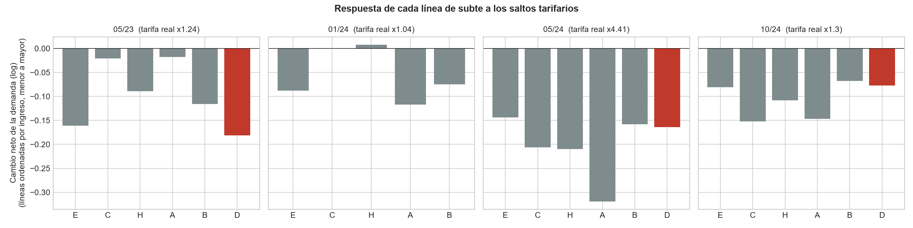

*Figura 21. Demanda de cada línea de subte alrededor de los saltos tarifarios.*

| definicion_D_excluida | especificacion | tendencia_por_linea | observaciones | delta | error_std | p_permutacion |
|---|---|---|---|---|---|---|
| cierre | indice continuo | no | 1.419 | -0,490 | 0,044 | 0,015 |
| cierre | indice continuo | sí | 1.419 | -0,052 | 0,064 | 0,539 |
| cierre | D contra A,B,C,E | no | 1.181 | -0,123 | 0,013 | 0,200 |
| cierre | D contra A,B,C,E | sí | 1.181 | -0,005 | 0,019 | 0,800 |
| cierre ampliado | indice continuo | no | 1.411 | -0,580 | 0,036 | 0,015 |
| cierre ampliado | indice continuo | sí | 1.411 | -0,225 | 0,068 | 0,026 |
| cierre ampliado | D contra A,B,C,E | no | 1.173 | -0,149 | 0,011 | 0,200 |
| cierre ampliado | D contra A,B,C,E | sí | 1.173 | -0,055 | 0,023 | 0,200 |

**Qué se obtuvo y se concluye.** El índice ordena a las líneas así: D (1,24), B (0,96), A (0,94), H (0,93), C (0,90) y E (0,89); la D es la única claramente por encima del promedio. El coeficiente `delta` es **negativo en las ocho especificaciones**, y la hipótesis predecía el signo contrario. En tres la permutación lo marca como significativo (p = 0,015 en dos especificaciones con índice continuo y sin tendencia propia por línea, y p = 0,026 con cierre ampliado y tendencia), pero con el **signo opuesto al esperado** (las líneas de más ingreso reaccionan *más*, no menos); con la especificación base con tendencia propia por línea, `delta` es −0,05 con p = 0,54. El resultado cambia con la especificación, así que no es robusto. Además, con solo seis líneas, el p mínimo posible del contraste D contra el resto es 0,20: esa prueba **no tiene poder**. Se reporta como **sin respaldo** (la hipótesis no se confirma) y con **poder bajo** (no se la puede refutar con estos datos).

### 6.6 Hitos de calendario: feriados, paros, elecciones y pandemia

**Qué es y por qué.** Son los episodios que más alteran un día cualquiera. Se mide cuánto cae (o sube) la demanda ese día respecto de lo habitual. Es un análisis **descriptivo** (no causal): compara el día con sus vecinos.

**Cómo se calcula.** Para cada día especial se calcula el **cociente** entre su demanda (transacciones) y la **mediana del mismo día de la semana en las ±4 semanas vecinas** (sin contar feriados, paros ni elecciones). Un cociente de 0,5 significa la mitad de lo habitual para ese día. La **banda de días ordinarios** (cociente entre 0,78 y 1,13 para el colectivo; 0,78–1,11 para el tren; 0,83–1,14 para el subte) mide la variación normal: son los percentiles 2,5 y 97,5 del mismo cociente en días laborables sin ningún hito. Un hito solo se considera un efecto cuando queda **fuera de la banda**. Es la misma idea que el residuo de STL de 4.3 (la diferencia entre lo observado y lo esperado), calculada de otra forma y por modo.

**Clasificación.** Un "paro" no es un único tipo de evento: la demanda de cada modo depende de **quién paró**. Se distinguen paros del **colectivo** (UTA, tres casos), del **tren** (La Fraternidad, un caso), de **tren y subte** conjuntamente (un caso) y **generales de la CGT** (cuatro casos; en el del 10 de abril de 2025 pararon el subte y los trenes, pero no el colectivo, porque la UTA no adhirió). Las **elecciones** se separan según hubo **gratuidad** del transporte (agosto, octubre y noviembre de 2023; el balotaje no tiene fuente y se infiere del dato) o no se observó (las tres elecciones de 2025).

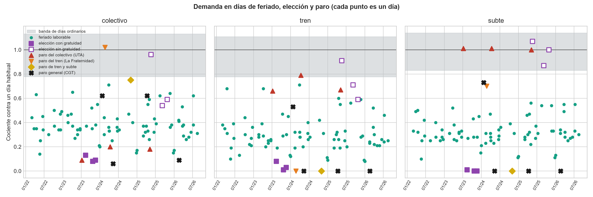

*Figura 22. Cociente de la demanda de cada día de hito respecto de lo habitual, por modo, contra la banda de días ordinarios.*

| tipo | modo | dias | mediana_cociente | minimo | maximo | banda_ruido_inf | banda_ruido_sup | pct_fuera_de_banda |
|---|---|---|---|---|---|---|---|---|
| eleccion | colectivo | 6 | 0,34 | 0,08 | 0,96 | 0,78 | 1,13 | 83 |
| eleccion | tren | 6 | 0,34 | 0,01 | 0,91 | 0,78 | 1,11 | 83 |
| eleccion | subte | 6 | 0,44 | 0,00 | 1,07 | 0,83 | 1,14 | 50 |
| feriado | colectivo | 76 | 0,36 | 0,14 | 0,71 | 0,78 | 1,13 | 100 |
| feriado | tren | 76 | 0,28 | 0,08 | 0,71 | 0,78 | 1,11 | 100 |
| feriado | subte | 76 | 0,31 | 0,10 | 0,56 | 0,83 | 1,14 | 100 |
| feriado en fin de semana | colectivo | 18 | 0,88 | 0,39 | 1,11 | 0,78 | 1,13 | 28 |
| feriado en fin de semana | tren | 18 | 0,84 | 0,43 | 1,14 | 0,78 | 1,11 | 33 |
| feriado en fin de semana | subte | 18 | 0,96 | 0,45 | 1,90 | 0,83 | 1,14 | 33 |
| paro | colectivo | 9 | 0,20 | 0,06 | 1,02 | 0,78 | 1,13 | 89 |
| paro | tren | 9 | 0,00 | 0,00 | 0,79 | 0,78 | 1,11 | 89 |
| paro | subte | 9 | 0,70 | 0,00 | 1,01 | 0,83 | 1,14 | 67 |

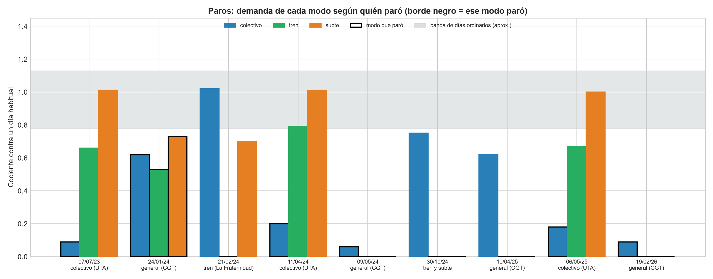

*Figura 23. Paros y elecciones por tipo: cociente mediano por modo.*

| tipo | subtipo | modo | dias | mediana_cociente | minimo | maximo | banda_ruido_inf | banda_ruido_sup |
|---|---|---|---|---|---|---|---|---|
| eleccion | con gratuidad | colectivo | 2 | 0,11 | 0,08 | 0,13 | 0,78 | 1,13 |
| eleccion | con gratuidad | tren | 2 | 0,04 | 0,01 | 0,08 | 0,78 | 1,11 |
| eleccion | con gratuidad | subte | 2 | 0,00 | 0,00 | 0,01 | 0,83 | 1,14 |
| eleccion | con gratuidad (inferida del dato) | colectivo | 1 | 0,09 | 0,09 | 0,09 | 0,78 | 1,13 |
| eleccion | con gratuidad (inferida del dato) | tren | 1 | 0,03 | 0,03 | 0,03 | 0,78 | 1,11 |
| eleccion | con gratuidad (inferida del dato) | subte | 1 | 0,00 | 0,00 | 0,00 | 0,83 | 1,14 |
| eleccion | sin gratuidad aparente | colectivo | 3 | 0,59 | 0,54 | 0,96 | 0,78 | 1,13 |
| eleccion | sin gratuidad aparente | tren | 3 | 0,71 | 0,59 | 0,91 | 0,78 | 1,11 |
| eleccion | sin gratuidad aparente | subte | 3 | 1,00 | 0,87 | 1,07 | 0,83 | 1,14 |
| paro | colectivo (UTA) | colectivo | 3 | 0,18 | 0,09 | 0,20 | 0,78 | 1,13 |
| paro | colectivo (UTA) | tren | 3 | 0,67 | 0,66 | 0,79 | 0,78 | 1,11 |
| paro | colectivo (UTA) | subte | 3 | 1,01 | 1,00 | 1,01 | 0,83 | 1,14 |
| paro | general (CGT) | colectivo | 4 | 0,36 | 0,06 | 0,62 | 0,78 | 1,13 |
| paro | general (CGT) | tren | 4 | 0,00 | 0,00 | 0,53 | 0,78 | 1,11 |
| paro | general (CGT) | subte | 4 | 0,00 | 0,00 | 0,73 | 0,83 | 1,14 |
| paro | tren (La Fraternidad) | colectivo | 1 | 1,02 | 1,02 | 1,02 | 0,78 | 1,13 |
| paro | tren (La Fraternidad) | tren | 1 | 0,00 | 0,00 | 0,00 | 0,78 | 1,11 |
| paro | tren (La Fraternidad) | subte | 1 | 0,70 | 0,70 | 0,70 | 0,83 | 1,14 |
| paro | tren y subte | colectivo | 1 | 0,75 | 0,75 | 0,75 | 0,78 | 1,13 |
| paro | tren y subte | tren | 1 | 0,00 | 0,00 | 0,00 | 0,78 | 1,11 |
| paro | tren y subte | subte | 1 | 0,00 | 0,00 | 0,00 | 0,83 | 1,14 |

*Cada paro: cociente del modo que paró y de los que no pararon (`rol` indica si ese modo paró o no ese día; `posicion`, si su cociente quedó por debajo, dentro o por encima de la banda):*

| fecha | paro | modo | rol | cociente | posicion |
|---|---|---|---|---|---|
| 2023-07-07 | colectivo (UTA) | colectivo | paró | 0,09 | bajo la banda |
| 2023-07-07 | colectivo (UTA) | tren | no paró | 0,66 | bajo la banda |
| 2023-07-07 | colectivo (UTA) | subte | no paró | 1,01 | dentro de la banda |
| 2024-01-24 | general (CGT) | colectivo | paró | 0,62 | bajo la banda |
| 2024-01-24 | general (CGT) | tren | paró | 0,53 | bajo la banda |
| 2024-01-24 | general (CGT) | subte | paró | 0,73 | bajo la banda |
| 2024-02-21 | tren (La Fraternidad) | colectivo | no paró | 1,02 | dentro de la banda |
| 2024-02-21 | tren (La Fraternidad) | tren | paró | 0,00 | bajo la banda |
| 2024-02-21 | tren (La Fraternidad) | subte | no paró | 0,70 | bajo la banda |
| 2024-04-11 | colectivo (UTA) | colectivo | paró | 0,20 | bajo la banda |
| 2024-04-11 | colectivo (UTA) | tren | no paró | 0,79 | dentro de la banda |
| 2024-04-11 | colectivo (UTA) | subte | no paró | 1,01 | dentro de la banda |
| 2024-05-09 | general (CGT) | colectivo | paró | 0,06 | bajo la banda |
| 2024-05-09 | general (CGT) | tren | paró | 0,00 | bajo la banda |
| 2024-05-09 | general (CGT) | subte | paró | 0,00 | bajo la banda |
| 2024-10-30 | tren y subte | colectivo | no paró | 0,75 | bajo la banda |
| 2024-10-30 | tren y subte | tren | paró | 0,00 | bajo la banda |
| 2024-10-30 | tren y subte | subte | paró | 0,00 | bajo la banda |
| 2025-04-10 | general (CGT) | colectivo | no paró | 0,62 | bajo la banda |
| 2025-04-10 | general (CGT) | tren | paró | 0,00 | bajo la banda |
| 2025-04-10 | general (CGT) | subte | paró | 0,00 | bajo la banda |
| 2025-05-06 | colectivo (UTA) | colectivo | paró | 0,18 | bajo la banda |
| 2025-05-06 | colectivo (UTA) | tren | no paró | 0,67 | bajo la banda |
| 2025-05-06 | colectivo (UTA) | subte | no paró | 1,00 | dentro de la banda |
| 2026-02-19 | general (CGT) | colectivo | paró | 0,09 | bajo la banda |
| 2026-02-19 | general (CGT) | tren | paró | 0,00 | bajo la banda |
| 2026-02-19 | general (CGT) | subte | paró | 0,00 | bajo la banda |

**Qué se obtuvo.**

- **Feriados.** Los feriados laborables tienen una mediana de 0,36 (colectivo), 0,28 (tren) y 0,31 (subte), con el 100% de los días fuera de la banda. Los feriados que caen en fin de semana casi no se distinguen de un fin de semana común (mediana de 0,84 a 0,96).
- **Elecciones.** El efecto depende de la **gratuidad**, no de la elección en sí. Con gratuidad, la demanda cae a una fracción mínima (entre 0,08 y 0,13 en el colectivo, entre 0,01 y 0,08 en el tren y entre 0,00 y 0,01 en el subte; las fuentes no confirman que el subte de la Ciudad haya adherido, pero el dato muestra cero igual). Sin gratuidad aparente (2025), la mediana del colectivo es 0,59 de un día normal, la del tren 0,71 y la del subte 1,00. La mediana de 0,34 del colectivo que mezcla todas las elecciones no describe ninguno de los dos grupos.
- **Paros: el modo que para cae a casi cero.** Cuando paró el propio modo, el cociente mediano es de 0,14 en el colectivo y de 0,00 en el tren y el subte. La excepción es el **paro general del 24 de enero de 2024** (0,53 a 0,73), con adhesión parcial; ese día cae en un mes con datos reconstruidos desde transacciones.
- **Paros: lo que les pasa a los modos que no pararon.** El supuesto de partida es razonable: si para el colectivo, parte de sus pasajeros podría pasar al subte y su demanda subiría. **No se observa.** En los tres paros del colectivo (UTA) el subte queda en 1,00 a 1,01, **dentro de la banda** (0,83–1,14). En cambio el **tren cae a 0,66–0,79** (fuera de la banda en dos de los tres), aunque no paró. Una explicación posible, que este trabajo no pone a prueba, es la **complementariedad**: muchos usuarios del tren llegan a las estaciones en colectivo, de modo que sin colectivo no completan el viaje; los del subte, con una red de acceso más peatonal, serían menos dependientes del colectivo.
- **Cuando paran el tren y el subte, el colectivo no absorbe esa demanda.** El 30 de octubre de 2024 (paro de tren y subte, sin adhesión de la UTA) el colectivo cae a 0,75, y el 10 de abril de 2025 (paro general sin adhesión de la UTA) a 0,62. No hay sustitución hacia el colectivo; la demanda total se reduce. En el paro de trenes de febrero de 2024 el colectivo se mantiene (1,02) y el subte cae a 0,70, fuera de la banda; con un solo evento no se puede distinguir la causa.
- **Cautelas.** Son nueve paros, con adhesión distinta en cada uno; el cociente no distingue entre quienes no viajan y quienes viajaron por otro medio ni controla el clima ni el aviso previo. La tarjeta SUBE registra usos, no la intención de viajar.

**Pandemia (solo descriptivo).** Demanda semanal de días hábiles de cada modo como porcentaje del promedio de enero–marzo de 2020. Es descriptivo: no se compara contra un nivel previo "normal" porque solo se dispone del período del 6 de enero al 8 de marzo de 2020 (temporada baja) y de ninguna base anual completa.

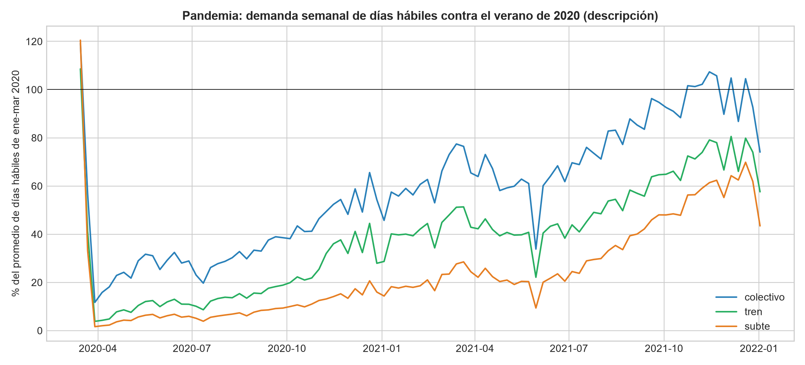

*Figura 24. Demanda semanal de días hábiles como porcentaje del promedio de enero–marzo de 2020, por modo.*

| modo | base_enero_marzo_2020_dia_habil | semana_minima | cociente_minimo | cociente_dic_2020 | cociente_dic_2021 |
|---|---|---|---|---|---|
| colectivo | 8.446.362 | 2020-03-29 | 0,117 | 0,570 | 0,972 |
| tren | 1.318.868 | 2020-03-29 | 0,038 | 0,365 | 0,751 |
| subte | 905.989 | 2020-03-29 | 0,016 | 0,172 | 0,646 |

El mínimo semanal fue de 12% (colectivo), 4% (tren) y 2% (subte) del nivel de enero–marzo de 2020; a fines de 2021 los modos habían vuelto a 97%, 75% y 65%.

### 6.7 Robustez: ingreso real y síntesis de P-1

**Qué pasa con la elasticidad al controlar por el salario real.** En 6.2 el precio se mide en términos reales (deflactado por el IPC), pero el poder de compra de los salarios también se movió en el período y podría estar asociado tanto al precio como a la demanda. Se repiten los métodos A y B con dos variantes: (i) agregando como regresora el **salario real** (RIPTE deflactado por IPC) y (ii) midiendo la tarifa **en salarios** (tarifa / RIPTE), que mide cuánto representa el viaje del salario. El RIPTE es un salario formal, nacional y mensual: aproxima el ingreso de los trabajadores registrados, no el de todos los usuarios. En los meses sin dato se repite el último salario real.

| modo | interanual: tarifa real | interanual: + salario real | interanual: tarifa en salarios | niveles c/tend.: tarifa real | niveles c/tend.: + salario real | niveles c/tend.: tarifa en salarios |
|---|---|---|---|---|---|---|
| colectivo_nacional | -0,012 | -0,018 | 0,030 | -0,016 | -0,022 | 0,051 |
| colectivo_provincial | -0,268 | -0,063 | -0,206 | -0,256 | -0,102 | -0,202 |
| tren | -0,043 | -0,032 | -0,021 | -0,037 | -0,030 | -0,004 |
| subte | -0,224 | -0,145 | -0,214 | -0,255 | -0,164 | -0,249 |

**Qué se obtuvo.** El control por salario real **no cambia las conclusiones cualitativas**, pero sí el tamaño de dos estimaciones:

- **Subte:** sigue negativa y significativa en todas las variantes, pero **baja en valor absoluto**: de −0,22 a −0,15 en interanual y de −0,26 a −0,16 en niveles con tendencia al agregar el salario real; con la tarifa medida en salarios queda en −0,21 y −0,25. Rango global con control: **de −0,15 a −0,25**.
- **Colectivo nacional y tren:** siguen cerca de cero (de −0,03 a +0,05) con intervalos que incluyen el 0.
- **Colectivo provincial:** pasa de −0,27 a −0,06 con el salario real (el intervalo incluye 0), mientras que con la tarifa en salarios queda en −0,21. Su resultado depende de cómo se controle el ingreso y no se considera robusto.

El ingreso se pudo incorporar con datos públicos (el RIPTE se descarga de datos.gob.ar) y no cambia el hallazgo central, aunque achica la elasticidad del subte. No lo vuelve un experimento: sigue habiendo pocos saltos, solo tres grandes, y todos en el mismo año; el salario real también se mueve con la tarifa, de modo que controlar por él quita parte de la variación que identifica el efecto.

**Síntesis de P-1.**

| Pregunta | Resultado | Confianza | Por qué esa confianza |
|---|---|---|---|
| ¿Reacciona la demanda al precio? | **Subte:** sí; elasticidad de −0,15 a −0,26 según el control (con tarifa real; −0,15 a −0,25 al controlar por salario real); Granger lo respalda. **Colectivo nacional y tren:** no se distinguen de cero. **Colectivo provincial:** no robusto. | Subte: media. Colectivo nacional y tren: baja | Subte: dos métodos y el control por salario coinciden en el signo y el test predictivo lo respalda, pero hay pocos saltos y no hay un experimento. Colectivo y tren: pocos saltos que además se mueven juntos en el tiempo, así que el precio no se separa de otros cambios. |
| ¿Cuánto cayó con los saltos tarifarios grandes? | Colectivo nacional ene–feb 2024: −13% (estudio de eventos) contra −3% sin significancia (control sintético). Subte may-2024 (tarifa ×4): −19%. Tren: sin caída en el salto grande (+1%) y −15% en uno moderado superpuesto con un paro. | Baja a media | Los dos métodos discrepan para el colectivo y el control sintético tiene donantes sin verificar. El subte tiene un solo salto grande limpio. |
| ¿Hay sustitución entre modos? | No se observa, ni ante saltos tarifarios ni ante paros. | Media | Los coeficientes cruzados no se pueden separar por colinealidad; en los paros el tren cae cuando para el colectivo (complementariedad) y el subte no sube. Pocos casos. |
| ¿Las líneas de mayor ingreso reaccionan menos? | Sin respaldo. | Baja | Solo 6 líneas: el test no tiene poder para detectar el efecto, y el signo cambia con la especificación. Resultado nulo, no refutación. |
| ¿Cómo se comporta la demanda en feriados, paros, elecciones y pandemia? | Feriados laborables ~0,3 de un día normal. Paro del propio modo: 0,0 a 0,2. Elecciones con gratuidad: ~0; sin gratuidad: 0,6 a 1,0. Pandemia: mínimos de 2% a 12%. | Alta | Muchos eventos, efectos mucho mayores que la banda de ruido y resultados consistentes entre modos y años. |

**Qué falta para un efecto causal más firme.** Los diseños de este trabajo se apoyan en que los controles (el año anterior, las ciudades del interior y el salario real) absorben lo que es común a todos. Lo propio del AMBA que coincida con el salto (por ejemplo, cambios de la oferta de servicio) no queda aislado, y con solo tres saltos grandes cualquier otro cambio simultáneo pesa mucho. Por eso las conclusiones sobre el precio se presentan con confianza media o baja, y las de calendario con confianza alta.

---

## 7. P-2. Qué método pronostica mejor y por qué

**Qué se quiere responder.** Qué método de pronóstico acierta más con la demanda diaria de usuarios, si esa ventaja es real o producto del azar, y por qué un método le gana a otro.

**Qué parte viene de la cátedra y qué se incorpora de afuera.** La **Clase Forecasting** presenta tres métodos: *forecasting lineal* (regresión con tendencia y estacionalidad), *forecasting STL* (pronosticar con "naive" la serie sin estacionalidad y sumarle el patrón estacional) y los modelos **ARMA/ARIMA** (con identificación de órdenes por ACF y PACF y diagnóstico de residuos). De ahí provienen el **Naive** y el **SARIMAX** (un ARIMA con parte estacional y regresoras). **No se vieron en clase** y se incorporan como estado del arte: Prophet, Gradient Boosting, PatchTST y Chronos-2, la prueba de Diebold-Mariano, el MASE y los intervalos conformes. Se incluyen porque la pregunta de P-2 es comparar enfoques de familias distintas (estadística clásica, aprendizaje automático, redes neuronales y modelos fundacionales); cada uno indica su fuente.

### 7.1 Diseño

**Serie.** Usuarios distintos por día (total AMBA y por modo), de enero de 2022 a septiembre de 2026, con los 62 días faltantes completados por la reconstrucción de la sección 5.

**Validación de origen móvil (*rolling origin* o *walk-forward*).** Si se evaluara un modelo con una sola ventana de prueba, el resultado podría deberse a que esa ventana fue fácil o difícil. En el origen móvil, el punto desde el cual se pronostica avanza en el tiempo y el modelo se reajusta cada vez: acá la ventana de entrenamiento es **creciente** (siempre empieza en enero de 2022) y se repite el pronóstico en **42 cortes** sucesivos: el primero el 30-jun-2023 y luego uno cada 28 días. En cada corte el modelo se ajusta con todo lo anterior y pronostica los **28 días siguientes**; los bloques no se solapan, así que cada día se pronostica una vez, con lo que se sabía antes. Quedan 1.161 días de prueba (sin paros ni elecciones), en lugar de 90, y eso permite probar si una diferencia es real. El horizonte de 28 días es el de planificación mensual y es múltiplo de 7, de modo que cada bloque tiene ciclos semanales completos; después se prueba que el resultado no depende de esa elección (horizontes de 7 y 90 días).

**Sin fuga de información.** Un modelo no debe usar datos posteriores al corte (fuga). Los modelos solo usan el pasado y el calendario (día de la semana, feriados, Nochebuena y fin de año, estacionalidad anual), que se conoce de antemano. Se verifica con `scripts/verificar_sin_fuga_p2.py`: reemplazar el futuro por basura no cambia ningún pronóstico.

**Los siete métodos.**

| # | Método | Qué hace | Origen |
|---|---|---|---|
| 1 | **Naive de 7 días** | Repite la última semana observada del entrenamiento. Es la referencia mínima: cualquier método útil debe superarla. | Clase Forecasting (método "naive") |
| 2 | **Naive de 364 días** | Repite el mismo día de la semana del año anterior (52 semanas antes). | Variante del anterior |
| 3 | **SARIMAX (2,0,1)x(0,1,1,7)** | Modelo autorregresivo y de medias móviles con parte estacional de período 7 y regresoras de calendario y armónicos anuales. Los órdenes se identifican en 7.2. | Clase Forecasting (ARIMA); Box y Jenkins |
| 4 | **Prophet** | Descomposición aditiva en tendencia con quiebres, ciclo semanal y anual y feriados nacionales. | Taylor y Letham (2018) |
| 5 | **Gradient Boosting recursivo** | Aprendizaje automático: muchos árboles de decisión pequeños, cada uno corrige el error de los anteriores. Aprende sobre una tabla de rezagos (1, 2, 7, 14, 21 y 28 días), media y desvío móvil de 7 días y calendario; pronostica paso a paso alimentándose de sus propias predicciones (por eso se llama recursivo). | Friedman (2001); implementación `HistGradientBoostingRegressor` |
| 6 | **Chronos-2** | **Modelo fundacional** de series temporales: una red neuronal entrenada de antemano con enormes colecciones de series de muchos dominios, que pronostica sin ajustar sus pesos con los datos propios (*zero-shot*). Recibe las covariables de calendario conocidas. | Ansari et al. (2024) para Chronos; Chronos-2 (`amazon/chronos-2`) |
| 7 | **PatchTST** | Red neuronal *Transformer* para series temporales: divide las últimas 8 semanas en parches de 7 días, aplica auto-atención entre parches (cada parche "mira" a los demás para decidir qué es relevante) y una normalización por ventana (**RevIN**) que lo hace insensible a cambios de nivel recientes; combina todo con las covariables futuras de calendario. | Nie et al. (2023); Kim et al. (2022) para RevIN |

**Métricas.** Con el error de cada día definido como pronóstico menos valor real:

- **MAE** (error absoluto medio): promedio del error sin signo, en millones de usuarios. Un MAE de 0,2 significa que, en promedio, el pronóstico se aleja 200.000 usuarios del valor real.
- **RMSE** (raíz del error cuadrático medio): como el MAE pero elevando los errores al cuadrado antes de promediar, de modo que penaliza más los errores grandes. Si es mucho mayor que el MAE, hay días con errores muy grandes.
- **MAPE** (error porcentual absoluto medio): el error como porcentaje del valor real. Permite comparar series de distinto tamaño (los tres modos), pero se infla en los días de poca demanda (feriados, domingos), donde un error chico es un porcentaje grande.
- **Sesgo:** promedio del error con signo. Positivo indica que el método tiende a sobreestimar; negativo, a subestimar.
- **MASE** (error escalado; Hyndman y Koehler, 2006): MAE del método dividido por el MAE del Naive de 7 días dentro de la muestra de entrenamiento. Menor a 1 es mejor que repetir la última semana; permite comparar entre series y horizontes sin depender de la unidad.

**Prueba de significancia de Diebold-Mariano** (Diebold y Mariano, 1995). Un método puede tener menor error que otro por azar. La prueba contrasta la hipótesis nula de que **dos métodos tienen el mismo error esperado**: se calcula, para cada día, la diferencia entre el error absoluto de un método y el del otro, y se prueba si el promedio de esas diferencias es distinto de cero. Un p-valor menor a 0,05 indica que la diferencia es distinguible del azar; el signo dice cuál método es mejor. Como los errores de días consecutivos están correlacionados, el error estándar se corrige con el estimador HAC (Newey-West, 27 rezagos); sin esa corrección la prueba rechazaría de más. La prueba dice si la diferencia es real, no si es grande en la práctica (para eso están el MAE y el MASE).

### 7.2 Orden del SARIMAX

**Qué es y de dónde viene.** Identificar el orden de un ARIMA es elegir cuántos términos autorregresivos y de media móvil usa. Se hace con las herramientas de la **Clase Forecasting** ("Determinación de los órdenes p y q en base a la ACF y la PACF"), usando solo datos hasta junio de 2023 para no mirar el período de prueba: ADF y KPSS (diferencia estacional de 7 días, d = 0; ver 4.2), ACF y PACF, y una grilla de 36 órdenes por BIC exigiendo residuos sin autocorrelación (Ljung-Box).

**Qué son la ACF y la PACF.** La **ACF** (función de autocorrelación) mide, para cada rezago k, la correlación entre la serie y ella misma k días antes. La **PACF** (autocorrelación parcial) mide esa misma correlación después de descontar la que ya explican los rezagos intermedios (1, 2, …, k − 1): es el aporte *propio* de cada rezago. Guían el orden del modelo: en términos generales, una ACF que se corta tras q rezagos sugiere un término de medias móviles de orden q, y una PACF que se corta tras p rezagos sugiere un término autorregresivo de orden p; si en cambio una decae gradualmente, la otra es la que se corta. La zona celeste es la banda de confianza de 95% para una serie sin autocorrelación (aproximadamente ±1,96/√n): las barras que sobresalen son autocorrelaciones significativas. Las líneas punteadas verticales marcan los múltiplos de 7 días.

**Qué muestran los gráficos.** Ambos corresponden al total AMBA con la diferencia estacional de 7 días ya aplicada, de modo que el ciclo semanal está parcialmente removido. En el eje horizontal está el rezago en días y en el vertical la autocorrelación (o autocorrelación parcial), entre −1 y 1.

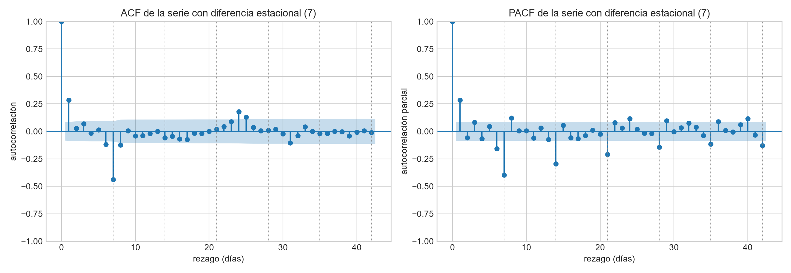

*Figura 25. ACF y PACF del total AMBA con la diferencia estacional de 7 días (entrenamiento hasta junio de 2023).*

**Qué se obtuvo.**

- **ACF.** Hay una autocorrelación positiva en el rezago 1 (+0,29) y una **fuerte autocorrelación negativa en el rezago 7 (−0,44)**; casi todo el resto cae dentro de la banda. Restar la semana anterior a una serie con patrón semanal estable introduce una autocorrelación negativa en el rezago 7: es la señal típica de un término de **media móvil estacional** de orden 1.
- **PACF.** También hay un pico positivo en el rezago 1 y, en los múltiplos de 7, picos negativos que **decaen gradualmente** (−0,40 en el 7, −0,30 en el 14, −0,21 en el 21, −0,14 en el 28). Una PACF que decae en los rezagos estacionales y una ACF con picos solo en los rezagos 1 y 7 es la combinación que corresponde a una media móvil estacional (un término autorregresivo estacional mostraría un solo pico en el rezago 7).
- **Orden resultante.** Los gráficos sugieren un término estacional de media móvil de orden 1 (Q = 1, P = 0) y términos no estacionales de orden bajo. La grilla lo confirma: el mejor modelo según BIC con residuos sin autocorrelación es **(2,0,1)x(0,1,1,7)**: dos términos autorregresivos, uno de media móvil, una diferencia estacional de 7 días y un término estacional de media móvil.

**Cómo leer la tabla de la grilla.** `orden` es (p, d, q)x(P, D, Q, s). `AIC` y `BIC` son criterios de información: miden el ajuste penalizando la cantidad de parámetros (menor es mejor; el BIC penaliza más la complejidad). `LjungBox_p7` y `LjungBox_p14` son los p-valores de la prueba de Ljung-Box (Ljung y Box, 1978), que contrasta que los residuos no tienen autocorrelación hasta el rezago 7 y 14; un valor mayor a 0,05 significa que no hay evidencia de autocorrelación residual, es decir, que el modelo captó la estructura temporal. Las diferencias de BIC entre los primeros órdenes son pequeñas (362,2, 362,7 y 364,3), así que el orden no queda identificado con precisión; por eso se verifica que usar el orden original del repositorio da prácticamente el mismo error.

| orden | AIC | BIC | LjungBox_p7 | LjungBox_p14 |
|---|---|---|---|---|
| (2,0,1)x(0,1,1,7) | 306,600 | 362,200 | 0,453 | 0,466 |
| (1,0,2)x(0,1,1,7) | 307,200 | 362,700 | 0,296 | 0,308 |
| (1,0,0)x(0,1,1,7) | 317,300 | 364,300 | 0,258 | 0,362 |
| (1,0,2)x(1,1,1,7) | 304,500 | 364,300 | 0,786 | 0,684 |
| (2,0,1)x(1,1,1,7) | 304,900 | 364,700 | 0,809 | 0,750 |

### 7.3 Resultados con el total AMBA (28 días)

**Cómo se lee.** Cada fila es un método; las columnas son las métricas de 7.1 calculadas sobre los 1.161 días de prueba (sin paros ni elecciones). La segunda tabla da, para cada método, la diferencia de MAE contra el mejor (PatchTST; positiva = peor que él) y su p-valor de Diebold-Mariano.

| modelo | dias | MAE | RMSE | MAPE_pct | sesgo | MASE |
|---|---|---|---|---|---|---|
| naive_7 | 1.161 | 0,472 | 0,824 | 19,549 | -0,052 | 1,431 |
| naive_364 | 1.161 | 0,395 | 0,698 | 17,374 | 0,076 | 1,195 |
| sarimax | 1.161 | 0,270 | 0,370 | 11,807 | 0,005 | 0,819 |
| prophet | 1.161 | 0,254 | 0,375 | 11,850 | -0,002 | 0,769 |
| chronos2 | 1.161 | 0,199 | 0,314 | 9,252 | 0,052 | 0,605 |
| gradient_boosting | 1.161 | 0,187 | 0,267 | 7,433 | 0,019 | 0,568 |
| patchtst | 1.161 | 0,180 | 0,267 | 7,170 | 0,056 | 0,547 |

*Diebold-Mariano contra PatchTST:*

| modelo | contra | dif_MAE | error_std_HAC | p_valor | dias |
|---|---|---|---|---|---|
| naive_7 | patchtst | 0,2920 | 0,0310 | 0,0000 | 1.161 |
| naive_364 | patchtst | 0,2140 | 0,0210 | 0,0000 | 1.161 |
| sarimax | patchtst | 0,0890 | 0,0100 | 0,0000 | 1.161 |
| sarimax_sin_anual | patchtst | 0,1370 | 0,0180 | 0,0000 | 1.161 |
| sarimax_orden_original | patchtst | 0,0880 | 0,0090 | 0,0000 | 1.161 |
| prophet | patchtst | 0,0730 | 0,0080 | 0,0000 | 1.161 |
| gradient_boosting | patchtst | 0,0060 | 0,0080 | 0,3922 | 1.161 |
| chronos2 | patchtst | 0,0190 | 0,0070 | 0,0083 | 1.161 |
| sarimax_en_logs | patchtst | 0,0630 | 0,0100 | 0,0000 | 1.161 |
| gb_solo_calendario | patchtst | 0,0560 | 0,0110 | 0,0000 | 1.161 |
| chronos2_zeroshot | patchtst | 0,0880 | 0,0140 | 0,0000 | 1.161 |

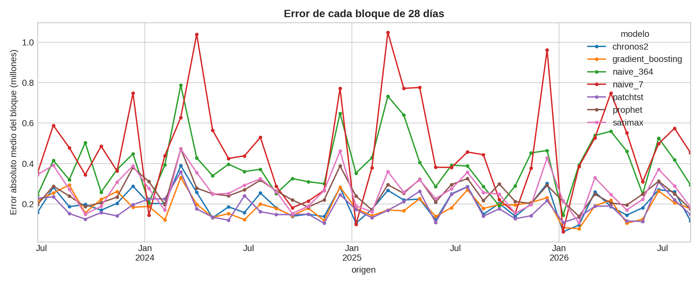

*Figura 26. Error absoluto medio de cada método en cada uno de los 42 cortes de evaluación.*

**Qué se obtuvo.**

- **PatchTST** (MAE 0,180 M, MAPE 7,17%, MASE 0,547) y **Gradient Boosting** (MAE 0,187 M, MAPE 7,43%, MASE 0,568) lideran con un **empate estadístico en el primer puesto** (Diebold-Mariano: diferencia de 0,006 M, p = 0,392), superando de forma significativa (p < 0,01) a todos los demás.
- **Chronos-2** se ubica tercero (MAE 0,199 M, MAPE 9,25%, MASE 0,605): **sin entrenar un solo parámetro sobre la serie de SUBE**, supera con claridad y significancia estadística tanto a **Prophet** (MAE 0,254 M, MASE 0,769) como a **SARIMAX** (MAE 0,270 M, MASE 0,819).

**Qué se concluye.** No hay un ganador único entre PatchTST y Gradient Boosting; ambos le ganan a los demás. Cuánta confianza merece la ventaja *numérica* de PatchTST se discute en 7.7 (sensibilidad).

### 7.4 Por qué: dónde está el error

**Qué se hace.** Para entender *por qué* un método gana se descompone el error por tipo de día y se comparan **variantes (ablaciones)** que cambian una sola cosa por vez.

*MAE por tipo de día (millones de usuarios):*

| modelo | domingo | feriado | hábil | sábado |
|---|---|---|---|---|
| naive_7 | 0,141 | 1,730 | 0,501 | 0,183 |
| naive_364 | 0,186 | 1,635 | 0,370 | 0,249 |
| sarimax | 0,253 | 0,674 | 0,255 | 0,206 |
| prophet | 0,252 | 0,884 | 0,213 | 0,215 |
| chronos2 | 0,128 | 0,762 | 0,177 | 0,163 |
| gradient_boosting | 0,131 | 0,284 | 0,198 | 0,151 |
| patchtst | 0,132 | 0,280 | 0,191 | 0,139 |

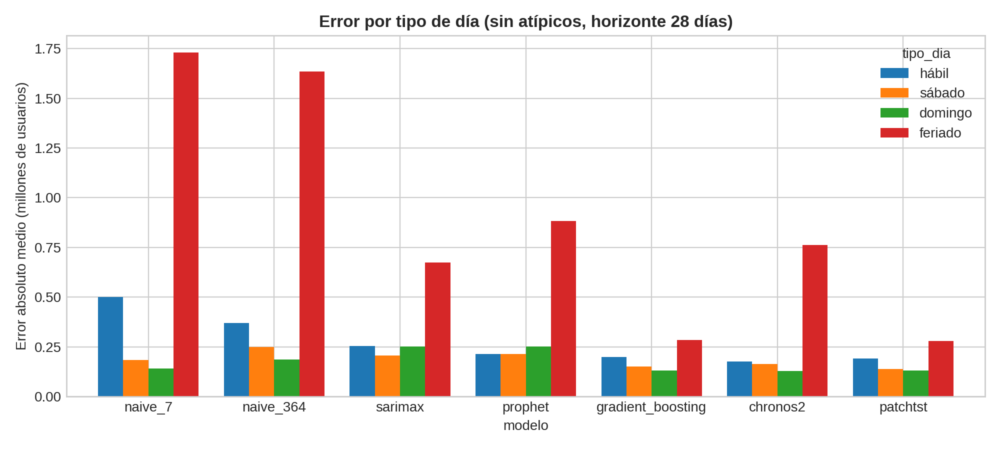

*Figura 27. Error absoluto medio de cada método por tipo de día (hábil, sábado, domingo, feriado).*

| Hallazgo | Evidencia (MAE, millones) |
|---|---|
| **Los feriados explican el grueso de la ventaja sobre los Naive y sobre los modelos sin ajuste supervisado de feriados.** | Feriados: Naive 7 = 1,73; PatchTST = 0,280; Gradient Boosting = 0,284; SARIMAX = 0,674; Chronos-2 = 0,762 |
| **En días hábiles ordinarios, el modelo fundacional (Chronos-2) logra el menor error de todos.** | Días hábiles: Chronos-2 = **0,177** (MAPE 5,3%); PatchTST = 0,191; Gradient Boosting = 0,198; Prophet = 0,213; SARIMAX = 0,255 |
| **Las covariables de calendario reducen 26% el error de Chronos-2 zero-shot.** Incluso sin calendario, Chronos-2 univariado empata con SARIMAX. | Chronos-2 con calendario = 0,199 (MASE 0,605) contra Chronos-2 *zero-shot* puro = 0,268 (MASE 0,817; feriados 1,640 contra 0,762) |
| **La estacionalidad anual importa.** | SARIMAX sin término anual 0,318 contra 0,270 con él |
| **El patrón semanal es multiplicativo.** En logaritmos el SARIMAX mejora 10%. | SARIMAX en logs 0,243 contra 0,270; domingos 0,132 contra 0,253 |
| **El Gradient Boosting gana por el calendario y por los rezagos; PatchTST suma atención por parches semanales y normalización RevIN sin acumular error recursivo.** | GB solo calendario = 0,237; GB completo = 0,187; PatchTST = 0,180 |

**Qué se concluye.** En sábados y domingos el Naive de 7 días es competitivo (el patrón de fin de semana es estable); las ganancias de los modelos vienen de los **días hábiles y los feriados**. Esto coincide con lo visto en la exploración: el ciclo semanal explica casi dos tercios de la variación (4.4) y los feriados son el valor extremo dominante (4.3).

### 7.5 Por modo: ¿gana el mismo método?

**Qué se hace.** Se repite la evaluación para cada modo por separado (colectivo, tren, subte). Se usa el MASE porque permite comparar entre series de escalas muy distintas.

| modelo | colectivo_amba | tren_amba | subte_amba |
|---|---|---|---|
| naive_7 | 1,429 | 1,245 | 1,278 |
| naive_364 | 1,191 | 1,317 | 1,861 |
| sarimax | 0,830 | 0,624 | 0,749 |
| sarimax_en_logs | 0,752 | 0,722 | 0,898 |
| prophet | 0,785 | 0,645 | 0,913 |
| gradient_boosting | 0,588 | 0,617 | 0,713 |
| chronos2 | 0,619 | 0,576 | 0,571 |
| patchtst | 0,558 | 0,478 | 0,566 |

*Diebold-Mariano por modo contra PatchTST:*

| modo | modelo | contra | dif_MAE | error_std_HAC | p_valor | dias |
|---|---|---|---|---|---|---|
| colectivo_amba | naive_7 | patchtst | 0,2699 | 0,0285 | 0,0000 | 1.161 |
| colectivo_amba | naive_364 | patchtst | 0,1963 | 0,0194 | 0,0000 | 1.161 |
| colectivo_amba | sarimax | patchtst | 0,0838 | 0,0090 | 0,0000 | 1.161 |
| colectivo_amba | sarimax_en_logs | patchtst | 0,0592 | 0,0089 | 0,0000 | 1.161 |
| colectivo_amba | prophet | patchtst | 0,0702 | 0,0075 | 0,0000 | 1.161 |
| colectivo_amba | gradient_boosting | patchtst | 0,0086 | 0,0070 | 0,2191 | 1.161 |
| colectivo_amba | chronos2 | patchtst | 0,0186 | 0,0066 | 0,0051 | 1.161 |
| tren_amba | naive_7 | patchtst | 0,0511 | 0,0062 | 0,0000 | 1.161 |
| tren_amba | naive_364 | patchtst | 0,0562 | 0,0049 | 0,0000 | 1.161 |
| tren_amba | sarimax | patchtst | 0,0097 | 0,0014 | 0,0000 | 1.161 |
| tren_amba | sarimax_en_logs | patchtst | 0,0164 | 0,0016 | 0,0000 | 1.161 |
| tren_amba | prophet | patchtst | 0,0110 | 0,0018 | 0,0000 | 1.161 |
| tren_amba | gradient_boosting | patchtst | 0,0092 | 0,0016 | 0,0000 | 1.161 |
| tren_amba | chronos2 | patchtst | 0,0064 | 0,0014 | 0,0000 | 1.161 |
| subte_amba | naive_7 | patchtst | 0,0277 | 0,0045 | 0,0000 | 1.104 |
| subte_amba | naive_364 | patchtst | 0,0517 | 0,0060 | 0,0000 | 1.104 |
| subte_amba | sarimax | patchtst | 0,0071 | 0,0017 | 0,0000 | 1.104 |
| subte_amba | sarimax_en_logs | patchtst | 0,0131 | 0,0020 | 0,0000 | 1.104 |
| subte_amba | prophet | patchtst | 0,0137 | 0,0022 | 0,0000 | 1.104 |
| subte_amba | gradient_boosting | patchtst | 0,0059 | 0,0020 | 0,0037 | 1.104 |
| subte_amba | chronos2 | patchtst | 0,0000 | 0,0018 | 0,9826 | 1.104 |

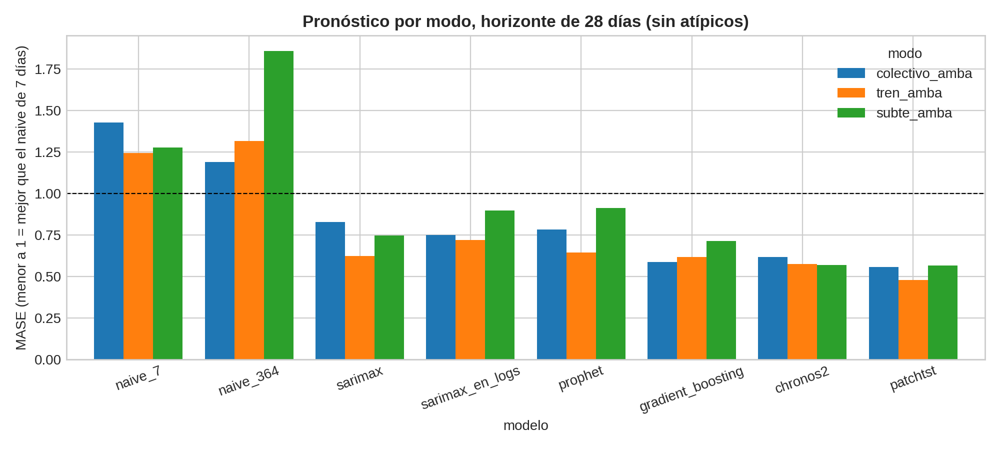

*Figura 28. MASE de cada método por modo.*

**Qué se obtuvo.**

- **Colectivo** (la gran mayoría de los usuarios): **PatchTST** (MASE 0,558, MAPE 7,3%) y **Gradient Boosting** (MASE 0,588, MAPE 7,6%) empatan estadísticamente en el primer lugar (p = 0,219), seguidos de cerca por **Chronos-2** (MASE 0,619).
- **Tren:** **PatchTST gana en solitario** (MASE **0,478**, MAPE 8,6%, p < 0,0001 contra todos los demás), seguido por **Chronos-2** (MASE 0,576), mientras que entre los modelos clásicos **Gradient Boosting** (0,617) y **SARIMAX** (0,624) empatan.
- **Subte:** **PatchTST** (MASE **0,566**, MAPE 9,7%) y **Chronos-2** (MASE **0,571**, MAPE 11,8%) **empatan en el primer puesto** (p = 0,983), superando por amplio margen a **Gradient Boosting** (0,713) y **SARIMAX** (0,749). Una explicación posible, **no probada** (no se evaluó una variante sin RevIN), es que el subte sufrió cambios marcados de nivel (en 2024 por tarifas y desde 2025 por el sistema multipago) y que la normalización por ventana de PatchTST y el escalado por contexto de Chronos-2 se ajustan al nivel local reciente, mientras que los árboles y los modelos aditivos arrastran el nivel histórico.
- Entre los métodos clásicos se observa una complementariedad en tren y subte: los modelos aditivos ganan en días hábiles y el Gradient Boosting en feriados y fines de semana, lo que motiva evaluar el híbrido de 7.6.

### 7.6 Híbrido por tipo de día

**Qué es y por qué.** Si cada método rinde mejor en un tipo de día distinto, un modelo que use cada método donde rinde mejor podría superar a todos. Se probaron tres versiones, todas con los pronósticos ya calculados:

- **Híbrido fijo:** SARIMAX en días hábiles, Gradient Boosting en el resto. La regla surge de mirar toda la muestra de prueba, así que es una cota optimista.
- **Híbrido walk-forward:** en cada corte elige, para cada tipo de día, el método con menor error en los cortes **anteriores** (sin mirar el futuro). Es la versión honesta.
- **Promedio** simple de SARIMAX y Gradient Boosting.

| modelo | total_amba | colectivo_amba | tren_amba | subte_amba |
|---|---|---|---|---|
| sarimax | 0,819 | 0,830 | 0,624 | 0,749 |
| prophet | 0,769 | 0,785 | 0,645 | 0,913 |
| gradient_boosting | 0,568 | 0,588 | 0,617 | 0,713 |
| hibrido_fijo | 0,683 | 0,693 | 0,547 | 0,602 |
| hibrido_walkforward | 0,580 | 0,605 | 0,536 | 0,612 |
| promedio_sarimax_gb | 0,618 | 0,637 | 0,552 | 0,632 |

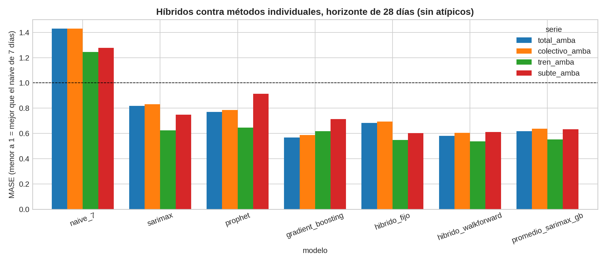

*Figura 29. MASE del híbrido y de sus métodos de origen, por serie.*

**Qué se obtuvo.** En **tren y subte** el híbrido mejora a los dos métodos de origen (MASE de 0,62 a 0,54 en el tren y de 0,71 a 0,61 en el subte; p < 0,01); el promedio simple ya mejora a ambos, así que la ganancia viene de que sus errores se complementan. En **total y colectivo** no aporta, porque el Gradient Boosting gana también en días hábiles.

**Qué se concluye.** No hay un método único; el mejor depende de la serie y del tipo de día. *Límite:* la idea del híbrido surgió de mirar los mismos resultados y se hicieron 24 comparaciones; es un hallazgo a confirmar en otro período.

### 7.7 Robustez: huecos, horizonte, días de hito en el entrenamiento y sensibilidad de PatchTST

**a) Tratamiento de los días sin dato.** Se reentrenaron SARIMAX, Prophet, Gradient Boosting, Chronos-2 y PatchTST con los 62 días completados de tres maneras: con la reconstrucción desde transacciones (serie principal), con interpolación por día de la semana y dejándolos vacíos. Todas se evalúan contra la serie reconstruida, excluyendo esos 62 días de las métricas.

| modelo | faltantes | interpolada | reconstruida |
|---|---|---|---|
| chronos2 | 0,723 | 0,644 | 0,605 |
| gradient_boosting | 0,606 | 0,630 | 0,562 |
| patchtst | 0,656 | 0,597 | 0,542 |
| prophet | 0,805 | 0,798 | 0,764 |
| sarimax | 0,808 | 0,824 | 0,806 |

El liderazgo de **PatchTST** (MASE 0,542) y **Gradient Boosting** (0,562), seguido por **Chronos-2** (0,605), no cambia según cómo se traten los 62 días sin dato, pero la **reconstrucción desde transacciones** reduce el error de los tres respecto de la interpolación o de dejar los huecos vacíos (en PatchTST el MASE baja de 0,656 con faltantes y 0,597 con interpolación a 0,542 con la serie reconstruida).

**b) Horizonte (7, 28 y 90 días).**

| modelo | 7 días | 28 días | 90 días |
|---|---|---|---|
| naive_7 | 1,190 | 1,431 | 1,436 |
| naive_364 | 1,191 | 1,195 | 1,208 |
| sarimax | 0,773 | 0,819 | 0,851 |
| prophet | 0,759 | 0,769 | 0,776 |
| chronos2 | 0,594 | 0,605 | 0,662 |
| gradient_boosting | 0,559 | 0,568 | 0,612 |
| patchtst | 0,523 | 0,547 | 0,671 |

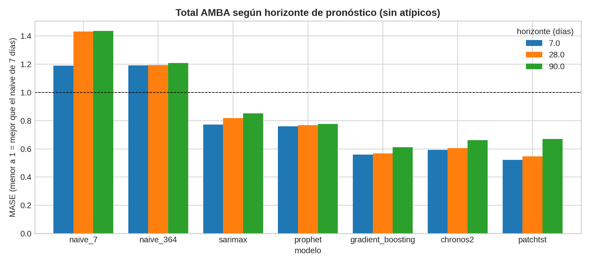

*Figura 30. MASE de cada método para horizontes de 7, 28 y 90 días.*

A **7 y 28 días** lidera **PatchTST** (MASE 0,523 y 0,547), en empate estadístico con **Gradient Boosting** (0,559 y 0,568; p = 0,106 y 0,392) y seguido por **Chronos-2** (0,594 y 0,605). A **90 días** (un trimestre completo hacia adelante), **Gradient Boosting** (0,612), **Chronos-2** (0,662) y **PatchTST** (0,671) empatan estadísticamente en la punta (p = 0,148 y 0,140), superando con claridad a Prophet (0,776) y SARIMAX (0,851).

**c) Entrenar con y sin los días de hito (paros y elecciones).** La serie principal se entrena con todos los días, incluidos los 15 días de paro y de elección entre 2022 y 2026; esos días solo se excluyen al calcular las métricas. Acá se prueba el enfoque contrario, igual que con los huecos. Tres variantes, mismos 42 cortes y mismos días de evaluación:

- **con_hitos:** serie principal.
- **sin_hitos:** los días de paro y de elección quedan **vacíos** en el entrenamiento (el SARIMAX los trata como datos faltantes; Prophet y el Gradient Boosting los descartan como objetivo).
- **hitos_imputados:** esos días se **reemplazan por el valor habitual**, la mediana del mismo día de la semana de las cuatro semanas anteriores (sin feriados, paros ni elecciones). Usa solo el pasado, de modo que no hay fuga. Se agrega porque con días vacíos el SARIMAX pierde las diferencias estacionales de 7 días que cruzan cada vacío.

Los **feriados no se quitan**: son predecibles y los modelos los aprenden con el calendario. Un corte (el del 24 de julio de 2026) se excluye de todas las variantes porque el SARIMAX con hitos imputados no devolvió pronóstico; por eso la comparación usa 1.133 días y no 1.161.

*MASE en días sin paros ni elecciones (la comparación principal):*

| modelo | con_hitos | sin_hitos | hitos_imputados |
|---|---|---|---|
| chronos2 | 0,602 | 0,593 | 0,589 |
| gradient_boosting | 0,568 | 0,572 | 0,568 |
| patchtst | 0,545 | 0,562 | 0,546 |
| prophet | 0,771 | 0,767 | 0,766 |
| sarimax | 0,819 | 0,909 | 0,785 |

*MASE en los propios días de paro y de elección:*

| modelo | con_hitos | sin_hitos | hitos_imputados |
|---|---|---|---|
| chronos2 | 5,041 | 5,128 | 5,073 |
| gradient_boosting | 4,918 | 4,947 | 4,926 |
| patchtst | 5,067 | 5,243 | 5,144 |
| prophet | 5,064 | 5,123 | 5,121 |
| sarimax | 4,997 | 5,137 | 5,123 |

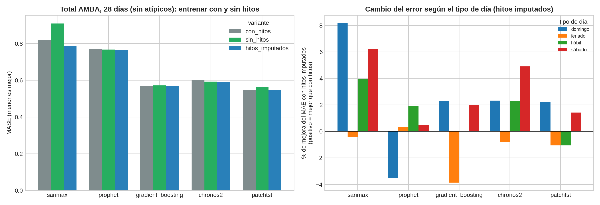

*Figura 31. Efecto de entrenar con los días de hito, vacíos o imputados.*

- **PatchTST, Gradient Boosting y Prophet casi no cambian** entre entrenar con la serie original o con los días imputados (MASE de PatchTST: 0,545 y 0,546; Gradient Boosting: 0,568 y 0,568; Prophet: 0,771 y 0,766). Dejar los días vacíos deteriora levemente a PatchTST (0,545 → 0,562, p = 0,028) porque las ventanas de parches que cruzan un paro reciben una interpolación interna simple.
- **Chronos-2 y SARIMAX mejoran al imputar:** el MASE de **Chronos-2** baja de 0,602 a **0,589** (p = 0,0013) y el de **SARIMAX** de 0,819 a **0,785** (p = 0,0004, un 4% menos de MAE), porque los shocks extremos dejan de contaminar el escalado en contexto y el término de media móvil estacional.
- **En los propios días de paro y elección nadie mejora** (MASE de 4,9 a 5,2 en todos los métodos): quitar los hitos del entrenamiento no ayuda a anticiparlos, porque no hay en el calendario nada que los anuncie. Para eso sirve el escenario de 7.9.

**d) Sensibilidad de PatchTST a la semilla y a los hiperparámetros.** *Por qué se hace.* PatchTST es una red neuronal: su resultado depende de la **semilla aleatoria** (el valor que fija la inicialización de los pesos) y de **hiperparámetros** (épocas de entrenamiento, tasa de aprendizaje, tamaño de la red) cuya elección en la corrida original no está documentada. Si su ventaja sobre el Gradient Boosting fuera un accidente de esa elección, la conclusión de 7.3 sería frágil. *Qué se hizo.* Se repitió la evaluación completa (mismos 42 cortes, total AMBA) con otras cinco semillas y con 12 variantes de un hiperparámetro por vez alrededor de la configuración original (150 épocas, tasa de aprendizaje 4e-3, `d_model` 32, 2 capas, 8 parches). No se eligió la "mejor" configuración: el objetivo es medir la dispersión, no volver a ajustar. *Cómo se lee.* `dif_MAE_vs_GB` es la diferencia de MAE contra el Gradient Boosting (negativa = PatchTST mejor) y `p_DM_vs_GB` el p-valor de Diebold-Mariano de esa diferencia.

| config | MAE | MASE | dif_MAE_vs_GB | p_DM_vs_GB |
|---|---|---|---|---|
| d_model_16 | 0,1904 | 0,5785 | 0,0037 | 0,6717 |
| d_model_64 | 0,1857 | 0,5646 | -0,0010 | 0,8992 |
| epochs_100 | 0,1913 | 0,5807 | 0,0046 | 0,5779 |
| epochs_300 | 0,1772 | 0,5373 | -0,0095 | 0,2003 |
| epochs_50 | 0,2576 | 0,7815 | 0,0708 | 0,0000 |
| gradient_boosting (referencia) | 0,1868 | 0,5680 | — | — |
| lr_0.001 | 0,2641 | 0,8013 | 0,0774 | 0,0000 |
| lr_0.002 | 0,1975 | 0,5995 | 0,0107 | 0,2024 |
| lr_0.008 | 0,1820 | 0,5525 | -0,0047 | 0,5339 |
| n_patches_12 | 0,1824 | 0,5545 | -0,0043 | 0,6105 |
| n_patches_4 | 0,1852 | 0,5629 | -0,0016 | 0,8285 |
| num_layers_1 | 0,1811 | 0,5500 | -0,0056 | 0,4810 |
| num_layers_3 | 0,1812 | 0,5498 | -0,0055 | 0,4637 |
| patchtst (corrida original de Arey14) | 0,1803 | 0,5469 | -0,0065 | 0,3922 |
| semilla_0 | 0,1852 | 0,5628 | -0,0015 | 0,8495 |
| semilla_1 | 0,1824 | 0,5539 | -0,0044 | 0,5197 |
| semilla_2 | 0,1845 | 0,5601 | -0,0022 | 0,7791 |
| semilla_3 | 0,1824 | 0,5539 | -0,0043 | 0,5748 |
| semilla_4 | 0,1833 | 0,5567 | -0,0035 | 0,6519 |
| semilla_42 | 0,1791 | 0,5436 | -0,0076 | 0,3137 |

- **Semillas:** el MASE de PatchTST va de **0,544 a 0,563** (mediana 0,555), contra 0,568 del Gradient Boosting. Con las seis semillas PatchTST queda numéricamente por debajo, pero **ninguna diferencia es estadísticamente distinguible** (p entre 0,31 y 0,85).
- **Hiperparámetros:** el MASE va de 0,537 a 0,801. Dos configuraciones son significativamente **peores** que el Gradient Boosting: pocas épocas (50) y tasa de aprendizaje baja (0,001), es decir, entrenamiento insuficiente. Las otras 10 quedan entre 0,537 y 0,600, y ninguna se distingue del Gradient Boosting (p ≥ 0,20). En total, **14 de las 19 corridas** (18 configuraciones más la original) tienen MASE menor que el Gradient Boosting.
- **Reproducción:** con la semilla 42 y la configuración original se obtiene un MAE de 0,1791 M, contra 0,1803 M de la corrida original del repositorio: casi igual pero no idéntico (es esperable alguna diferencia entre máquinas y versiones de la biblioteca).

**Qué se concluye.** La ventaja de PatchTST sobre el Gradient Boosting **no es robusta**: es pequeña (alrededor de 0,006 M de MAE), nunca significativa y depende de que el entrenamiento sea suficiente. La conclusión que se sostiene es que **PatchTST y Gradient Boosting empatan** en el primer puesto y que ambos superan al resto.

### 7.8 Intervalos de predicción

**Para qué sirve.** Un pronóstico puntual ("mañana habrá 3,4 millones de usuarios") no dice cuán seguro es. Un **intervalo de predicción** acompaña ese valor con un rango dentro del cual se espera que caiga el valor real con una probabilidad dada: el de **80%** debería contener el valor real 8 de cada 10 días y el de **95%**, 19 de cada 20. Para planificar el servicio importa el rango, no solo el punto.

**Cómo se construyen.** Con el método **conforme** (*split conformal*; Vovk et al., 2005; Lei et al., 2018), que no supone una distribución del error: para cada corte, a partir del noveno, el semiancho del intervalo es el cuantil del error absoluto que tuvo el mismo método en los **cortes anteriores** a horizontes parecidos (±3 días). El intervalo es el pronóstico más y menos ese semiancho. Solo usa errores pasados. Se calcula para los 952 días de los 34 cortes que quedan (todos los días, incluidos paros y elecciones).

**Qué se evalúa.** Dos cosas que van juntas: la **cobertura** (`cobertura_80` y `cobertura_95`: la proporción de días en que el valor real cayó dentro del intervalo, que debería ser cercana al nivel nominal 0,80 y 0,95; si es menor, el intervalo promete más de lo que cumple) y el **semiancho** (`semiancho_80` y `semiancho_95`: la mitad del ancho promedio, en millones de usuarios; con la misma cobertura, menor es mejor). Como referencia, la demanda media es de 3,05 millones de usuarios por día (3,54 en días hábiles).

| modelo | dias | cobertura_80 | semiancho_80 | cobertura_95 | semiancho_95 |
|---|---|---|---|---|---|
| naive_7 | 952 | 0,807 | 0,720 | 0,937 | 2,332 |
| naive_364 | 952 | 0,785 | 0,453 | 0,940 | 1,955 |
| sarimax | 952 | 0,821 | 0,426 | 0,945 | 0,830 |
| prophet | 952 | 0,809 | 0,344 | 0,949 | 0,848 |
| gradient_boosting | 952 | 0,847 | 0,314 | 0,942 | 0,568 |
| chronos2 | 952 | 0,810 | 0,302 | 0,951 | 0,818 |
| patchtst | 952 | 0,828 | 0,304 | 0,942 | 0,622 |

**Qué se obtuvo.** Los siete métodos están bien calibrados: la cobertura observada va de 79% a 85% para el intervalo nominal de 80% y de 94% a 95% para el de 95%. Lo que distingue a los métodos de punta es el **ancho necesario para garantizar esa cobertura**: en el de **80%**, **Chronos-2** (± 0,302 M) y **PatchTST** (± 0,304 M) logran los intervalos más estrechos, seguidos de **Gradient Boosting** (± 0,314 M), menos de la mitad del ancho del Naive de 7 días (± 0,720 M). En el de **95%**, **Gradient Boosting** (± 0,568 M) y **PatchTST** (± 0,622 M) son los más precisos (alrededor de 16%–18% de un día hábil), frente a ± 0,818 M de Chronos-2 (su cola del 95% refleja los mayores errores en feriados), ± 0,830 M de SARIMAX y ± 2,332 M del Naive de 7 días.

### 7.9 Pronóstico de los hitos de P-1: feriados, paros, elecciones y saltos tarifarios

**Qué se hace y por qué.** Las comparaciones anteriores excluyen los paros y las elecciones. Pero para planificar importa lo contrario: **qué pasa con la demanda si hay un paro, una elección o un aumento de tarifa**, y qué método se equivoca menos. Acá se evalúan los mismos pronósticos (origen móvil, 28 días) en los días de los hitos de P-1, sin darles información adicional: los modelos conocen solo el pasado y el calendario de feriados. Se miden tres cosas:

- **A. Error en días de hito**, por método: MAE (millones de usuarios) para el total del AMBA.
- **B. Pronóstico condicional (escenario).** Si se *sabe* que habrá un paro o una elección, el pronóstico del método puede multiplicarse por el cociente típico que midió P-1 para ese tipo de día y ese modo (mediana de los **otros** días del mismo grupo, dejando afuera el día evaluado). Es lo que haría un planificador que conoce el calendario de paros y elecciones. Hay pocos eventos por grupo (de 3 a 6), así que es una ilustración y no una prueba.
- **C. Saltos tarifarios.** Pronósticos hechos **el día anterior** al primer aumento del salto (el origen móvil de 28 días no sirve para esto, porque casi siempre incorpora parte del aumento), y su error en los 28 días hábiles posteriores al último aumento. Se compara con el error habitual del mismo método a horizontes largos, y con un pronóstico que además recibe el precio: el del método multiplicado por exp(ε × cambio en log de la tarifa real), con la elasticidad ε de P-1 para ese modo (−0,012 colectivo, −0,043 tren, −0,224 subte). Como esa elasticidad se estimó con toda la muestra, este último resultado es **optimista**.

**A. Error en días de hito (total AMBA, MAE en millones):**

| grupo | naive_7 | naive_364 | sarimax | prophet | chronos2 | gradient_boosting | patchtst |
|---|---|---|---|---|---|---|---|
| día hábil ordinario | 0,501 | 0,370 | 0,255 | 0,213 | 0,177 | 0,198 | 0,191 |
| feriado laborable | 2,024 | 1,909 | 0,507 | 0,732 | 0,786 | 0,298 | 0,284 |
| paro (cualquier modo) | 2,085 | 2,069 | 2,072 | 2,060 | 2,125 | 2,094 | 2,184 |
| elección con gratuidad | 1,368 | 1,260 | 1,275 | 1,510 | 1,353 | 1,300 | 1,297 |
| elección sin gratuidad | 0,189 | 0,412 | 0,546 | 0,427 | 0,365 | 0,323 | 0,290 |

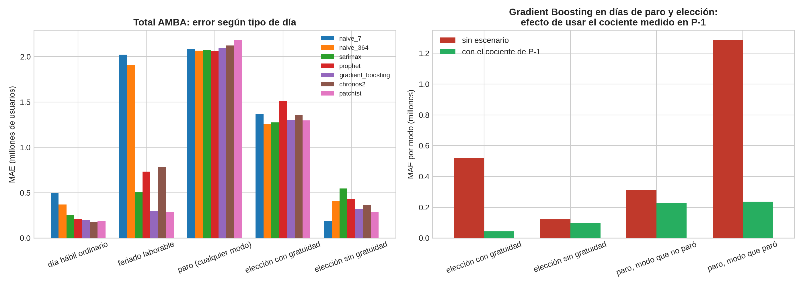

*Figura 32. Error de cada método en los días de hito de P-1.*

- **Días hábiles ordinarios:** **Chronos-2** (0,177 M), **PatchTST** (0,191 M) y **Gradient Boosting** (0,198 M) logran los menores errores.
- **Feriados laborables: se anticipan, y el ajuste supervisado del calendario marca la diferencia.** **PatchTST** (0,284 M) y **Gradient Boosting** (0,298 M) reducen el error un **85%–86%** respecto del Naive de 7 días (2,024 M). **Chronos-2** con covariables baja el error a la mitad respecto de su versión sin calendario (0,786 M contra 1,640 M), pero al operar en modo *zero-shot* no iguala el descuento específico de un feriado argentino que aprenden PatchTST y Gradient Boosting.
- **Paros y elecciones con gratuidad: ningún método los anticipa sin información externa.** El MAE en paros es de 2,06 a 2,18 M y en elecciones gratuitas de 1,26 a 1,51 M para los siete métodos: sin saber de antemano que ocurre el evento, la arquitectura del modelo no cambia el resultado.

**B. Pronóstico condicional con el cociente de P-1:**

| grupo | modelo | MAE sin escenario | MAE con escenario | reducción % |
|---|---|---|---|---|
| elección con gratuidad | chronos2 | 0,523 | 0,043 | 91,783 |
| elección con gratuidad | gradient_boosting | 0,520 | 0,043 | 91,667 |
| elección con gratuidad | naive_364 | 0,500 | 0,046 | 90,800 |
| elección con gratuidad | naive_7 | 0,537 | 0,042 | 92,122 |
| elección con gratuidad | patchtst | 0,497 | 0,044 | 91,074 |
| elección con gratuidad | prophet | 0,595 | 0,038 | 93,617 |
| elección con gratuidad | sarimax | 0,507 | 0,045 | 91,196 |
| elección sin gratuidad | chronos2 | 0,147 | 0,104 | 29,091 |
| elección sin gratuidad | gradient_boosting | 0,121 | 0,098 | 18,508 |
| elección sin gratuidad | naive_364 | 0,163 | 0,126 | 22,541 |
| elección sin gratuidad | naive_7 | 0,075 | 0,080 | -6,637 |
| elección sin gratuidad | patchtst | 0,108 | 0,097 | 9,877 |
| elección sin gratuidad | prophet | 0,176 | 0,115 | 34,972 |
| elección sin gratuidad | sarimax | 0,219 | 0,148 | 32,317 |
| paro, modo que no paró | chronos2 | 0,343 | 0,214 | 37,726 |
| paro, modo que no paró | gradient_boosting | 0,312 | 0,229 | 26,412 |
| paro, modo que no paró | naive_364 | 0,389 | 0,320 | 17,679 |
| paro, modo que no paró | naive_7 | 0,346 | 0,267 | 22,865 |
| paro, modo que no paró | patchtst | 0,422 | 0,260 | 38,421 |
| paro, modo que no paró | prophet | 0,330 | 0,190 | 42,263 |
| paro, modo que no paró | sarimax | 0,336 | 0,221 | 34,146 |
| paro, modo que paró | chronos2 | 1,258 | 0,234 | 81,372 |
| paro, modo que paró | gradient_boosting | 1,286 | 0,236 | 81,668 |
| paro, modo que paró | naive_364 | 1,290 | 0,239 | 81,447 |
| paro, modo que paró | naive_7 | 1,239 | 0,235 | 81,027 |
| paro, modo que paró | patchtst | 1,265 | 0,233 | 81,620 |
| paro, modo que paró | prophet | 1,234 | 0,235 | 80,981 |
| paro, modo que paró | sarimax | 1,241 | 0,232 | 81,347 |

Conocer el evento y su efecto típico importa **mucho más que el método**. En el **modo que para**, multiplicar el pronóstico por el cociente típico de P-1 reduce el error de **81% a 82%** con los cinco métodos, y los cinco quedan con un MAE casi idéntico (0,23 a 0,24 millones por modo y día, contra 1,2 a 1,3 sin escenario). En las **elecciones con gratuidad** la reducción es de **91% a 94%** (el MAE por modo pasa de 0,5–0,6 a 0,04). En los modos **que no pararon**, la mejora es de 18% a 42%, según el método (el cociente típico del tren cuando para el colectivo es 0,67, y el del subte cercano a 1). En las **elecciones sin gratuidad** el escenario ayuda poco (de −7% a +35%) y empeora al Naive de 7 días: no hay un efecto uniforme que aplicar. Es decir: para paros y elecciones gratuitas **la elección del método es secundaria**; lo que mejora el pronóstico es **saber que el evento ocurre y cuánto reduce la demanda** (justamente lo que mide P-1). Estos eventos suelen anunciarse con anticipación (los paros, días antes; el calendario electoral, meses), de modo que el escenario es operativo. Límites: el cociente se estima con los demás eventos del mismo grupo, que son pocos (de 3 a 6), con adhesión variable entre paros; y la intensidad de un paro con adhesión parcial no se conoce de antemano.

**C. Saltos tarifarios.** `sobreestimacion_pct` es el sesgo medio del pronóstico en los 28 días hábiles posteriores al último aumento (positivo = el modelo esperaba más demanda de la que hubo); `sobreestimacion_pct_habitual` y `MAPE_habitual` son los del mismo método y modo a horizontes de 22 a 28 días en el resto de la muestra; `*_con_precio` son los del pronóstico que recibe el precio.

*Gradient Boosting, pronóstico hecho el día anterior al salto:*

| modo | salto_desde | tarifa_x | cambio_demanda_pct_P1 | dias_ventana | sobreestimacion_pct | sobreestimacion_pct_habitual | MAPE | MAPE_habitual | sobreestimacion_pct_con_precio | MAPE_con_precio |
|---|---|---|---|---|---|---|---|---|---|---|
| colectivo | 2024-01-15 | 3,93 | -13,30 | 17 | 2,63 | 0,79 | 3,96 | 5,67 | 0,82 | 3,66 |
| colectivo | 2024-08-12 | 1,32 | -1,30 | 20 | -4,00 | 0,79 | 6,39 | 5,67 | -4,35 | 6,62 |
| colectivo | 2026-02-18 | 1,38 | 9,00 | 19 | -2,88 | 0,79 | 4,87 | 5,67 | -3,18 | 4,96 |
| subte | 2024-05-17 | 4,21 | -19,40 | 17 | 14,24 | 4,88 | 14,24 | 11,99 | -20,24 | 20,24 |
| subte | 2024-10-01 | 1,14 | -10,40 | 19 | 10,50 | 4,88 | 10,89 | 11,99 | 7,43 | 8,49 |
| tren | 2024-01-15 | 3,18 | 1,40 | 17 | -6,22 | 2,41 | 7,46 | 7,81 | -11,02 | 11,46 |
| tren | 2024-05-06 | 1,34 | -14,70 | 19 | 5,09 | 2,41 | 6,28 | 7,81 | 3,17 | 5,27 |
| tren | 2024-09-16 | 1,40 | 1,00 | 19 | 2,25 | 2,41 | 3,93 | 7,81 | 0,83 | 4,02 |
| tren | 2026-05-18 | 1,32 | -0,10 | 19 | 1,51 | 2,41 | 5,20 | 7,81 | 0,62 | 5,14 |

*Promedio por tipo de salto y método:*

| tipo de salto | modelo | sobreestimacion_pct | sobreestimacion_pct_habitual | MAPE | MAPE_habitual | MAPE_con_precio |
|---|---|---|---|---|---|---|
| moderado | chronos2 | 2,04 | 1,36 | 4,99 | 5,30 | 4,45 |
| moderado | gradient_boosting | 2,08 | 2,28 | 6,26 | 7,79 | 5,75 |
| moderado | naive_364 | 4,15 | 2,63 | 14,78 | 14,18 | 13,67 |
| moderado | naive_7 | -5,72 | -3,04 | 12,88 | 14,78 | 12,63 |
| moderado | patchtst | 2,65 | 3,58 | 5,94 | 6,09 | 5,26 |
| moderado | prophet | 1,25 | 0,98 | 5,21 | 6,06 | 4,75 |
| moderado | sarimax | 0,17 | 1,78 | 6,16 | 7,16 | 5,83 |
| grande (×3 o más) | chronos2 | 9,27 | 1,37 | 10,74 | 5,56 | 11,26 |
| grande (×3 o más) | gradient_boosting | 3,55 | 2,69 | 8,55 | 8,49 | 11,79 |
| grande (×3 o más) | naive_364 | -2,18 | 4,64 | 14,41 | 15,85 | 17,31 |
| grande (×3 o más) | naive_7 | 6,46 | -2,67 | 10,81 | 15,38 | 9,64 |
| grande (×3 o más) | patchtst | 14,13 | 3,94 | 14,13 | 6,67 | 11,42 |
| grande (×3 o más) | prophet | 6,31 | 1,67 | 7,29 | 6,69 | 12,34 |
| grande (×3 o más) | sarimax | 5,26 | 2,27 | 8,03 | 7,77 | 12,44 |

- **Moderados (+10% a +40%).** El error no se distingue del habitual: el MAPE del Gradient Boosting va de 3,9% a 6,4% en el colectivo y el tren (habituales: 5,7% y 7,8%) y es de 10,9% en el subte (habitual: 12%). Los modelos no son "sorprendidos" por los saltos chicos.
- **Grandes.** El **subte de mayo de 2024 (tarifa ×4)** es el único caso donde el modelo sin precio sobreestima claramente: **+14%** contra un sesgo habitual de +5% (la caída medida en P-1 es de −19%). El **colectivo de enero–febrero de 2024** apenas se desvía (+2,6%, contra +0,8% habitual) y el **tren de enero de 2024** se equivoca en sentido contrario (−6%: la demanda fue *mayor* que la pronosticada), coherente con que P-1 no encuentra una caída del tren en ese salto.
- **Incorporar el precio.** Para los saltos **moderados**, el pronóstico con precio mejora levemente (MAPE del Gradient Boosting de 6,3% a 5,8%; de 5,2% a 4,8% en Prophet). Para los **grandes** empeora (de 8,6% a 11,8% con Gradient Boosting): al subte de mayo de 2024 le aplica una elasticidad de −0,22 a un aumento real de ×4,4 y sobrecorrige (−20%), y al tren de enero de 2024 le resta 11% a una demanda que no cayó. Una elasticidad constante estimada con saltos chicos no extrapola bien a un aumento que multiplica la tarifa por cuatro.
- **Conclusión.** Con la información disponible (pocos saltos, tres de ellos grandes y de 2024) no se puede afirmar que un modelo con precio pronostique mejor el efecto de un aumento. Los saltos moderados no requieren un tratamiento especial; los grandes son tan raros y tan distintos del resto de la historia que un modelo de series temporales no tiene de dónde aprender su efecto. Para responder "qué pasa si se sube la tarifa X%" sirve más un escenario de P-1 (con su intervalo de incertidumbre) que un modelo ajustado con datos históricos.

---

## 8. Discusión y conclusiones

**Qué medimos.** En P-1 la demanda son las **transacciones** (usos de la SUBE) y en P-2 las **tarjetas distintas por día**. Ninguna cuenta personas ni viajes completos: "baja la demanda" significa que se registran menos usos o menos tarjetas (3.2).

### 8.1 Respuestas a P-1 y P-2

**P-1 (cómo se comportó la demanda ante los hitos y por qué).** El precio importa para el **subte** (elasticidad de −0,15 a −0,26 según se controle o no por el salario real; como referencia, la literatura internacional reporta valores de corto plazo del orden de −0,3) y casi nada para el **colectivo nacional** y el **tren** en los saltos tarifarios observados. Los efectos más claros y estables son los de **calendario**: un feriado laborable, un paro propio o una elección con gratuidad reducen la demanda a una fracción de un día normal, mucho más que cualquier salto de tarifa. No hay evidencia de sustitución entre modos ni de que las líneas de mayor ingreso reaccionen menos (aunque esta última prueba tiene poco poder). Los resultados del precio **no son un efecto causal demostrado**: los diseños usados (control del año anterior, control sintético, control por salario real) absorben lo común pero dependen de supuestos, y Granger es solo evidencia predictiva. En los paros, el modo que para cae a casi cero y los otros **no absorben esa demanda**: el subte no sube cuando para el colectivo y el tren cae (complementariedad).

**P-2 (qué método pronostica mejor y por qué).** Con una evaluación de origen móvil (42 cortes de 28 días) y siete métodos, que incluyen un *Transformer* especializado (PatchTST) y un modelo fundacional (Chronos-2), surgen cuatro hallazgos:

1. **En el total AMBA y el colectivo**, **PatchTST** (MASE 0,547, MAPE 7,17%) y **Gradient Boosting** (MASE 0,568, MAPE 7,43%) lideran en empate estadístico (p = 0,392), seguidos por **Chronos-2** (MASE 0,605).
2. **La ventaja numérica de PatchTST no es robusta** (7.7 d): con otras seis semillas y 12 variantes de hiperparámetros, ninguna diferencia con el Gradient Boosting es significativa, y con entrenamiento insuficiente PatchTST es significativamente peor. La conclusión que se sostiene es el empate.
3. **En el tren y el subte**, donde existen cambios marcados de nivel, **PatchTST gana con claridad en tren** (MASE 0,478, p < 0,0001) y **empata en la punta con Chronos-2 en subte** (0,566 y 0,571). Una explicación posible, aún no probada, es la normalización local por ventana (RevIN / escalado por contexto). Esta lectura por modo se hizo con una configuración y una semilla; la sensibilidad de 7.7 se midió solo en el total AMBA.
4. **El modelo fundacional (Chronos-2) supera sin entrenamiento local a SARIMAX y Prophet** (MASE 0,605 contra 0,819 y 0,769) y logra el menor error en días hábiles ordinarios (0,177 M), mientras que los modelos entrenados localmente (PatchTST y Gradient Boosting) sacan su ventaja en los **feriados nacionales** (0,280 M y 0,284 M). Para los paros y las elecciones con gratuidad, ningún método los anticipa por sí solo, pero aplicar el cociente típico medido en P-1 reduce el error entre **81% y 94%** en cualquiera de los siete modelos.

### 8.2 Cómo se complementan P-1 y P-2

**Un mismo dato, dos enfoques.** Para *predecir* conviene el método más flexible, aunque sea una caja negra; para *atribuir* un efecto hace falta un diseño con contrafactual y supuestos explícitos. El Gradient Boosting pronostica bien pero no dice cuánto se debe al precio; las herramientas de P-1 sí intentan aislar ese efecto, con menos precisión. Las dos preguntas se alimentan entre sí.

**Lo que P-1 le aportó a P-2.**

1. *Qué días son especiales y de qué tamaño.* P-1 midió que un feriado laborable deja la demanda en cerca de 0,3 de un día normal, un paro del propio modo en 0 a 0,2 y una elección con gratuidad cerca de 0. Eso explica por qué los feriados concentran el error de los modelos (7.4) y por qué ningún modelo anticipa un paro. Y permite un pronóstico condicional: si se conoce el evento y se aplica el cociente medido en P-1, el error baja entre 81% y 94% con cualquier modelo (7.9).
2. *Cómo tratar los días atípicos al entrenar.* Como P-1 los aisló, P-2 pudo probar entrenar sin ellos o con valores imputados (7.7 c): ayuda al SARIMAX y a Chronos-2 y no cambia al Gradient Boosting ni a Prophet.
3. *Si hace falta incluir el precio.* P-1 encontró que el precio mueve al subte y casi nada al colectivo y al tren, así que para estos dos no se justifica modelar el precio. Para el subte, el pronóstico sin precio sobrestima la demanda tras el salto de mayo de 2024; incorporar la elasticidad de P-1 mejora los saltos moderados y empeora los grandes porque sobrecorrige (7.9).
4. *Si conviene pronosticar cada modo por separado.* P-1 (sin sustitución en paros ni en saltos tarifarios) y la CCF (4.7: los modos se mueven juntos el mismo día, sin adelantos) indican que cada modo se puede pronosticar por su cuenta y que un paro en uno no obliga a subir el pronóstico de los otros.
5. *Qué estructura debe tener el modelo.* La exploración de la sección 4 (FFT, ACF, STL) mostró el ciclo semanal, el anual y el peso de los feriados; los modelos de P-2 los incluyen (día de la semana, términos anuales, feriados).

**Lo que P-2 le aportó a P-1.** Un modelo que pronostica bien es también un contrafactual: lo que habría pasado sin el hito. Los pronósticos hechos el día anterior a cada salto tarifario (7.9) son una lectura de ese tipo, y la sobrestimación en el subte de mayo de 2024 va en la misma dirección que la caída medida en P-1. Es una ilustración con pocos eventos, no un diseño causal.

### 8.3 Qué método conviene según el tipo de día

Total AMBA, error absoluto medio en millones de usuarios (`tabla_p2_metricas_por_tipo_dia.csv` y `tabla_p2_hitos_errores.csv`):

| Tipo de día | Mejor método | Referencias |
|---|---|---|
| Hábil (780 días) | Chronos-2 (0,177) | PatchTST 0,191; Gradient Boosting 0,198; Prophet 0,213; SARIMAX 0,255; Naive 7 días 0,501 |
| Sábado (164) | PatchTST (0,139) | Gradient Boosting 0,151; Chronos-2 0,163; Naive 7 días 0,183 |
| Domingo (156) | Empate: Chronos-2 (0,128), Gradient Boosting (0,131), PatchTST (0,132) | Naive 7 días 0,141 |
| Feriado laborable (51) | PatchTST (0,284) y Gradient Boosting (0,298) | SARIMAX 0,507; Prophet 0,732; Chronos-2 0,786; Naive 7 días 2,024 |
| Paro (9) | Ninguno | 2,06 a 2,18 con los siete métodos |
| Elección con gratuidad (3) | Ninguno | 1,26 a 1,51 con los siete métodos |

Hay tres lecturas. (1) **No hay un método para todo:** en los días ordinarios (la mayoría) los tres métodos más nuevos están cerca (0,177 a 0,198, unos 20.000 usuarios de error medio de diferencia); las diferencias grandes aparecen en los feriados, donde Chronos-2 falla (0,786 contra 0,284). (2) **Lo anticipable y lo no anticipable:** el calendario se anticipa (feriados) y los paros y las elecciones gratuitas no, con ningún método; para esos días la información que sirve es conocer el evento y su cociente típico (P-1). (3) **Una consecuencia práctica, a explorar:** usar cada método según el tipo de día, como el híbrido de 7.6, que mejoró a tren y subte; con los métodos nuevos no se probó. Estas comparaciones por tipo de día son descriptivas (no se probó significancia por tipo de día).

**Un supuesto a tener presente.** Los cocientes de P-1 se miden con transacciones y se aplican a pronósticos de usuarios; se supone que ambas medidas reaccionan igual a un evento, lo cual no se verificó.

### 8.4 Limitaciones

- Los modelos clásicos (SARIMAX, Prophet, Gradient Boosting) usan configuración estándar. Los hiperparámetros de PatchTST son fijos (150 épocas, tasa de aprendizaje 4e-3) y su origen no está documentado; la sensibilidad medida en 7.7 d muestra que la ventaja sobre el Gradient Boosting no es significativa, y la lectura por modo (7.5) no se repitió con otras semillas.
- Los paros y las elecciones no se pronostican y se excluyen de las métricas; en esos días el error es mucho mayor.
- La demanda del subte registrada en SUBE desde 2025 es de 18% a 30% menor que la que informa el CEPA/Metrovías, producto de la incorporación de medios de pago *contactless*/NFC/QR desde diciembre de 2024 que no pasan por SUBE. Aun recortando la muestra hasta noviembre de 2024 (pre-multipago), la elasticidad real del subte sigue siendo negativa y significativa (−0,18), aunque la estimación 2022–2026 sin control salarial (−0,22) está parcialmente amplificada por esa sustitución de medio de pago: al incluir indicadores en las fechas de apertura (2-dic-2024 en el subte y 22-may-2025 con QR), la elasticidad de la muestra completa queda entre −0,14 y −0,18. Las fechas son de prensa y el indicador supone una adopción inmediata, cuando fue gradual.
- Los modelos de P-2 no incluyen ningún indicador del cambio de medio de pago: el nivel de usuarios y de transacciones registrados en SUBE (sobre todo en el subte desde diciembre de 2024) cambió por un motivo ajeno a la demanda real. Con pocos meses de datos posteriores, el modelo no podría estimar cuánto pesa.
- Las tarifas de varias jurisdicciones son parcialmente inferidas (cada fila indica su fuente).
- Octubre de 2026 es preliminar y no se evalúa en P-2 (la exploración de la sección 4 llega hasta el 29 de octubre).
- Chronos-2 se publicó en octubre de 2025 y los cortes de evaluación empiezan en junio de 2023: no se puede descartar que su preentrenamiento haya incluido datos de esas fechas, por lo que el carácter *zero-shot* solo es seguro en los cortes de 2026.
- El híbrido es un hallazgo exploratorio a confirmar en otro período.
- Los resultados sobre hitos de P-2 (paros, elecciones y saltos tarifarios) se basan en pocos eventos por grupo.
- El RIPTE es un salario formal, nacional y mensual; no representa el ingreso de todos los usuarios.
- La elección de los métodos de interpolación (sección 5) se hizo sobre los mismos bloques con que se mide su error, y la comparación de los modelos con los huecos (sección 9) se basa en solo dos meses.

### 8.5 Trabajo futuro

Probar los hitos como variables indicadoras (paro, elección) en lugar de quitarlos o imputarlos, y combinar la imputación con el híbrido; probar el híbrido con datos nuevos; ajustar hiperparámetros del Gradient Boosting y del SARIMAX y repetir la sensibilidad de PatchTST por modo; explorar el ajuste fino (*fine-tuning*) de modelos fundacionales sobre feriados locales y arquitecturas multivariadas como iTransformer; usar el mejor pronosticador como contrafactual de los hitos.

---

## 9. Extensión: los modelos de pronóstico frente a los dos meses sin dato

**Qué se pregunta.** La sección 5 completó los 62 días faltantes de la serie de usuarios (agosto de 2022 y enero de 2024) con la reconstrucción desde las transacciones y evaluó métodos de interpolación. La sección 7 comparó siete modelos de pronóstico. Queda una pregunta que combina las dos: **si esos dos meses se pronosticaran con cada modelo, usando solo lo anterior a cada mes, ¿cuánto se acercarían a la reconstrucción y cómo quedarían frente a la mejor interpolación?** Responde, en la práctica, cuándo conviene usar un modelo de pronóstico en lugar de una interpolación para rellenar un hueco.

**Diseño.** Para cada mes se pronostican 31 días con origen el último día anterior al hueco, con los siete modelos de P-2 y la misma configuración que en 7.1 (la de PatchTST, con la semilla 42). El entrenamiento de agosto de 2022 es de enero a julio de 2022 (212 días); el de enero de 2024 es de enero de 2022 a diciembre de 2023, con agosto de 2022 reconstruido. Como referencia se usa la **reconstrucción desde transacciones**. No es el dato real, que no existe, sino otra estimación con un error de 1,6% a 3,2% en meses de vacaciones (sección 5); por eso las cifras que siguen miden *distancia a la reconstrucción*, no error verdadero. Se agregan tres interpolaciones de la sección 5. Un detalle importante: las **interpolaciones usan los datos de ambos lados del hueco** (también los posteriores), mientras que los modelos solo ven lo anterior; la comparación favorece a la interpolación. El Naive de 364 días no se puede calcular para agosto de 2022 porque la serie empieza en enero de 2022.

**Cómo se lee.** La figura de arriba muestra, para cada mes, la reconstrucción (línea negra gruesa), el pronóstico de cada modelo y la mejor interpolación (línea negra punteada). Abajo, las barras ordenan los métodos por **MAPE** (error porcentual absoluto medio contra la reconstrucción, ver 7.1): menor es mejor.

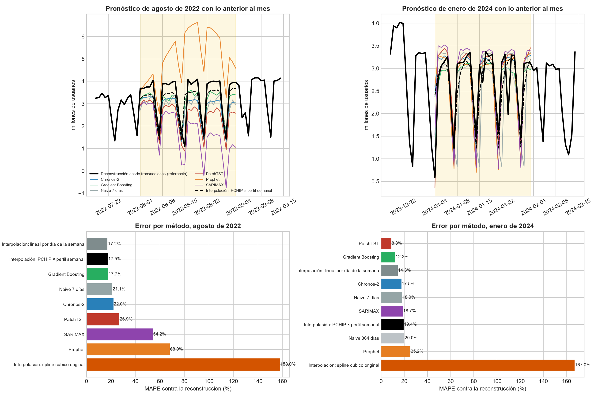

*Figura 33. Pronóstico de agosto de 2022 y enero de 2024 con lo anterior a cada mes, frente a la reconstrucción desde transacciones y a la mejor interpolación. Abajo, MAPE de cada método.*

| Método | MAPE ago-2022 (%) | MAE ago-2022 (M) | sesgo ago-2022 (%) | MAPE ene-2024 (%) | MAE ene-2024 (M) | sesgo ene-2024 (%) |
|---|---|---|---|---|---|---|
| Naive 7 días | 21,100 | 0,661 | -9,800 | 18,000 | 0,466 | -4,300 |
| Naive 364 días | — | — | — | 20,000 | 0,291 | 7,500 |
| SARIMAX | 54,200 | 1,646 | -54,200 | 18,700 | 0,323 | 5,100 |
| Prophet | 68,000 | 1,711 | 67,700 | 25,200 | 0,365 | 4,300 |
| Gradient Boosting | 17,700 | 0,481 | -3,000 | 12,200 | 0,234 | 0,900 |
| Chronos-2 | 22,000 | 0,660 | -12,100 | 17,500 | 0,235 | 10,100 |
| PatchTST | 26,900 | 0,912 | -26,900 | 8,800 | 0,185 | 3,300 |
| Interpolación PCHIP × perfil semanal | 17,500 | 0,440 | -3,000 | 19,400 | 0,300 | 5,400 |
| Interpolación lineal por día de la semana | 17,200 | 0,452 | -1,600 | 14,300 | 0,308 | 0,400 |
| Interpolación spline cúbico original | 158,000 | 4,280 | 105,300 | 167,000 | 4,422 | -166,900 |

**Qué se obtuvo.**

- **Agosto de 2022.** Los mejores métodos son las interpolaciones (17,2% la lineal por día de la semana y 17,5% PCHIP × perfil semanal) y el Gradient Boosting (17,7%). Siguen el Naive de 7 días (21,1%) y Chronos-2 (22,0%). PatchTST (26,9%), SARIMAX (54,2%) y Prophet (68,0%) quedan lejos: **SARIMAX subestima 54% y Prophet sobreestima 68%**. Con solo siete meses de historia, la estacionalidad anual no se puede identificar (Prophet emite una advertencia de que con menos de dos años el modelo puede estar mal identificado), y agosto sigue a un julio de vacaciones de invierno de baja demanda, cuyo nivel arrastran los modelos que extrapolan lo último que vieron. Es una explicación consistente con los datos, no una demostración.
- **Enero de 2024.** Con dos años de historia, los modelos se ordenan distinto: **PatchTST** (8,8%) y **Gradient Boosting** (12,2%) quedan mejor que las interpolaciones (14,3% la lineal por día de la semana y 19,4% PCHIP × perfil semanal); luego Chronos-2 (17,5%), Naive de 7 días (18,0%), SARIMAX (18,7%), Naive de 364 días (20,0%) y Prophet (25,2%). PatchTST tiene en ese mes un sesgo de +3,3% (sobreestima levemente).
- **El spline cúbico original** queda a 158% y 167%: confirma, sobre los dos huecos reales, el resultado de la sección 5.

**Qué se concluye y qué no.**

1. **Un buen modelo de pronóstico puede igualar o superar a la mejor interpolación, pero no siempre.** Con historia suficiente (enero de 2024) PatchTST y Gradient Boosting lo hacen; con poca (agosto de 2022) solo el Gradient Boosting la iguala y varios modelos fallan mucho. Un modelo no es una alternativa segura a interpolar cuando la serie es corta.
2. **Ningún método se acerca al error de la reconstrucción desde transacciones (1,6%–3,2%).** Es lo esperable: lo que falta en un mes de vacaciones es información, y solo una fuente adicional la aporta. Los mejores resultados de esta sección (8,8% a 17,7%) están en el orden del error de la mejor interpolación de la sección 5 (mediana de 17,2% en 89 bloques).
3. **Límites.** Son solo dos meses, un origen cada uno, y no se calculó una prueba de significancia (con un solo bloque de 31 días autocorrelacionados no tendría poder); el liderazgo de PatchTST en enero de 2024 es un caso, no una regla, y la sección 7.7 d muestra que su ventaja general es frágil. La referencia es una estimación. Los modelos no se compararon con la interpolación en igualdad de condiciones (la interpolación ve el futuro del hueco).
4. **Una idea no probada.** Combinar ambos enfoques (por ejemplo, usar el pronóstico del modelo para el perfil semanal y los datos posteriores al hueco para el nivel) podría reducir el error de la interpolación; queda como trabajo futuro.

---

## Referencias

**Material de la cátedra.** Clases del curso *Data Mining de Series Temporales* (Dr. Marcelo Risk, FCEyN UBA), listadas al comienzo.

**Fuentes externas citadas.** Las citas se escribieron de memoria y **deben verificarse** (autores, año y páginas) antes de la entrega final.

- Abadie, A., Diamond, A. y Hainmueller, J. (2010). Synthetic control methods for comparative case studies. *Journal of the American Statistical Association*, 105(490), 493–505.
- Ansari, A. F. et al. (2024). Chronos: learning the language of time series. *Transactions on Machine Learning Research*. (Chronos-2: modelo `amazon/chronos-2`, 2025; verificar la referencia del informe técnico.)
- Balcombe, R. et al. (2004). *The demand for public transport: a practical guide* (TRL Report TRL593). TRL Limited.
- Box, G. E. P., Jenkins, G. M., Reinsel, G. C. y Ljung, G. M. (2015). *Time series analysis: forecasting and control*. Wiley.
- Cleveland, R. B., Cleveland, W. S., McRae, J. E. y Terpenning, I. (1990). STL: a seasonal-trend decomposition procedure based on Loess. *Journal of Official Statistics*, 6(1), 3–73.
- Dickey, D. A. y Fuller, W. A. (1979). Distribution of the estimators for autoregressive time series with a unit root. *Journal of the American Statistical Association*, 74(366), 427–431.
- Diebold, F. X. y Mariano, R. S. (1995). Comparing predictive accuracy. *Journal of Business & Economic Statistics*, 13(3), 253–263.
- Friedman, J. H. (2001). Greedy function approximation: a gradient boosting machine. *The Annals of Statistics*, 29(5), 1189–1232.
- Fritsch, F. N. y Carlson, R. E. (1980). Monotone piecewise cubic interpolation. *SIAM Journal on Numerical Analysis*, 17(2), 238–246. (Origen del método PCHIP, sección 5.)
- Granger, C. W. J. (1969). Investigating causal relations by econometric models and cross-spectral methods. *Econometrica*, 37(3), 424–438.
- Holm, S. (1979). A simple sequentially rejective multiple test procedure. *Scandinavian Journal of Statistics*, 6(2), 65–70.
- Hyndman, R. J. y Koehler, A. B. (2006). Another look at measures of forecast accuracy. *International Journal of Forecasting*, 22(4), 679–688.
- Kim, T. et al. (2022). Reversible instance normalization for accurate time-series forecasting against distribution shift. *ICLR 2022*.
- Kwiatkowski, D., Phillips, P. C. B., Schmidt, P. y Shin, Y. (1992). Testing the null hypothesis of stationarity against the alternative of a unit root. *Journal of Econometrics*, 54, 159–178.
- Lei, J., G'Sell, M., Rinaldo, A., Tibshirani, R. J. y Wasserman, L. (2018). Distribution-free predictive inference for regression. *Journal of the American Statistical Association*, 113(523), 1094–1111.
- Ljung, G. M. y Box, G. E. P. (1978). On a measure of lack of fit in time series models. *Biometrika*, 65(2), 297–303.
- Newey, W. K. y West, K. D. (1987). A simple, positive semi-definite, heteroskedasticity and autocorrelation consistent covariance matrix. *Econometrica*, 55(3), 703–708.
- Nie, Y., Nguyen, N. H., Sinthong, P. y Kalagnanam, J. (2023). A time series is worth 64 words: long-term forecasting with Transformers (PatchTST). *ICLR 2023*.
- Taylor, S. J. y Letham, B. (2018). Forecasting at scale. *The American Statistician*, 72(1), 37–45.
- Vovk, V., Gammerman, A. y Shafer, G. (2005). *Algorithmic learning in a random world*. Springer.

**Datos.** Secretaría de Transporte de la Nación, datos abiertos SUBE: <https://datos.transporte.gob.ar>. Encuesta Anual de Hogares de la Ciudad de Buenos Aires (IDECBA) y BA Data. RIPTE (datos.gob.ar). Tarifas: resoluciones del Boletín Oficial (ver `data/hitos/serie_tarifas.csv`).

**Reproducibilidad.** El orden de ejecución de los scripts está en el `README.md`. Todos los resultados que muestra este informe se generan con los scripts de `scripts/` y quedan en `resultados/tablas` y `resultados/figuras`; los gráficos y tablas nuevos de las secciones 4 y 9 salen de `scripts/figuras_exploracion.py` y `scripts/modelos_sobre_huecos.py`.
